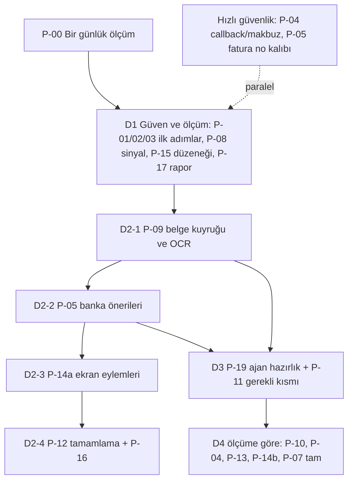
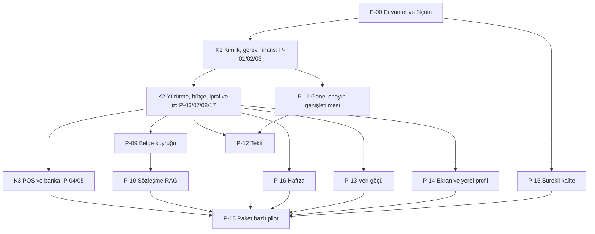

# TekirExtra — Birleşik yapay zekâ, FinTech ve kurumsal ERP imalat programı

Belge tarihi: 14 Kasım 2026  
Sürüm: 3.2 — Yapay zekâ odaklı yeniden sıralama (15 Kasım 2026, kullanıcı kararı; dal `ilt-merkezi-ileti`, `85c8b6ea`). Sürüm 3.1: kod tabanı karşılaştırması (14 Kasım 2026, `b50d5da7`)  
Durum: Program kaydedildi; uygulama işleri planlandı, hiçbir paket başlamadı. Her dalganın isterleri kodlamadan önce `docs/ISTERLER.md`'ye yazılıp onaylanır (S-01). Üretim kabulü paket ve teslimat kapılarıyla verilir.  
Amaç: Yapay zekâ yönünü geliştirmek: önce güvenilir ve ölçülebilir hâle getirmek, sonra kullanıcının zaman kazandığı görünür yetenekleri ve onaylı hazırlık yapan ajan katmanını kurmak.

## 1. Kapsam, dayanak ve kullanım

Bu belge önceki birleşik planın teknik incelemesinden sonra yeniden düzenlenmiştir. Sürüm 3.2 iş sırasını §1.2'deki dalgalara göre değiştirir; paket kartlarındaki "Sürüm 3.2" notları ilgili kartın önceki maddelerinden önce gelir. Aynı dosyadaki önceki şema örnekleri ve koşulsuz otomatik kapama hükümleri bu sürümde geçerli değildir. Bu sürüm, hangi işin hangi sırada üretileceğini ve hangi kanıtla kabul edileceğini tanımlar; uygulama veya yayın yapılmış olduğunu bildirmez.

Dayanaklar:

- [Ayrıntılı AI imalat programı](docs/YAPAY-ZEKA-AYRINTILI-IMALAT-PROGRAMI-2026-11-14.md).
- [Finans kaynakları](docs/AI-FINANS-KAYNAKLARI.md) ve [kalite testleri](docs/AI-KALITE-TESTLERI.md).
- [Ek entegrasyon planı](docs/YAPAY-ZEKA-EK-ENTEGRASYON-IS-PLANI-2026-11-05.md).
- [FinTech ürün kapsamının önceki taslağı](TEKIREXTRA-YAPAY-ZEKA-VE-FINTECH-IMALAT-PLANI-2026-11-14.md).
- [ERP geliştirme planı](TEKIREXTRA-KIVIERP-GELISTIRME-VE-URETIM-PLANI-2026-11-06.md).

Çelişki hâlinde bu programdaki iş sırası ve kontrol kuralları esas alınır. Önceki FinTech taslağındaki `KAPANDI`, onaysız skorla kayıt, yanlış RLS değişkeni ve yeni bağımsız onay motoru önerileri uygulanmaz. Ayrıntılı AI programının alt görevleri aşağıdaki eşleme üzerinden korunur.

İlk teslimatta otomatik banka muhasebeleştirmesi ve çoklu ajan orkestrasyonu yoktur. Banka önerileri kullanıcı kararıyla uygulanır. İleride otomatik uygulama istenirse ayrı ürün politikası, ölçüm, limit ve onay sözleşmesi gerekir. Şirket belgelerinde RAG ilk olarak sözleşme/şartname kapsamındadır; mevzuat içeriği için yürürlük, güncellik ve kaynak yönetimi ayrıca kabul edilmelidir.

### 1.1 Program dışı ilişkili modül: Fiyat ve Endeks Analizi (END)

14 Kasım 2026'da önerilen END modülü (TCMB EVDS üzerinden TÜFE, Yİ-ÜFE ve kur ile ürün fiyatı karşılaştırması) bu programın paketlerine dahil değildir; isterleri `docs/ISTERLER.md` §3.29'da END-01…27 olarak yazılmış ve 14 Kasım 2026'da onaylanmıştır (S-01); modül plan özelliğidir. **15 Kasım 2026 itibarıyla END-01…27'nin tamamı kodlandı ve pilotta** (aşama 1–3; ayrıntı ve kanıt §3.29 durum satırlarında). Aşağıdaki kesişimler bu nedenle tarihseldir: END-21 araçları mevcut finans kaynak kartlarıyla, END-22 brifingi mevcut görev hattıyla yapıldı; P-03 ve P-02 kabulünde bu kullanımlar da regresyona dahil edilir.

Bu programla kesişimi:

- END aşama 1 (endeks deposu, ürün ekranı, toplu rapor) AI içermez; hiçbir pakete bağımlı değildir ve K1 ile paralel yürüyebilir.
- END-21 (asistan/MCP araçları) P-03 olgu sözleşmesine uyar ve P-01 ortak bağlamından geçer; P-03 kabulünden sonra açılır.
- END-22 (brifing ve içgörü) P-02 görev durumlarını kullanır.
- END-16 (fiyat güncelleme önerisi) onay kuralı varsa P-11 ile genişleyen genel onay motoruna düşer; ayrı onay mekanizması kurulmaz.
- §3 kuralları END için de geçerlidir: model parasal hesap yapmaz (kural 5), yeni firma verisinde RLS ve erişim testleri tamamlanır (kural 12). Endeks deposu kiracı verisi içermeyen ortak tablodur.

### 1.2 Sürüm 3.2: yapay zekâ odaklı yeniden sıralama (15 Kasım 2026)

**Karar (kullanıcı, 15 Kasım 2026):** programın odağı yapay zekâ yönünün geliştirilmesidir. Sürüm 3.1'in yatay sırası (önce bütün ortak altyapı K1–K2, sonra modüller) yerine dalgalar uygulanır: önce güven ve ölçüm, sonra dikey dilimler hâlinde görünür yetenekler, sonra onaylı hazırlık yapan ajan katmanı. Her dikey dilim yalnız kendine gereken ortak altyapıyı kurar.

**Gerekçe:**

- Gerçek kadro tek geliştirici + AI destekli geliştirmedir; §4'teki dört kişilik varsayımla 13 hafta, gerçekte 5–8 ay demektir ve ilk görünür AI yeteneği 3.1 sırasında ~7. haftaya düşer.
- Bugünkü hacimde bazı ağır altyapılar (tam maliyet rezervasyonu, p50/p95 panoları, sıfırdan bayrak altyapısı, pgvector'e imaj geçişi) değer üretmeden risk ve süre ekler. Mevcut mekanizmalar (bütçe freni, `AiCagriIz`, paket kapsamı/plan özellikleri ve firma istisnası, PostgreSQL tam metin araması) önce kullanılır.
- Ölçüm olmadan AI iyileştirmesi doğrulanamaz; P-15 bu yüzden Dalga 1'e alınır ve sonraki her değişiklik ondan geçer.

| Dalga | Amaç | Paketler | Kullanıcının gördüğü | Tahmin (kişi-gün) |
|---|---|---|---|---|
| **D1** Güven ve ölçüm | AI kullanıcının panelde göremediğini yapamasın; sayı uydurmasın; kalite ölçülsün | P-01 ve P-02 göç gerektirmeyen ilk adımlar, P-03 olgu metrik kodu/sürümü, P-15 değerlendirme düzeneği, P-08 iptal sinyali | Doğrudan değil; güven | 12–21 |
| **D2** Görünür yetenekler (sırayla, her biri ayrı yayın) | Kullanıcının en çok zaman kaybettiği işler | (1) P-09 belge kuyruğu ve OCR inceleme, (2) P-05 banka önerileri, (3) P-14a ekran eylemleri, (4) P-12 tamamlama + P-16 | Toplu fiş/fatura okuma, kanıtlı banka eşleştirme, bağlamı bilen asistan, tam teklif akışı | 31–49 |
| **D3** Ajan katmanı | Yapay zekâ işi gece hazırlar, kullanıcı tek ekrandan onaylar | P-19 (yeni), P-11 gerekli kadar | "Sabah onay kutusu": hazır eşleştirmeler, taslaklar, kontroller | 10–16 |
| **D4** İhtiyaç kanıtlanırsa | Ölçüm ya da talep sonucuna göre | P-10 (tam metin + uzun bağlamla başlar), P-04 markalı tahsilat, P-13, P-14b, P-07 tam rezervasyon, P-17 panoları | — | ölçüme göre |

**Her dalgada hafif tutulan ortak altyapı:** P-06 yalnız taşınan çağrılar için ortak yürütme ve istem önbelleği/model yönlendirmesi; P-07 yerine çağrı başına tavan ve gece uzlaştırması; P-17 yerine `AiCagriIz` üzerinde tek rapor; P-18 bayrakları plan özelliği + firma istisnası + acil durdurma ile.

**Hızlı güvenlik düzeltmeleri (AI dışı, programdan bağımsız, ayrı SEC/ister maddesi):** POS callback'te firmanın URL'den değil sunucu kaydından çözülmesi ve makbuz anahtarının özetle saklanması (P-04'ün güvenlik maddeleri); banka eşleştirmesinde fatura no kalıbının yıla sabit olmaması (P-05). Bunlar D1 ile paralel yapılabilir.

## 2. Mevcut bileşenler ve genişletme kararı

| Alan | Mevcut kaynak | Bu programdaki karar |
|---|---|---|
| Kullanıcı bağlamı | `core/istek-baglami.ts`, `auth/auth.guard.ts` | Worker ve devam işlemlerinde ortak çözümleyici |
| Araç/AI onayı | `ai/ajan/uc-cagirici.ts`, `ai/onay/` | Mevcut yetki ve kullanıcı teyidi korunur |
| Kurumsal onay | `onay/`, `OnayKurali`, `OnayTalebi` | Departman ve ek kademelerle genişletilir |
| POS | `pos/`, `PosTahsilat`, `PosIade` | Ödeme sayfası, bağlantı ve uzlaştırma bu akışa bağlanır |
| Banka ekstresi | `kasa-banka/ekstre-eslestirme.service.ts`, `BankaEkstreSatir` | Aday/kanıt puanları eklenir; yeni muhasebe motoru kurulmaz |
| Fatura ödemesi | `fatura/odeme-durumu.ts`, `fatura/denklestirme.ts` | Mevcut kapama ve mahsup kullanılır |
| Finans olguları | `ai/ajan/finans-kaynaklari.ts`, `finans-aciklama.ts`, `ai/cari-ozet/` | Yönetici yorumuna ortaklaştırılır |
| Sağlayıcılar | `ai/saglayici/` | Ortak yürütme, maliyet, iptal ve yetenek profili |
| OCR/ekler | `ai/ai.service.ts`, `ai/ocr-kaydi.ts`, `ekler/` | Kuyruk ve alan inceleme katmanı |
| Teklif/hafıza | `ai/teklif-talebi/`, `ai/hafiza/` | Kaynaklı eşleştirme, fiyat ve hafıza geçerliliği |
| Veri göçü | `veri-aktarimi/`, `VeriAktarimi` | Mevcut sihirbaza AI kolon önerisi |
| Ekran asistanı | `components/asistan-penceresi.tsx`, `lib/asistan-baglami.ts` | Ekrana özel eylemler ve işlem kartları |

`apps/api/src/` ve `apps/web/src/` yukarıdaki göreli kaynakların kökleridir. Kaynakların başlangıç envanterinde mevcut olduğu doğrulanmıştır; P-00 uygulama başlangıcında sürüm ve davranışı tekrar kaydeder.

### 2.1 Kod tabanı karşılaştırması (sürüm 3.1)

Karşılaştırma şema ve servis kodunun okunmasına dayanır; test koşulmamış, davranış çalıştırılarak doğrulanmamıştır. Esas alınan çalışma ağacı `ilt-merkezi-ileti` dalıdır (`main`'in 65 commit önünde); P-00 hangi dalın esas alınacağını kaydeder.

| Paket | Kodda bulunan | Kodda bulunmayan / açık |
|---|---|---|
| P-01 | Panel, MCP ve Telegram bağlamı `ozelRol` + `paketModulleri` ile kurulur; paket kapsamı `UcCagirici.cagir` içinde DB'den yeniden denetlenir | Worker yolları yalnız `{tenantId, userId, rol}` verir (`ai-gorev-yurutucu.ts:84-135`, `onay.service.ts:156`, `teklif-talebi.service.ts:590,639`): özel rolün kapattığı kutular zamanlanmış görevde ve onay sonrası yürütmede uygulanmaz. 20'den fazla zamanlayıcı `SISTEM_USER_ID` + `rol: "yonetici"` ile çalışır |
| P-02 | `TenantAiGorevCalisma`: benzersiz pencere, `sahiplikAnahtari`, koşullu sahiplenme, üç deneme | Sonuç yazımı sahipliğe bağlı değil (`ai-gorev-yurutucu.ts:228`, yalnız `where: { id }`). Durum enum'u 4 değerli (`calisiyor/basarili/hata/kosul_saglanmadi`) |
| P-03 | `FinansKaynagi`: araç, adres, alınma zamanı, dönem, decimal-string kalem, döviz, uyarılar | Olgu kimliği, metrik kodu ve hesaplama sürümü yok |
| P-06 | Sayaçlı kiracı sağlayıcısı, ekonomik/güçlü model, aktarım onayı | Yetenek profili kavramı yok; `AiOzelligi` içinde OCR ve embedding ayrı özellik değil |
| P-07 | Çağrı öncesi bütçe denetimi, günlük sayaç için advisory kilit, tahmini maliyet işareti | Rezervasyon, uzlaştırma ve fiyat sürümü yok; maliyet çağrıdan sonra yazılır, son çağrı sınırı aşabilir |
| P-08 | Web `AbortController`; API SSE kapanınca `sinyal`, araç turları arasında bakılır | Sinyal sağlayıcı isteğine taşınmaz (`aracli-ortak.ts:36` yalnız `AbortSignal.timeout`); `IAiProvider` arayüzünde sinyal yok |
| P-04 | İmza, tutar, döviz, üye işyeri doğrulaması; geç ödeme; kısmi iade; sağlayıcı sorgusu; `bekleyenSaglayiciIade`; `durum = odendi` tekrar koruması | Firma markalı ödeme sayfası (`odemeSayfasiUrl` sağlayıcının sayfası), kalıcı sağlayıcı olay tablosu, bağlantı/deneme/tahsilat ayrımı (tek satır + `denemeSayisi`); `makbuzAnahtari` düz metin; callback rotası `tenantId`'yi URL'den alır |
| P-05 | Sıralı kurallar: VKN → fatura no → ad benzerliği → AI karşı taraf çıkarımı; çoklu fatura dağıtımı | Sayısal skor ve aday/kanıt modeli yok; ETTN ve IBAN sinyali yok; fatura no regex'i `[A-Z0-9]{3}20\d{11}` yüzyıla sabit (`ekstre-eslestirme.service.ts:701`) |
| P-11 | 1–2 adım (rol ya da kullanıcı), görev ayrılığı, geri çekme, hedef özeti, hatırlatma | Üçüncü kademe, departman, maliyet merkezi, vekâlet, özel role bağlı onaylayıcı; yürütmede güncel özel rol denetimi |
| P-09 | Eşzamanlı OCR çağrıları, içeriksiz `AiOcrDenetim` izi, `ekler/` deposu | Belge/sayfa/iş kuyruğu yok (BullMQ yalnız e-Belge, tarama, ileti, personel); alan kanıtı ve düzeltme kaydı yok |
| P-10 | — | Embedding/pgvector izi yok; imaj `postgres:16-alpine` pgvector içermez |
| P-12 | Taslak asistan aracıyla açılır, fiyat ERP'den gelir, fiyatsız satır 0 + uyarı, tekrar ileti denetimi | Gönderim onayı alıcıya ve belge durumuna bağlıdır (`araclar/onayli.ts` `hedefDurumu` → `belgeGonderimi`, AI-27 özeti); konu/metin ve PDF ek sürümünün onaya bağlanması ile revizyon/alıntı ayrımı yoktur ya da doğrulanmamıştır |
| P-13 | Sihirbaz, parti kaydı, geri alma; `tablo.ts` Logo/Mikro/Netsis/Paraşüt başlık eşanlamlıları | AI çağrısı yok |
| P-16 | Kapsam `olusturanUserId` + rol ile; kaynak, durum, kullanım sayısı | Geçerlilik, son doğrulama, sürüm alanı yok |
| P-17 | `AiCagriIz` (süre, hata sınıfı, token, maliyet) | p50/p95 ve belirsiz işlem gösteren ekran yok |
| P-15 | `ai/kalite/` altında 3 senaryo | Hedef 50+ |
| P-18 | Paket modülleri ve ayar anahtarları | Firma/özellik/kanal bayrağı altyapısı yok |

## 3. Değişmez uygulama kuralları

1. Firma işlemleri `prisma.tenantIslem(tenantId, ...)` ve `app.tenant_id` bağlamıyla yürütülür. Kullanıcı, özel rol, paket ve kayıt erişimi her kanalda denetlenir.
2. AI bir işlem önerir; mevcut AI onayı kullanıcı teyidini, genel onay motoru kurumsal yetki adımlarını yönetir. İki mekanizmanın durumu birbirinin yerine kullanılmaz.
3. Sağlayıcıda gerçekleşmiş ödemenin doğrulanarak kaydedilmesi, yeni AI ödeme emriyle aynı olay değildir. Callback kaydı yeniden kullanıcı onayı bekletmez; kimlik, imza, tutar, döviz ve tekrar kuralları uygulanır.
4. `FaturaDurum` mevcut `taslak/kesin/iptal` sözleşmesinde kalır. Ödenmedi/kısmi/ödendi sonucu kapama ve mahsuplardan hesaplanır. Fazla tahsilat avans kurallarıyla işlenir.
5. Tutarlar Decimal ve doğrulanmış ondalık string sözleşmeleriyle taşınır. Model parasal hesap veya serbest finansal değer üretmez.
6. Banka puanı yalnız öneri sırasıdır; tek başına yetki, doğruluk olasılığı veya muhasebeleştirme izni değildir.
7. Kalıcı işlem anahtarı, benzersiz kısıt ve koşullu durum geçişleri birlikte kullanılır. Kilit, kalıcı tekrar denetiminin yerine geçmez.
8. İş penceresi kimliği ile worker sahiplik belirteci ayrıdır. Sonuç yazımı güncel sahiplik ve beklenen duruma bağlıdır.
9. İptal öğrenildikten sonra yeni adım başlatılmaz; tamamlanan yan etki geri alınmış gibi gösterilmez. Belirsiz dış işlem körlemesine tekrarlanmaz.
10. Bütçe tüketim ve rezervasyon birlikte denetlenir. Sert tavan yalnız azami fiyat/kullanımı sınırlandırılabilen profiller için taahhüt edilir; bilinmeyen kullanım uzlaştırılır.
11. E-posta, belge ve istemci form verisi güvenilmeyen içeriktir; yetki veya sistem talimatı olamaz.
12. Yeni firma verilerinde RLS, UUID türleri, firma içi referans bütünlüğü, indeksler ve erişim testleri tamamlanır. API genel öneki `/api/v1` korunur.
13. Migration genişlet–taşı–daralt sırasını izler. Açık görev, onay ve rezervasyonlar eski/yeni sürüm geçişinde okunabilir kalır.
14. Log ve varsayılan telemetri belge/sohbet gövdesi, kart bilgisi veya anahtar saklamaz. İş gereği saklanan kaynak ve düzeltmeler ayrı erişim/saklama politikasına tabidir.

## 4. Kadro, efor ve iş paketi tablosu

Kadro varsayımı (3.1): iki API geliştirici, bir web geliştirici, bir QA; yarı zamanlı operasyon ve muhasebe/satış temsilcisi. **Sürüm 3.2:** gerçek kadro tek geliştirici + AI destekli geliştirmedir; efor ve takvim buna göre yeniden kurulmuştur. Depo geçmişi tek geliştirici görünümündedir; gerçek kadro bu varsayımdan küçükse §8 takvimi P-00'da kişi-gün toplamından yeniden kurulur. Kişi atamaları P-00'da yapılır. Eforlar kişi-gündür; paket içi test ve inceleme dahildir. P-15 ortak kalite altyapısı ve tekrarlı model ölçümünün ek eforudur. Sağlayıcı hesap açılışı, dış servis beklemesi ve veri temini ayrıca izlenir.

Mevcut P-00…P-18 kodları korunmuştur; sürüm 3.2'de P-14 ikiye bölünmüş (P-14a ekran eylemleri, P-14b yerel model) ve P-19 ajan hazırlık katmanı eklenmiştir. P-15 bütün program boyunca çalışır; yalnız son haftaya bırakılmaz.

| Kod | Dalga (3.2) | Öncelik | Paket | Bağımlılık | Efor 3.2 (3.1) | Sorumlu |
|---|---|---|---|---|---|---|
| P-00 | D1 | P0 | Envanter ve 1 günlük ölçüm sorgusu (§5 P-00 notu) | Yok | 1–2 (3–4) | Teknik sorumlu |
| P-01 | D1 | P0 | Ortak kimlik, özel rol ve paket bağlamı — göç gerektirmeyen ilk adımlar | P-00 | 3–5 (5–8) | API |
| P-02 | D1 | P0 | Görev durumları ve worker sahipliği — koşullu sonuç yazımı | P-01 | 1–2 (3–5) | API |
| P-03 | D1 | P0 | Finans olguları: metrik kodu, hesaplama sürümü | P-00 | 2–3 (3–5) | API |
| P-15 | D1 | P0 | Değerlendirme düzeneği ve kalite kapısı | P-00 | 3–5 + dalga başına 1–2 (7–11) | API, QA |
| P-08 | D1 | P1 | İptal sinyalinin sağlayıcı isteğine taşınması | P-06 (yalnız sağlayıcı arayüzü) | 1–2 (3–5) | API |
| P-06 | D2 boyunca | P1 | Taşınan çağrılar için ortak yürütme, istem önbelleği, model yönlendirme | P-01, P-03 | 3–5 (4–7) | API |
| P-09 | D2-1 | P1 | Belge kuyruğu ve OCR alan inceleme | P-06, P-15 | 7–10 (7–11) | API, web |
| P-05 | D2-2 | P1 | Banka eşleştirme önerileri (aday/kanıt) | P-01, P-03, P-15 | 6–9 (7–11) | API, web, muhasebe |
| P-14a | D2-3 | P1 | Ekran eylemleri (asistan açık kaydı bilir) | P-03, P-06 | 3–5 (P-14: 4–7) | Web, API |
| P-12 | D2-4 | P1 | E-postadan teklif: gönderim onayının tamamlanması | P-01, P-03, P-06 | 3–5 (7–11) | API, web |
| P-16 | D2-4 | P2 | Hafıza kapsamı ve geçerliliği | P-01, P-06 | 3–4 (4–6) | API, web |
| P-19 | D3 | P1 | **Yeni:** ajan hazırlık katmanı ve sabah onay kutusu | P-01, P-02, P-15, ilgili D2 dilimleri | 7–10 (—) | API, web |
| P-11 | D3 | P2 | Genel onayın genişletilmesi — yalnız P-19'un gerektirdiği kadar | P-01, P-02 | 2–4 (5–8) | API, web |
| P-17 | D1–D3 | P2 | `AiCagriIz` üzerinde tek işlem/hata/maliyet raporu | P-02 | 1–2 (3–5) | Web, API |
| P-18 | Her yayında | P1 | Plan özelliği + firma istisnası + acil durdurma ile pilot | İlgili paket, P-15 | 2–3 (5–8) | Operasyon, API |
| P-07 | D4 | P2 | Tam maliyet rezervasyonu (D1–D3'te çağrı tavanı + gece uzlaştırması) | P-06 | 1–2 hafif / 5–8 tam | API |
| P-10 | D4 | P3 | Belge sorgulama: tam metin + uzun bağlamla başlar; pgvector ölçüme bağlı | P-09 | 4–6 ilk / 8–13 tam | API, QA |
| P-04 | D4 (+güvenlik maddeleri şimdi) | P2 | Markalı tahsilat deneyimi | P-01 | 4–6 (6–10) | API, web |
| P-13 | D4 | P3 | Veri göçüne AI kolon önerisi — P-00 kaçırma oranı yüksekse | P-06 | 3–5 (5–8) | API, web |
| P-14b | D4 | P3 | Yerel model profili (Ollama) | P-06 | 3–4 | API |

D1–D3 toplamı (ilk tahmin): **53–86 kişi-gün** (D1 12–21, D2 31–49 — dilim başına P-15 senaryoları ve P-18 pilot payı dahil, D3 10–16); D4 ölçüme göre ayrıca tahmin edilir. 3.1 toplamı 94–151 idi; fark, hafifletilen ortak altyapı (P-06/07/08/17/18), daraltılan P-11/P-12/P-15 ilk kapsamı ve D4'e alınan paketlerden gelir. Kişi-gün tahminleri geleneksel tempoyla verilmiştir; tek geliştirici + AI destekli üretimde §8'deki hafta hedefleri (D1 ~2 hafta, D2 dilimi 1–2 hafta, D3 ~2 hafta) bu tahminlerin altındadır ve ilk iki dilimin gerçekleşen süresiyle yeniden kurulur.

## 5. İmalat kartları

### P-00 — Envanter, sözleşmeler ve başlangıç ölçümü

**Sürüm 3.2 (D1):** ağır envanter yerine bir günlük ölçüm sorgusu: özellik bazında AI çağrısı başarı/hata/maliyet (`AiCagriIz`), banka ekstre satırlarının kendiliğinden ve elle eşleşme oranı, OCR'da kullanıcı düzeltme oranı, veri aktarımında tanınmayan başlık oranı, worker/zamanlayıcı kimlik envanteri. Kadro, sağlayıcı ve pgvector maddeleri ilgili paket başlarken yapılır. Ölçüm sonucu D2 sırasını ve D4 kararlarını belirler.

- [ ] Kanal → kimlik → araç → iş servisi → sağlayıcı → maliyet yollarını çıkar.
- [ ] Her mevcut işlevi korunacak/genişletilecek/yeni olarak sınıflandır; kaynak sürümünü kaydet.
- [ ] POS sağlayıcı ürününü ve hesap/üye işyeri/firma eşlemesini doğrula; platform abonelik ödemeleriyle firma müşteri tahsilatını ayır.
- [ ] Özellik bayraklarını, veri/istem/model sürümlerini ve dış bağımlılıkları kaydet.
- [ ] Başlangıç başarı, kullanıcı düzeltmesi, süre ve maliyet ölçümlerini çıkar; ölçülmeyen alanı belirt.
- [ ] Test verisini anonim/sentetik hazırla; geliştirme ve ayrı değerlendirme setini ayır.
- [ ] Paket sahiplerini, API sözleşmelerini ve sayısal pilot hedeflerini ata.
- [ ] Esas alınacak dalı ve commit'i kaydet; §2.1 tablosunu o sürümde yeniden doğrula.
- [ ] Gerçek kadroya göre takvimi yeniden kur.
- [ ] P-10 için pgvector'lü PostgreSQL imajına geçişin yedekleme/geri yükleme zincirine (PLT-109…117) etkisini engel listesine yaz.
- [ ] P-13 için mevcut başlık eşanlamlı tablosunun gerçek dosyalarda kaçırdığı başlık oranını ölç.

Kabul: Her üretim girişinin sorumlusu, yetki ve maliyet yolu bulunur. Yeni tablo/servis önerileri mevcut bileşenle karşılaştırılmıştır. Bilinmeyen sağlayıcı/altyapı koşulları engel listesinde görünür.

### P-01 — Ortak kullanıcı bağlamı

**Sürüm 3.2 (D1):** yalnız göç gerektirmeyen adımlar: görev yürütücüsü, genel onay yürütmesi ve teklif otomasyonuna güncel özel rol + paket kapsamının taşınması (panel/MCP/Telegram ile aynı çözümleyici), yetki okuması başarısızsa durdurma, `SISTEM_USER_ID` zamanlayıcılarının sınıflandırılması. Sistem bakım kimliği sözleşmesinin kalanı D3'te P-19 ile.

Kaynaklar: `core/istek-baglami.ts`, `auth/auth.guard.ts`, `ai/ajan/uc-cagirici.ts`, `ai/ayarlar/ai-gorev-yurutucu.ts`, `ai/teklif-talebi/`, `onay/onay.service.ts`.

- [ ] Kullanıcı aktifliği, temel rol, özel rol ve paket kapsamını güncel yükleyen çözümleyici kur.
- [ ] Worker, teklif otomasyonu, genel onay yürütmesi ve devam işlemlerini buna taşı.
- [ ] Sistem bakım kimliği ile kullanıcı adına yürütmeyi ayrı sözleşmeyle tanımla.
- [ ] Yetki okuması başarısızsa işlemi durdur; sessiz temel rol dönüşünü engelle.
- [ ] İlk adım (migration gerektirmez): `ai-gorev-yurutucu.ts`, `onay.service.ts` yürütmesi ve `teklif-talebi.service.ts` bağlamlarına güncel `ozelRol` ve paket kapsamını taşı; panel/MCP/Telegram'daki mevcut kurulumla aynı çözümleyiciyi kullan.
- [ ] `SISTEM_USER_ID` + `rol: "yonetici"` ile çalışan zamanlayıcıların envanterini çıkar; her birini sistem bakım kimliği ya da kullanıcı adına yürütme olarak sınıflandır.

Kabul/test: Panelde kapalı bölüm hiçbir kanalda açılamaz. İki firma, özel rol, paket kapatma, pasif kullanıcı ve beklerken rol değişimi gerçek PostgreSQL/RLS kabulünde doğrulanır.

### P-02 — Görev durumları ve sahiplik

**Sürüm 3.2 (D1):** yalnız koşullu sonuç yazımı (`sahiplikAnahtari` + beklenen durum) ve kapalı sağlayıcının başarı sayılmaması. Yeni durum enum'u ve belirsiz sonuç D3'te P-19 ile.

- [ ] Başarılı, koşul sağlanmadı, sağlayıcı kapalı, sınır, yetkisiz, iptal, hata ve sonuç belirsiz durumlarını tanımla; eski API'ye eşleme ekle.
- [ ] Her durum için yeniden deneme, gün kapatma ve bildirim davranışını belirle.
- [ ] Benzersiz çalışma penceresi ve ayrı rastgele sahiplik belirteci kullan; sahiplik devri koşullu olsun.
- [ ] Sonuç yazma ve yan etki başlatmayı güncel sahipliğe bağla; eski worker yeni sonucu ezemesin. İlk adım (migration gerektirmez): `TenantAiGorevCalisma` sonuç/hata yazımlarını `sahiplikAnahtari` ve beklenen durum koşullu `updateMany` yap. Mevcut pencere ve sahiplenme mantığı korunur.
- [ ] Sağlayıcı çağrısının sonucu bilinmiyorsa tekrar ve maliyet kararını belirsiz durum üzerinden ver.

Kabul/test: Kapalı sağlayıcı başarı sayılmaz. İki worker tek geçerli sahip üretir. Çökme, sahiplik devri, üç deneme sınırı ve bildirim tekrarı denenir. Dış çağrıda mutlak tek ücret garantisi verilmez; belirsizlik izlenir ve uzlaştırılır.

### P-03 — Finansal olgu sözleşmesi

**Sürüm 3.2 (D1):** mevcut `FinansKaynagi`/olgu seçimi korunur (END-21 de kullanıyor); eklenen yalnız olgu metrik kodu ve hesaplama sürümü ile yanlış metrik/dönem ilişkisinin reddi. Yönetici yorumunun taşınması P-14a ile.

- [ ] Mevcut `FinansKaynagi` sözleşmesini genişlet: değer, döviz, dönem, kaynak ve alınma zamanı vardır; olgu kimliği, metrik kodu ve hesaplama sürümü eklenir.
- [ ] Yönetici yorumunu mevcut cari/sohbet olgu seçimi yaklaşımına taşı.
- [ ] Model yalnız izinli olgu/yorum kodlarını seçsin; metni uygulama doğrulanmış şablonla kursun.
- [ ] Eksik veri, eksik kur, karışık döviz, net/brüt ve bakiye/dönem hareketi ayrımlarını koru.
- [ ] Model hatasında kaynaklı temel özeti döndür.

Kabul/test: Yanlış kaynak kimliği, yanlış dönem ve yanlış metrik ilişkisi de reddedilir; yalnız rakam taraması yapılmaz. Negatif/büyük/sıfır değerler ve yetkisiz kaynaklar kapsanır.

### P-06 — Ortak AI yürütme ve yetenek profilleri

**Sürüm 3.2 (D2 boyunca):** bütün modüller tek seferde taşınmaz; her D2 dilimi kendi çağrısını taşır. Önce istem önbelleği (destekleyen sağlayıcıda) ve görev başına model yönlendirmesi (ucuz model ön eleme, güçlü model karar) eklenir; maliyet etkisi P-15/P-17 ile ölçülür.

- [ ] Mevcut sayaçlı sağlayıcıyı kullanarak özellik, kanal, bağlam, süre, iptal, çıktı sınırı, takip kimliği ve şema/istem sürümünü ortaklaştır.
- [ ] Görsel, araç ve yapılandırılmış çıktı yeteneklerini profil/sürüm/geçerlilik bilgisiyle yönet; profil kavramı kodda yoktur, yeni kurulur.
- [ ] `AiOzelligi` listesine OCR ve embedding'i ayrı özellik olarak ekle.
- [ ] Ekonomik/güçlü/yedek yönlendirmede aktarım onayı ve kullanıcı politikasını denetle.
- [ ] Yetki, bütçe veya aktarım engelinde başka modele kaçışı reddet.
- [ ] Asistan, OCR, görev, özet, e-Belge, ekstre, hatırlatma ve yeni embedding çağrıları için geçiş envanteri uygula.
- [ ] Bağlantı testlerinin sayaç/maliyet politikasını açıklaştır.

Kabul/test: Taşınan her modül ortak politikalardan geçer; adaptör sözleşmeleri, bozuk JSON, boş yanıt, yeteneksiz profil ve onaysız yedek testleri geçer. Bütün modüller aynı anda yeniden yazılmaz.

### P-07 — Rezervasyon ve uzlaştırma

**Sürüm 3.2 (D4):** D1–D3'te tam rezervasyon kurulmaz. Yerine: çağrı başına azami çıktı/maliyet tavanı, mevcut bütçe freni ve gece uzlaştırma işi (tahmini ↔ gerçek maliyet farkı raporu). Gerçek bir bütçe aşımı ya da eşzamanlılık sorunu görülürse tam paket açılır.

- [ ] Firma/ay tüketilmiş + ayrılmış maliyeti atomik denetle; fiyat sürümünü sakla. Mevcut `ai-butce.ts` yalnız çağrı öncesi denetim yapar; rezervasyon kaydı yeni kurulur, mevcut advisory kilit ve `AiCagriIz` maliyet yazımı korunur.
- [ ] Sunucu çıktı sınırı ve giriş/görsel/embedding maliyetine uygun rezervasyon hesapla.
- [ ] Gerçek kullanım geldiğinde bir kez uzlaştır; aynı çağrıyı iki kez sayma.
- [ ] İptal/zaman aşımında kullanım bilinmiyorsa rezervasyonu hemen serbest bırakma.
- [ ] Çökme sonrası uzlaştırma işi, operatör incelemesi ve süreli eskalasyon ekle.
- [ ] Platform/BYOK/güçlü sağlayıcı fiyat kaynağını ayır; maliyet yazım hatasını kalıcı tekrar kuyruğuna al.

Kabul/test: En az 20 eşzamanlı rezervasyonda aynı bütçe tekrar ayrılamaz. Çift sonuç, eksik fiyat, ay değişimi, tahmini token ve belirsiz ücret denenir. Sert tavan desteklenmeyen profilde kullanıcıya ölçüm/tahmin sınırı gösterilir.

### P-08 — İptal, zaman aşımı ve kalıcı iz

**Sürüm 3.2 (D1):** yalnız iptal sinyalinin `IAiProvider` yöntemlerine ve sağlayıcı isteğine taşınması, iptal öğrenildikten sonra yeni adım başlatılmaması. Kimlik zinciri ve görünür devam işi P-17 tek raporu ve P-19 ile.

- [ ] UI → API → model isteğine iptal sinyalini taşı; toplam son tarih yeniden denemelerde korunsun. UI → API ve araç turları arası denetim vardır; eksik halka `IAiProvider` yöntemlerine sinyal parametresi ve `saglayiciIstegi` içinde zaman aşımıyla birleştirilmesidir.
- [ ] e-Belge bekleme sınırını alttaki gerçek istek iptaline bağla.
- [ ] İptal öğrenilince yeni araç/model adımı başlatma; iptal edilemeyen devam işini görünür yap.
- [ ] Açılmış onayları ve tamamlanmış kayıtları sonuçta belirt.
- [ ] İstek, çağrı, araç, görev ve onay kimliklerini ilişkilendir; içeriksiz kalıcı iz yaz.

Kabul/test: Model beklerken, araçlar arasında ve onay açıldıktan sonra iptal denenir. Sekme kapanmasının anında ve kesin iletileceği vaat edilmez; sunucu süre sınırı ayrıca çalışır. Belirsiz maliyet P-07 ile uzlaştırılır.

### P-04 — Mevcut POS üzerinde tahsilat deneyimi

**Sürüm 3.2:** güvenlik maddeleri (callback firmasının sunucu kaydından çözülmesi, makbuz anahtarının özetle saklanması) programdan bağımsız hemen yapılabilir. Markalı ödeme sayfası ve olay tablosu D4'te.

Kaynaklar: `pos/pos.service.ts`, `pos/pos.controller.ts`, sağlayıcı adaptörleri, `PosTahsilat`, `PosIade`, fatura kapama servisleri.

- [ ] Mevcut ödeme başlatma, bağlantı, taksit, bildirim, makbuz ve iade davranışını koru. İmza/tutar/döviz/üye işyeri doğrulaması, geç ödeme, kısmi iade, sağlayıcı sorgusu ve kayıtsız iade izi mevcuttur; yeniden yazılmaz, eksikleri tamamlanır.
- [ ] Callback rotasındaki `tenantId` yol parametresini yalnız arama ipucu say; firma, kayıt ve sağlayıcı doğrulamasıyla sunucuda çözülür. Mevcut sağlayıcı panel adresleri kırılmadan geçiş planlanır.
- [ ] `makbuzAnahtari` için özet saklamaya geçişi mevcut bağlantıların geçerliliğini bozmadan planla.
- [ ] Firma markalı ortak ödeme sayfası ve fatura içi paylaşma eylemini ekle; alan adı/rota P-00'da kesinleşsin.
- [ ] Bağlantı, ödeme denemesi ve gerçekleşmiş tahsilatı ayır; gerekli ek alanları mevcut modele göre tasarla.
- [ ] Opaque rastgele tokenı kimlik bilgisi gibi ele al; yeni tokenlarda özet saklama, süre, iptal, yenileme ve log/referrer politikası tanımla.
- [ ] Public uçta firmayı istemci verisinden güvenilir sayma; sunucu kayıtlarıyla çöz, yalnız gerekli bilgiyi göster.
- [ ] Her adaptörde doğru imza/sonuç doğrulaması, üye işyeri, sipariş, tutar ve döviz kontrolü uygula.
- [ ] Kalıcı sağlayıcı olay kaydı, iş anahtarı ve koşullu durum geçişi tasarla; yanıtı sağlayıcı protokolüne göre dön.
- [ ] Ödeme gerçekleşip kayıt yazılamazsa sorgulama/uzlaştırma ile tamamla; yeni tahsilat başlatma.
- [ ] Kısmi ödeme, fazla ödeme avansı, iptal sonrası geç başarı, kısmi iade ve dönem kilidi davranışını tanımla.

Kabul/test: Fatura durumuna `KAPANDI` yazılmaz; mevcut mahsup sonucu kullanılır. En az 10 eşzamanlı aynı olay tek finansal etki üretir. Farklı denemelerin meşru ayrı ödemeleri yanlışlıkla yutulmaz. Tutar/döviz/hesap uyuşmazlığı reddedilir. Sandbox ve gerçek HTTP kabulü olmadan pilot açılmaz.

### P-05 — Açıklanabilir banka önerileri

**Sürüm 3.2 (D2-2):** P-07/P-08'in tam hâline bağımlı değildir; çağrı tavanı ve iptal sinyali yeterlidir. Başarı ölçüsü P-00'daki elle eşleştirme oranının düşmesi ve yanlış pozitif oranıdır (P-15'te en az 500 etiketli hareket hedefi korunur, ilk ölçüm mevcut veriyle). Fatura no kalıbı düzeltmesi hemen yapılabilir.

Kaynak: `BankaEkstreSatir`, `kasa-banka/ekstre-eslestirme.service.ts`, mevcut kurallar ve AI karşı taraf çıkarımı.

- [ ] Mevcut cari, mevcut fiş, masraf, gelir, virman, çek ve kredi kartı akışlarını koru.
- [ ] Fatura no, ETTN, VKN/TCKN, IBAN, unvan ve tutar kanıtını ayrı aday sinyalleri yap.
- [ ] Fatura no ve UUID/ETTN ayrıştırıcılarını ayır; yıla sabit regex kullanma. Mevcut fatura no kalıbı `20` önekine sabittir, ETTN ve IBAN sinyali yoktur.
- [ ] Yön, döviz, cari, açık bakiye, dönem kilidi ve önceki muhasebeleştirmeyi zorunlu uygunluk filtresi yap.
- [ ] Önce mevcut sıralı kuralları (VKN → fatura no → ad benzerliği → AI) aday/kanıt modeline dönüştür; sayısal skor kodda yoktur.
- [ ] Skoru veri setiyle kalibre et; iki yakın/aynı adayda seçim iste.
- [ ] Bir ödeme–çok fatura ve kısmi ödeme dağılımını mevcut servisle uygula.
- [ ] Kullanıcıya kanıt, alternatif, dağıtım ve oluşacak kayıtları göster.
- [ ] Onayda satırı sahiplenip güncel bakiyeyi tekrar kontrol et; geri alma mevcut kurallara uysun.

Kabul/test: Skor ne olursa olsun ilk teslimatta otomatik fiş üretilmez. Yanlış pozitif, kapsama ve incelemeye bırakma ayrı ölçülür. Aynı tutarlı faturalar, masraf kesintisi, avans, ters yön, döviz ve eşzamanlı uygulama kapsanır.

### P-11 — Mevcut genel onay motorunun genişletilmesi

**Sürüm 3.2 (D3):** yalnız P-19'un gerektirdiği kadar: toplu hazırlık sonuçlarının mevcut onay kutusunda gösterilmesi ve son onayda güncel yetki denetimi. Üçüncü kademe, departman, maliyet merkezi ve vekâlet D4'te talebe bağlı.

- [ ] `OnayKurali`/`OnayTalebi` üzerinde ikiden fazla kademe, departman ve maliyet merkezi ihtiyacını modelle. Mevcut sınır `adimlar.max(2)`; görev ayrılığı, geri çekme, hedef özeti ve hatırlatma vardır ve korunur.
- [ ] Serbest CFO/müdür metni yerine mevcut rol, özel rol veya kullanıcı kimliğine bağlı onaylayıcı çöz.
- [ ] Kural aralığı sınırları, çakışan kurallar ve döviz/TL eşik dönüşümünü tanımla.
- [ ] Talep anı kural/adım/kur/karar gerekçesi sürümünü sakla.
- [ ] Görev ayrılığı, vekâlet, pasif onaylayıcı, ret, geri çekme ve süre aşımını tanımla.
- [ ] Hedef değişirse talebi geçersizleştir; son onayda güncel yetkiyi kontrol et.
- [ ] AI kullanıcı teyidi → genel onay → yürütme sonucunu ayrı durumlarla ekranda göster.

Kabul/test: Aynı kullanıcı iki farklı karar zorunluluğunu sessizce karşılayamaz. Son onay iki kez çalışmaz. Genel onaya sevk edilmiş işlem tamamlanmış görünmez. Mevcut iki adımlı talepler migration sonrasında çalışır.

### P-09 — Belge kuyruğu ve OCR incelemesi

**Sürüm 3.2 (D2-1):** D2'nin ilk ve en görünür dilimi. Kendi ihtiyacı olan ortak altyapıyı (iş kuyruğu, çağrı tavanı, iptal) kurar. Hedef: toplu fiş/fatura yükleme → arka planda okuma → alan kanıtlı inceleme → onaylı kayıt. Başarı ölçüsü P-00'daki kullanıcı düzeltme oranı ve belge başı süre.

- [ ] Mevcut dosya depolaması ve BullMQ üzerinde belge/sayfa/iş sürümü ve durumları oluştur. Belge kuyruğu kodda yoktur, sıfırdan kurulur; OCR bugün eşzamanlı çağrıdır ve `AiOcrDenetim` içerik tutmaz.
- [ ] PDF sayfa, dosya boyutu, toplu adet ve ayrıştırma kaynak sınırı uygula; gerçek dosya türünü doğrula.
- [ ] Firma kapsamında dosya/iş özetiyle mükerrer adayları bul; meşru farklı belgeleri otomatik silme.
- [ ] Toplu işte kısmi başarıyı koru, kalanları güvenli yeniden işle.
- [ ] Alanı sayfa ve varsa koordinat/alıntı kanıtıyla göster; desteklenmeyen konumu uydurma.
- [ ] Güven puanı, aritmetik doğrulama ve eşleşme kesinliğini ayrı sun.
- [ ] Çek rakam/yazı, döviz ve zorunlu alan çelişkileri çözülmeden kayıt aktarımını engelle.
- [ ] İlk çıkarım/kullanıcı düzeltmesini ayrı tut; belgeden oluşan kayıtları ilişkilendir.

Kabul/test: Tek puan otomatik kayıt izni vermez. Düşük kaliteli belge, eksik sayfa, çok KDV, tutar çelişkisi, mükerrer iş, mobil/klavye incelemesi ve kullanıcı düzeltmesi kapsanır.

### P-10 — Sürümlü ve yetkili sözleşme RAG

**Sürüm 3.2 (D4):** pgvector ve PostgreSQL imaj değişikliğiyle başlanmaz (yedekleme zinciri riski; dış yedek henüz yok). İlk adım: sözleşme/şartname belgelerinde PostgreSQL tam metin araması + ilgili belgenin uzun bağlamla modele verilmesi, sayfa kaynaklı yanıt. Belge sayısı ya da geri çağırma ölçümü yetersiz kalırsa vektör arama ayrı karar olarak açılır; aşağıdaki maddeler o kararla geçerlidir.

- [ ] PostgreSQL/pgvector sürümü, dağıtım imajı, extension yetkisi ve yedek/geri yükleme uyumunu doğrula. Mevcut imaj `postgres:16-alpine` pgvector içermez; imaj değişimi pilot veritabanı ve yedekleme zinciriyle birlikte denenir.
- [x] Belge üst kaydı ve parça kaydını ayır: sürüm, özet, sayfa/bölüm, erişim kapsamı, geçerlilik ve işleme durumu.
- [x] Tam metin araması: PostgreSQL GIN indeksli tam metin araması (`to_tsvector('turkish', ...)` + `ts_rank_cd`), sayfa ve bölüm bazlı parçalama.
- [x] Firma yanında belge rol/kayıt erişimini bulma ve cevap aşamalarında uygula (PostgreSQL RLS ve `yetkiliRoller`).
- [x] Silme/erişim kaldırma/sürüm değişiminde indeks ve önbelleği geçersizleştir (`oncekiSurumId` ve `arsivlendi`).
- [x] Kaynak sayfası ve sürümü göster; yeterli kanıt yoksa cevap üretme (Olgu reddi / Grounding).
- [x] Belgedeki talimatın araç veya gönderim başlatmasını engelle (Prompt injection kalkanı).

Kabul/test: Başka firma veya erişimi kaldırılmış belge cevapta görünmez. Eski sürüm/çelişkili madde ayrılır. Sayfa iddiası gerçek kaynağa bağlanır. En az 50.000 parçalı ölçümde donanım, firma dağılımı, p95 süre ve kaynak bulma kalitesi raporlanır; ölçümsüz 50 ms garantisi verilmez.

### P-12 — E-postadan fiyatlı teklif ve gönderim

**Sürüm 3.2 (D2-4):** mevcut teklif akışı korunur; ilk teslim gönderim onayına konu, metin ve ek sürümünün bağlanması ile alıntı/revizyon ayrımıdır. Hafıza desteği P-16 ile aynı dilimde.

- [ ] Yeni talep, alıntı, imza, revizyon ve tekrar iletilerini ayır.
- [ ] Ürün/varyant/birim adaylarını kaynak ifadeyle göster; yalnız sunulan adaylardan seçim yaptır.
- [ ] Fiyat, iskonto, vergi, vade ve dövizi ERP iş servislerinden getir.
- [ ] Stok bilgisi ile gerçek stok rezervasyonunu ayır; belirsiz teslim süresi uydurma.
- [ ] Eksik bilgi ve alternatif ürün için düzenlenebilir yanıt önerisi oluştur.
- [ ] Fiyat kaynağı/sürümünü sakla; kaydetme/onayda değişen koşulları yeniden değerlendir.
- [ ] Alıcı, konu, metin, belge ve ek sürümünü gönderim onayına bağla. Alıcı ve belge durumu mevcut onay özetinde vardır; konu, metin ve ek sürümü eklenir.
- [ ] Her yan etki için kalıcı işlem anahtarı ve belirsiz gönderim incelemesi uygula.

Kabul/test: Aynı ileti tekrar teklif/gönderim üretmez. Alıcı/ek değişirse eski onay kullanılamaz. Yanlış birim, eski alıntıdaki miktar, pasif ürün ve eşzamanlı fiyat değişimi kapsanır. Hafızasız temel akış çalışır; P-16 kabulünden sonra hafıza desteği açılır.

### P-13 — Veri göçüne AI kolon önerisi

**Sürüm 3.2 (D4):** P-00 ölçümünde tanınmayan başlık oranı düşükse paket açılmaz.

- [ ] Mevcut önizleme, başlık eşleme, hata dosyası, parti kaydı ve geri almayı koru.
- [ ] AI önerisini yalnız mevcut başlık eşanlamlı tablosunun (`tablo.ts`) tanımadığı kolonlar için çağır; P-00 ölçümü kaçırma oranını düşük bulursa paket kapsamı daraltılır.
- [ ] Kolon başlıklarıyla başla; gerekirse çeşitli satırlardan sınırlı/maskelenmiş örnek al, dış aktarım onayını uygula.
- [ ] İlk beş satırı bütün dosyanın temsili sayma; öneriyi kullanıcıya doğrulat.
- [ ] Tarih/ondalık/döviz/borç-alacak yönünü deterministik doğrula.
- [ ] Cari/stok/ilişkili kayıt sırası, tekrar yükleme ve kısmi başarısızlık politikasını tanımla.
- [ ] Açılış bakiye ve açık faturanın birlikte aktarımında çift borcu engelle; kontrol toplamlarını göster.
- [ ] Logo/Mikro gibi kaynakları sürümlü gerçek örneklerle doğrula; yalnız kolon benzerliğini tam ürün desteği sayma.

Kabul/test: AI doğrudan kayıt yazmaz. Aynı parti tekrar uygulanmaz; kullanıcı hatalı satırları görebilir. Geri alma sonradan bağlı kayıt varsa güvenli biçimde reddedilir. Ölçümsüz yüzde 99/hatasız aktarım vaadi yoktur.

### P-16 — Hafıza kapsamı ve geçerliliği

**Sürüm 3.2 (D2-4):** P-12 ile birlikte.

- [ ] Kullanıcı/firma/cari kapsamını ve mevcut kayıtların varsayılanını açıklaştır.
- [ ] Kaynak, onaylayan, sürüm, son doğrulama ve geçerlilik bilgisi ekle. `AiHafiza`'da kaynak, durum ve `olusturanUserId` vardır; geçerlilik, son doğrulama ve sürüm alanları eklenir.
- [ ] Kullanıcı kararını otomatik öneriye üstün tut; pasife alınan kayıt yeniden öğrenilmesin.
- [ ] Pasif stok/varyant, çelişen eşleşme ve kapanan cari ilişkilerini denetle.
- [ ] Neden önerildi kartı, pasife alma ve saklama/silme politikasını ekle.

Kabul/test: Kullanıcıya özel tercih diğer kullanıcıya uygulanmaz. Fiyat/bakiye kalıcı hafıza sayılmaz. Hafıza bir aracı kendiliğinden çalıştıramaz.

### P-17 — Yönetim ve işlem kaynak ekranları

**Sürüm 3.2:** pano yerine `AiCagriIz` üzerinde tek rapor (özellik/model bazında çağrı, hata sınıfı, maliyet, iptal ve belirsiz işlem sayısı) D1'de; işlem kaynak kartları P-19 ile. p50/p95 panoları D4.

- [ ] İstek/araç/görev/onay/rezervasyon izlerini yetkili kullanıcıya ilişkilendir.
- [ ] Özellik ve model bazında başarı, p50/p95, hata sınıfı, maliyet, yedek model ve belirsiz işlem sayısını göster. Veri `AiCagriIz`'de vardır; p50/p95 hesaplayan uç ve ekran yoktur.
- [ ] Okunan kaynak, hazırlanan işlem, bekleyen karar ve gerçekleşen sonucu ortak kartlarla ayır.
- [ ] Eski/yeni değer ve hedef bağlantısı ekle; onaylandı ile tamamlandı aynı görünmesin.
- [ ] Telemetri temizliği rezervasyon/maliyet uzlaştırma ihtiyacını bozmasın; platform/firma görünümünü ayır.

Kabul/test: İçerik gövdesi açılmadan başarısız adım bulunabilir. İşleniyor ve sonucu belirsiz işler görünürdür; yetkisiz izlere erişilemez.

### P-14 — Ekran eylemleri ve yerel model profili

**Sürüm 3.2:** ikiye bölündü. **P-14a (D2-3):** ekran eylemleri — asistan açık kaydı sunucuda doğrulayarak bilir; "bu cariyi analiz et", "bu faturadaki fiyat sapmasını açıkla", "bu teklifi revize et" gibi eylemler mevcut kaynaklı araçlara bağlanır (ilk üç madde). **P-14b (D4):** yerel model/Ollama profili ve SSRF politikası (son dört madde) talep kanıtlanırsa.

- [ ] Mevcut asistan penceresi, `asistaniAc` ve `useEkranKaydi` üzerine ekran eylemleri ekle.
- [ ] Açık kayıt kimliğini sunucuda doğrula; kaydedilmemiş form verisini ayrı, güvenilmeyen taslak olarak taşı.
- [ ] Risk/fiyat sapması gibi eylemleri mevcut kaynaklı araçlara bağla; parasal değişikliği önizlemede göster.
- [ ] Yerel profillerde gerçek görsel/araç/şema yeteneklerini ve Türkçe kaliteyi ölç.
- [ ] Görsel desteklemeyen metin modeli için OCR motoru veya uygun görsel model kullan.
- [ ] Firma içi Ollama erişiminin sunucudan nasıl kurulacağını ve SSRF/ağ politikasını tanımla; tenantın keyfi iç ağ adresini açma.
- [ ] Harici API ücreti ile donanım/işletim maliyetini ayrı göster; bütün maliyetlerin sıfır olduğunu söyleme.

Kabul/test: Ekran verisi yetkiyi genişletemez. Yerel profil uygunluk ve kalite testini geçmeden açılmaz. Telegram hassas veri kapısı ve mobil/klavye kullanımı korunur.

### P-15 — Sürekli kalite ve yayın kapıları

**Sürüm 3.2 (D1, öne alındı):** değerlendirme düzeneği kurulur: gerçek kullanım izlerinden (`AiCagriIz`, sohbet ve görev kayıtları; kişisel veri ve tutarlar anonimleştirilerek) 50+ senaryo; ölçülenler doğru araç seçimi, kaynakta olmayan sayı üretmeme, yetki dışı işlem denememe, onay gerektiren işlemi onaysız yapmama ve Türkçe yanıt kalitesi. Model/istem/araç değişikliği bu setten geçmeden yayına çıkmaz. Her D2 dilimi kendi senaryolarını ekler.

- [ ] P-00'dan itibaren en az 50 ayrı senaryo hazırla; yetki, finans, OCR, teklif ve hata/iptale en az onar senaryo ayır. Başlangıç: `ai/kalite/kalite-senaryolari.ts` içinde 3 senaryo.
- [ ] Ödeme, banka, RAG, onay ve veri göçü senaryolarını bu havuza ekle; 50 sayısını kapsam tavanı sayma.
- [ ] Her senaryoya girdi, izinli araçlar, beklenen karar ve kayıt sonucu yaz.
- [ ] Kritik gerçek model senaryolarını en az üç tekrarla ölç; model/istem/şema sürümünü kaydet.
- [ ] Geliştirme setinden ayrı değerlendirme seti kullan; maliyet sınırını önceden belirle.
- [ ] Paket bazlı birim, PostgreSQL, HTTP ve tarayıcı kanıtlarını takip kartına bağla.

Kabul: Kritik başarısızlık varken ilgili paket pilot açamaz. Test havuzunda sıfır hata şartı, bütün üretim durumları için mutlak garanti olarak sunulmaz.

### P-18 — Pilot, işletim ve kontrollü yayın

**Sürüm 3.2:** sıfırdan bayrak altyapısı kurulmaz. Firma düzeyinde açma/kapama mevcut plan özelliği (paket kapsamı `ozellikler`) ve firma istisnasıyla yapılır; eksik olan yalnız özellik başına acil durdurma anahtarıdır (platform ayarı). Kanal kapsamı gerekirse aynı kayda eklenir.

- [ ] Firma/özellik/kanal bayrakları ve acil durdurma yolu hazırla. Bayrak altyapısı kodda yoktur (yalnız paket modülleri ve ayar anahtarları); ilk pilot açan paketten önce kurulur ve eforu bu pakete dahildir.
- [ ] Test ortamı → sınırlı firma → ölçüme bağlı yayılım uygula; her paketin pilot kapsamını ayrı belirle.
- [ ] İlk pilotta bütçe, kuyruk hacmi, dosya adedi ve görev sayısını sınırla.
- [ ] Belirsiz ödeme/gönderim, asılı rezervasyon ve kuyruk yeniden işleme yönergelerini hazırla.
- [ ] Açık onay, görev, iş ve rezervasyon sayısını yayın öncesi/sonrası karşılaştır.
- [ ] Teknik sorumlu, QA ve iş alanı temsilcisi paket kabulünü kaydetsin.

Kabul: Bayrak kapatma ve önceki uygulama sürümüne dönüş denenmiştir. Geri dönüş yeni tahsilat/gönderim başlatmaz; belirsiz işlemler uzlaştırılır. Pilot kararında başarı, düzeltme oranı, p95 ve işlem maliyeti raporu bulunur.

### P-19 — Ajan hazırlık katmanı ve sabah onay kutusu (yeni, sürüm 3.2)

Amaç: yapay zekâ işleri kendiliğinden kesinleştirmez; zamanlanmış görevlerle gece hazırlar, kullanıcı sabah tek ekrandan inceleyip onaylar. Mevcut görev hattı (`TenantAiGorev`), içgörü (`ai_icgoruler`), iş kutusu, genel onay kutusu ve günlük brifing üzerine kurulur; çoklu ajan orkestrasyonu kurulmaz (§1 kuralı korunur).

- [x] Hazırlık işi sözleşmesi: girdi kapsamı, kullanıcı adına yürütme kimliği (P-01), sahiplik (P-02), çıktı olarak yalnız taslak/öneri; kesin kayıt, gönderim, ödeme yok.
- [x] İlk hazırlık türleri: (1) gelen faturaların stok kartlarıyla eşleştirme önerisi, (2) banka ekstresi eşleştirme önerileri (P-05 motoru), (3) vadesi geçenler için hatırlatma e-postası taslakları, (4) kritik stok için satın alma talebi taslağı, (5) ay sonu kapanış kontrol listesi.
- [x] Sabah onay kutusu: hazırlanan her öğe kanıtı, alternatifi ve oluşacak kayıtla gösterilir; tekli/toplu onay, ret ve düzenleme; onayda hedef ve yetki yeniden denetlenir (P-11'in gerekli kısmı).
- [x] Hazırlıkların günlük brifinge özet satırı ve bildirimi; aynı öğe tekrar hazırlanmaz (kalıcı iş anahtarı).
- [x] Firma/özellik bazında açma-kapama (P-18) ve bütçe tavanı; hazırlık maliyeti P-17 raporunda görünür.

Kabul/test: Hazırlık hiçbir kesin işlem yapmaz. Onaylanmayan öğe süresi dolunca düşer, kayıt bırakmaz. Yetkisi değişen kullanıcının bekleyen hazırlığı onaylanamaz. İki worker aynı öğeyi iki kez hazırlamaz. P-15'te her hazırlık türü için doğruluk ve kullanıcı kabul oranı ölçülür.

## 6. Veri modeli, API ve migration kapısı

Nihai Prisma şeması P-00 karar kaydı ve ilgili paket tasarımı sonrasında yazılır. Aşağıdaki kavramlar gereksinimdir; otomatik yeni tablo emri değildir.

| Gereksinim | Tasarım kararı |
|---|---|
| Ödeme bağlantısı/denemesi/olayı | `PosTahsilat` ile ilişki ve sağlayıcı kapsamlı benzersiz anahtar |
| Banka önerisi/kanıtı | `BankaEkstreSatir` üzerinde alan veya ilişkili sürümlü öneri |
| Onay adımları | Mevcut kurallar ve talepleri genişletme; açık adım sürümünü koruma |
| Maliyet rezervasyonu | Firma/ay/çağrı kimliği, fiyat sürümü, ayrılan/gerçek maliyet, uzlaştırma durumu |
| Belge/sayfa/alan kanıtı | Kaynak dosya, sürüm, iş kaydı, konum ve düzeltme ilişkisi |
| RAG parçası | Yetkili belge/sürüm/sayfa, embedding profili ve indeks durumu |
| Hafıza | Mevcut kayıtlara kapsam, kaynak ve geçerlilik bilgisi |
| Görev durumu | `AiGorevCalismaDurumu` enum'una yeni değerler; eski dört değer okunabilir kalır |
| Özellik bayrağı | Firma/özellik/kanal kapsamlı, kapalı varsayılanlı kayıt; paket modülü kutularının yerine geçmez. **3.2:** önce mevcut plan özelliği + firma istisnası, ek olarak yalnız özellik başına acil durdurma |
| Hazırlık öğesi (P-19, 3.2) | Firma, hazırlık türü, kaynak kayıt, öneri içeriği, kanıt, kalıcı iş anahtarı, durum (hazır/onaylandı/reddedildi/süresi doldu), hazırlayan görev çalışması |
| Değerlendirme senaryosu (P-15, 3.2) | Senaryo kimliği, kaynak (gerçek iz/sentetik), anonimleştirilmiş girdi, izinli araçlar, beklenen karar; koşu sonucu model/istem/şema sürümüyle |

Her migration için:

- [ ] İlişkili `id/tenantId` türleri mevcut `@db.Uuid` sözleşmesine uyuyor.
- [ ] Ters ilişkiler, benzersiz kısıtlar, indeksler, silme davranışı ve firma referansları doğrulandı.
- [ ] Firma tablolarında RLS, `app.tenant_id`, uygulama DB rolü ve gerekli FORCE davranışı denendi.
- [ ] Public ödeme ve callback için güvenilir firma çözümü belgelendi; geniş RLS atlama yolu eklenmedi.
- [ ] Büyük veri backfill'i parçalı ve ölçümlü; açık iş ve eski istemci uyumu test edildi.
- [ ] Rota ve çıktı sözleşmesi `/api/v1` ile uyumlu; durumların istemci geçişi belgelendi.
- [ ] Şema geri alınmadan önceki uygulama sürümüne dönüş ve yedek/geri yükleme sınandı.

## 7. Bağımlılık ve teslimat kapıları

Sürüm 3.2 dalga kapıları (3.1'in K0–K5 kapıları aşağıda tarihsel olarak durur; uygulama 3.2 kapılarıyla yürür):



| Kapı | Gerekli çıktı | Açılma koşulu |
|---|---|---|
| G0 | P-00 ölçüm sorgusu | Ölçümler kayıtlı; D2 sırası ve D4 kararları için başlangıç değerleri belli |
| G1 (D1) | P-01/02/03 ilk adımları, P-08 sinyal, P-15 düzeneği, P-17 rapor | İki firma + özel rol + pasif kullanıcı kabulü; eski worker sonucu ezemez; olgu reddi testleri; değerlendirme setinin ilk koşusu ve temel çizgisi |
| G2-n (her D2 dilimi) | İlgili paket | Dilimin kendi kabulü + değerlendirme setinde gerileme yok + P-18 ile pilot firmada açık |
| G3 (D3) | P-19 | Hazırlık kesin işlem yapmaz; tekrar ve yetki değişimi testleri; kullanıcı kabul oranı ölçülür |
| G4 | D4 paketleri | Ölçüm ya da talep kanıtı kaydedildi; paket ayrıca isterlenip onaylandı |

Her D2 dilimi ayrı yayındır; tek büyük yayın yoktur.

Sürüm 3.1 kapıları (tarihsel):



| Kapı | Gerekli çıktı | Açılma koşulu |
|---|---|---|
| K0 | P-00 envanter ve sözleşmeler | Sahipler, ölçümler ve dış engeller belli |
| K1 | P-01/02/03 güvenilirlik düzeltmeleri | Yetki, yarış ve finans regresyonları geçti |
| K2 | P-06/07/08/17 ortak altyapı | Rezervasyon, iptal ve kalıcı iz kabulü geçti |
| K3 | P-04/05 tahsilat ve banka önerileri | Sağlayıcı sandbox, tekrar, mahsup ve kullanıcı onayı kabulü geçti |
| K4 | P-09/10/11/12/13/14/16 modül teslimleri | Her modülün kendi kabulü ve kalite ölçümü geçti |
| K5 | P-18 kontrollü yayın | İlgili paket kabulü, geri dönüş ve operasyon onayı tamam |

K1 ayrı küçük sürüm olabilir. K4 tek büyük yayın zorunluluğu değildir; tamamlanan modül P-15 ve P-18'in kendi kapısından geçerek pilot açabilir. Şemadaki ortak pilot düğümü bütün programın son kabulünü gösterir.

## 8. Kaynak ve takvim programı

Sürüm 3.1 notu (tarihsel): 13 hafta, sürüm 3.0'ın 88–142 kişi-günlük tahmini ve dört kişilik kadro varsayımıyla kurulmuş ilk planlama hedefidir; başlangıç tarihine bağlı kesin teslim sözü değildir. Sürüm 3.1'in 94–151 kişi-günlük toplamı ve gerçek kadroyla P-00'da yeniden hesaplanır; aşağıdaki tablo o zamana kadar sıra ve bağımlılık göstergesidir. Hafta tanımı pazartesi–cuma iş günleridir; tatil ve izinler P-00'da kapasiteden düşülür. Sabit tarihli ardışık Gantt yerine ekip kapasitesi ve bağımlılıklarla güncellenen program kullanılır.

**Sürüm 3.2 takvimi** (tek geliştirici + AI destekli geliştirme; hafta = 5 iş günü; her dilimde ~%20 düzeltme payı):

| Hafta | İş | Kapı |
|---|---|---|
| 1 | P-00 ölçüm sorgusu; P-01/02 göç gerektirmeyen adımlar; hızlı güvenlik düzeltmeleri | G0 |
| 2 | P-03 metrik kodu/sürüm, P-08 sinyal, P-15 düzeneği ve ilk koşu, P-17 rapor | G1 |
| 3–4 | P-09 belge kuyruğu ve OCR inceleme (+ P-06 ilgili kısmı) | G2-1, pilot |
| 5–6 | P-05 banka önerileri | G2-2, pilot |
| 7 | P-14a ekran eylemleri | G2-3 |
| 8 | P-12 tamamlama + P-16 | G2-4 |
| 9–10 | P-19 ajan hazırlık + P-11 gerekli kısmı | G3 |
| 11+ | D4 kararları (ölçüme göre) | G4 |

Sürüm 3.1 takvimi (tarihsel, dört kişilik kadro varsayımıyla):

| Hafta | API çalışması | Web çalışması | QA / iş alanı ve kapı |
|---|---|---|---|
| 1 | P-00, P-01 tasarımı | Mevcut ekran envanteri | P-15 başlangıç seti, K0 |
| 2–3 | P-01/02/03 (önce migration gerektirmeyen ilk adımlar) | Görev/finans durum uyumu | Yetki/yarış/finans kabulü, K1 |
| 4–5 | P-06/07; P-11 tasarımı | İşlem/rezervasyon görünümü | Sağlayıcı sözleşmesi ve bütçe testleri |
| 6 | P-08/17, P-11 | İptal ve kaynak kartları | Ortak altyapı kabulü, K2 |
| 7–8 | P-04/05, P-11 tamamlama | Ödeme/öneri/onay ekranları | Sandbox ve HTTP, K3 |
| 9–10 | P-09/12/16 | Belge inceleme ve teklif | OCR/teklif/hafıza kabulü |
| 11–12 | P-10/13/14, kalan düzeltmeler | RAG/göç/ekran eylemleri | Modül bazlı K4, pilot hazırlığı |
| 13 ve gerekirse devamı | Pilot kusurları ve uzlaştırma | Pilot geri bildirimi | P-18, K5 ve yayılım kararı |

API ağırlıklı paketlerin iki kişiyi aşan eşzamanlı yükü kabul edilmez; haftalık atamada işler sıraya alınır. P-00 ve her kapıda kalan efor güncellenir. Üst tahmin veya dış engel oluşursa önce P-10/P-13/P-14 P2 teslimleri sonraki sürüme taşınır; güvenlik ve kalite kapsamı düşürülmez. Entegrasyon ve pilot düzeltmeleri için haftalık kapasitenin yaklaşık yüzde 20'si ayrılır; bu pay yeni kapsam için tüketilmez.

## 9. Kabul ve ölçüm matrisi

| Alan | Yayın ölçütü | Kanıt |
|---|---|---|
| Firma/özel rol/paket izolasyonu | Kritik senaryolarda sıfır ihlal | Gerçek PostgreSQL ve HTTP, en az iki firma |
| Onay ve yan etki | Onaysız model kesin işlemi ve mükerrer kayıt yok | Yarış, rol değişimi ve hedef sürümü testleri |
| Finans | Değer, metrik, dönem, döviz ve kaynak ilişkisi doğru | Olgu sözleşmesi ve negatif örnekler |
| POS | Tek olay tek finansal etki; meşru ayrı ödemeler korunur | 10 eşzamanlı callback, kısmi/fazla/iade ve geç başarı |
| Bütçe | Aynı limit iki kez ayrılmaz; belirsiz kullanım görünür | 20 eşzamanlı rezervasyon ve çökme senaryosu |
| OCR | Kritik tutar/döviz çelişkisi kayıt öncesi çözülür | En az 100 çeşitli örnek, alan bazlı doğruluk ve düzeltme |
| Banka | Yanlış pozitif/kapsama/inceleme oranı ayrı ölçülür | En az 500 etiketli hareket; otomatik kayıt kapalı |
| RAG | Yetkisiz/eski kaynak reddi, doğru sayfa ve yeterli kanıt | İzin iptali, sürüm, silme, yanıtsız soru ve kaynak testi |
| Veri göçü | Kontrol toplamları tutarlı, tekrar ve geri alma güvenli | Açılış/açık fatura, hatalı satır ve bağlı kayıt senaryoları |
| Performans/maliyet | P-00'da belirlenen özellik bazlı hedefler | Donanım/veri/eşzamanlılık ile p95 ve iş başı maliyet |
| AI kalitesi (3.2) | Değerlendirme setinde doğru araç seçimi, kaynakta olmayan sayı sıfır, yetki dışı/onaysız işlem sıfır; gerileme yok | Her model/istem/araç değişikliğinde P-15 koşusu; temel çizgiyle karşılaştırma |
| Ajan hazırlık (3.2) | Hazırlık kesin işlem yapmaz; kullanıcı kabul oranı ve düzeltme oranı hazırlık türü bazında ölçülür | Tekrar, yetki değişimi, süresi dolan öğe ve iki worker senaryoları |

Başlangıç ölçümü olmayan doğruluk yüzdesi taahhüt sayılmaz. Model başarı yüzdesiyle finansal yan etki izni verilmez. Kritik olay tek kez görülse ilgili paket durdurulur ve kusur kapanmadan yayılmaz.

Test çalıştırma kılavuzu; aşağıdaki komutlar bu belge hazırlanırken çalıştırılmış kabul sonucu değildir:

```bash
# apps/api içinde ilgili birim grubu
pnpm exec vitest run src/ai src/pos src/onay src/veri-aktarimi
pnpm exec vitest run src/kasa-banka/ekstre-eslestirme.service.test.ts
pnpm run typecheck
# apps/web içinde
pnpm run typecheck
pnpm test
```

HTTP/PostgreSQL ve Playwright kabulü P-00'da doğrulanan izole ortamda paket kapsamıyla yürütülür. Gerçek model ölçümü açık sağlayıcı/model seçimi ve bütçe sınırıyla yapılır. Canlı müşteri verisine kontrolsüz test yazılmaz. Mevcut önceki AI birim sonucu 39 dosyada 435 testtir; yeni paketlerin kabulü yerine kullanılamaz.

## 10. Pilot, geri dönüş ve operasyon

- Pilot öncesi ilgili bayraklar kapalı varsayılanla hazırlanır; firma ve kanal kapsamı açık kaydedilir.
- Yetki ihlali, yanlış finansal kayıt veya mükerrer ödeme/gönderimde ilgili otomasyon hemen kapatılır; belirsiz işler incelemeye alınır.
- Önceki uygulama sürümüne dönülürken genişletilmiş şema korunur; tamamlanmış ödeme veya gönderim tekrar edilmez.
- Sağlayıcı kesintisi başka sağlayıcıya geçişte aktarım/kota kurallarını aşamaz.
- Maliyet kaydı/rezervasyon/kuşkulu ödeme için operatör sahibi, sorgulama yolu ve eskalasyon süresi belirlenir.
- Veri saklama/temizlik işleri açık onay, çalışma, maliyet uzlaştırması ve denetim kanıtlarını erken silmez.
- Operasyon tesliminde kuyruk, hata, sahiplik, rezervasyon ve sağlayıcı durum panosu ile müdahale yönergeleri bulunur.

## 11. Önceki AI programıyla izlenebilirlik

| Önceki paket | Birleşik paketi |
|---|---|
| AI-IM-00 / 01 / 02 / 03 | P-00 / P-01 / P-02 / P-03 |
| AI-IM-04 / 05 / 06 | P-06 / P-07 / P-08 |
| AI-IM-07 | P-08 ve P-17 |
| AI-IM-08 / 09 | P-09 |
| AI-IM-10 / 11 | P-12 |
| AI-IM-12 | P-16 |
| AI-IM-13 | P-14 ve P-17 |
| AI-IM-14 / 15 | P-15 / P-18 |
| Yeni FinTech/kurumsal kapsam | P-04, P-05, P-10, P-11, P-13 |
| Yeni (sürüm 3.2) ajan hazırlık katmanı | P-19 |

Alt iş ayrıntıları önceki AI programında korunur; yeni paket tamamlanırken eşlenen alt işlerin kapanma kanıtı da aranır. İşlevin kodda bulunması canlı kalite veya üretim kabulü sayılmaz.

## 12. Tamamlanma ve takip

Her paket için:

- [ ] Sorumlu, kapsam, bağımlılık ve efor atandı.
- [ ] API/veri/istem sözleşmesi ve migration etkisi incelendi.
- [ ] Yetki, firma, yarış, tekrar, hata ve iptal senaryoları geçti.
- [ ] İlgili birim/entegrasyon/HTTP/tarayıcı/model ölçüm kanıtları eklendi.
- [ ] Kaynak gösterimi ve kullanıcı durumları doğru.
- [ ] Özellik bayrağı, gözlemleme, saklama ve geri dönüş hazır.
- [ ] Teknik sorumlu, QA ve ilgili iş alanı kabulü kayıtlı.

```text
Paket/alt iş:
Durum: Planlandı | Hazır | Geliştiriliyor | Doğrulanıyor | Pilot | Tamamlandı | Engelli
Sahip ve inceleyen:
Bağımlılık / dış engel:
Teslimat ve kabul ölçütleri:
Kaynak değişiklikleri / migration:
Test ve ölçüm kanıtı:
Özellik bayrağı / geri dönüş:
Tahmin / gerçekleşen efor:
Açık kusur / sonraki adım:
```

Başlangıç iş sırası (sürüm 3.2): **D1 isterlerinin `docs/ISTERLER.md`'ye yazılıp onaylanması → P-00 ölçüm sorgusu → P-01/P-02 göç gerektirmeyen adımlar → P-03, P-08, P-15, P-17 → G1**. Hızlı güvenlik düzeltmeleri (P-04 callback/makbuz, P-05 fatura no kalıbı) ayrı ister maddesi olarak paralel yürür. D1 sonunda D2 sırası P-00 ölçümüyle teyit edilir. Bu belge programı kaydeder; kod geliştirmesi, migration, dış gönderim veya yayın işlemi başlatmaz.
