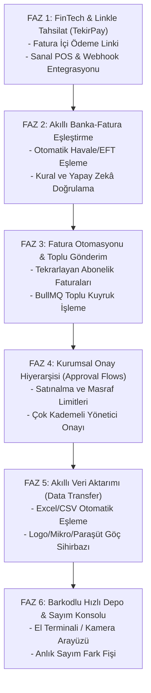

# TekirExtra — KiviERP Rekabetçi Analiz & İleri Üretim Planı

Tarih: 6 Kasım 2026  
Durum: Taslak İmalat Programı  
Hedef: KiviERP ve benzeri yeni nesil FinTech/ERP uygulamalarında öne çıkan rekabetçi kabiliyetlerin TekirExtra mimarisine (Next.js 15 + NestJS 11 + Prisma RLS + BullMQ) entegre edilmesi.  
Kapsam: 6 Ana İmalat Fazı (FinTech Tahsilat, Akıllı Banka Eşleme, Fatura Otomasyonu, Onay Hiyerarşisi, Veri Göçü Sihirbazı, Hızlı Barkodlu Sayım).

---

## 1. Yönetici Özeti ve Amaç

Yapılan detaylı mimari ve tersine mühendislik incelemesinde;
* **TekirExtra'nın Üstün Olduğu Alanlar:** PostgreSQL Row-Level Security (RLS) ile veritabanı düzeyinde kiracı yalıtımı, Next.js 15 App Router uçtan uca tip güvenliği, derin ERP modülleri (Reçeteli Üretim, Demirbaş, Araç Takip, Personel Self-Servis) ve yerleşik bağımsız `/platform` yönetim konsolu.
* **KiviERP'nin Pazar Avantajı Sağladığı Alanlar:** Katılım bankaları ve FinTech entegrasyonları (KiviPAY / Linkle Tahsilat), banka hareketlerini faturalarla otomatik eşleştiren kurallar (`intelligentOperations`), tekrarlayan toplu faturalama, departman onay akışları (`approvalFlows`) ve veri göçünü kolaylaştıran aktarım sihirbazları (`dataTransfer`).

Bu imalat planının amacı; TekirExtra'nın sağlam mühendislik omurgasını bozmadan, KiviERP'nin sahada müşteri kazandıran en kritik 6 kabiliyetini sisteme kazandırmaktır.

---

## 2. İmalat Fazları ve Yol Haritası



---

## 3. Detaylı Faz Planları ve Teknik Tasarım

### FAZ 1: FinTech — Linkle Tahsilat & Fatura Ödeme Köprüsü (TekirPay)

#### 1.1. Amaç ve İşleyiş
Kesilen satış faturalarına veya cari borç bakiyelerine tek tıkla güvenli bir ödeme bağlantısı (`https://odeme.tekirextra.com/f/{token}`) üretilir. Müşteri linke tıkladığında, şirketin logosu ve fatura detaylarıyla hazırlanmış ödeme ekranında kredi kartıyla (tek çekim/taksit) ödemesini tamamlar. Webhook tetiklendiğinde fatura "Ödendi" statüsüne geçer, kasa/banka tahsilat fişi otomatik oluşturulur.

#### 1.2. Veritabanı Şeması (`apps/api/prisma/schema.prisma`)
```prisma
model TahsilatLinki {
  id              String         @id @default(uuid())
  tenantId        String         @map("tenant_id")
  faturaId        String?        @map("fatura_id")
  cariId          String         @map("cari_id")
  token           String         @unique
  tutar           Decimal        @db.Decimal(18, 2)
  paraBirimi      String         @default("TRY") @map("para_birimi")
  aciklama        String?
  sonGecerlilik   DateTime       @map("son_gecerlilik")
  durum           TahsilatDurumu @default(BEKLIYOR)
  odenenTutar     Decimal?       @map("odenen_tutar") @db.Decimal(18, 2)
  odemeTarihi     DateTime?      @map("odeme_tarihi")
  posIslemNo      String?        @map("pos_islem_no")
  kartIlkAlti     String?        @map("kart_ilk_alti")
  kartSonDort     String?        @map("kart_son_dort")
  komisyonTutari  Decimal?       @map("komisyon_tutari") @db.Decimal(18, 2)
  createdAt       DateTime       @default(now()) @map("created_at")
  updatedAt       DateTime       @updatedAt @map("updated_at")

  @@index([tenantId, durum])
  @@map("tahsilat_linkleri")
}

enum TahsilatDurumu {
  BEKLIYOR
  ODENDI
  IPTAL
  ZAMAN_ASIMI
}
```

#### 1.3. API Uç Noktaları (`apps/api/src/pos/`)
* `POST /api/pos/tahsilat-linki`: Faturaya veya serbest tutara bağlı token'lı link üretir.
* `GET /api/odeme/kamu/:token`: Müşterinin açtığı oturumsuz güvenli ödeme önizleme uç noktası.
* `POST /api/odeme/kamu/:token/baslat`: 3D Secure akışını başlatır.
* `POST /api/pos/webhook/:saglayici`: Sanal POS bildirimini karşılar; faturayı kapatır ve RLS bağlamında tahsilat kaydını işler.

#### 1.4. Kullanıcı Arayüzü
* `/panel/faturalar/[id]`: "Tahsilat Linki Üret & Paylaş" butonu (WhatsApp, SMS, E-posta, Pano Kopyala).
* `/panel/pos/tahsilat-linkleri`: Açılan linklerin durumu, tıklanma sayısı ve tahsilat başarı takibi.
* `/odeme/[token]` (Genel / Public): Next.js mobil uyumlu modern ödeme sayfası.

---

### FAZ 2: Akıllı Banka Hareketi - Fatura Eşleştirme Motoru

#### 2.1. Amaç ve İşleyiş
KiviERP'deki `/intelligentOperations` fonksiyonuna karşılık gelir. Banka hesap hareketleri (havale, EFT, FAST) sisteme düştüğünde; açıklamadaki VKN/TCKN, fatura numarası, cari ünvanı ve tutar üzerinden puanlama algoritması çalışır. %95 üzeri kesin eşleşmeler otomatik kapanır; şüpheli olanlar muhasebecinin önüne "Öneri" olarak düşer.

#### 2.2. Veritabanı Şeması
```prisma
model BankaEslestirmeKurali {
  id              String   @id @default(uuid())
  tenantId        String   @map("tenant_id")
  oncelik         Int      @default(0)
  kuralAdi        String   @map("kural_adi")
  alanAdi         String   @map("alan_adi") // ACIKLAMA, TUTAR, IBAN
  operator        String   // ICERIR, ESITTIR, REGEX
  deger           String
  hedefCariId     String?  @map("hedef_cari_id")
  hedefKategoriId String?  @map("hedef_kategori_id")
  otomatikOnayla  Boolean  @default(false) @map("otomatik_onayla")
  aktif           Boolean  @default(true)

  @@index([tenantId, aktif])
  @@map("banka_eslestirme_kurallari")
}
```

#### 2.3. Puanlama & Eşleştirme Motoru (`apps/api/src/kasa-banka/`)
1. **Puan +40:** Açıklamada açık bir faturanın ETTN veya Fatura Numarası geçiyorsa.
2. **Puan +30:** Açıklamadan çekilen VKN/TCKN açık faturadaki cari ile birebir eşleşiyorsa.
3. **Puan +20:** Hareket tutarı, carinin açık fatura tutarıyla kuruşu kuruşuna eşitse.
4. **Puan +10:** Gönderen hesap adı ile cari ticari ünvanı Levenshtein benzerliği > %80 ise.
* **Sonuç ≥ 90:** `OTOMATIK_ESLESTI` (Fatura kapanır, tahsilat fişi kesilir).
* **70 ≤ Sonuç < 90:** `ONERI_BEKLIYOR` (Kullanıcı panelinde tek tıkla onaylama kartı açılır).

---

### FAZ 3: Tekrarlayan Faturalar & Toplu Gönderim Otomasyonu

#### 3.1. Amaç ve İşleyiş
SaaS firmaları, aidat toplayan yönetimler, danışmanlık veya düzenli bakım hizmeti veren KOBİ'ler için her ay aynı faturaları elle kesme zorunluluğunu ortadan kaldırır.

#### 3.2. Teknik Tasarım
* **Periyot Türleri:** Aylık, 3 Aylık, 6 Aylık, Yıllık, Özel Günlük.
* **Tetikleme:** BullMQ Cron Worker (`apps/api/src/fatura/tekrarlayan-fatura.worker.ts`).
* **Şablon Değişkenleri:** Açıklama içine `{{AY}} {{YIL}} Dönemi Hizmet Bedeli` gibi dinamik alan desteği.
* **Toplu GİB Gönderimi:** Kuyruğa alınan 100+ faturanın GİB entegratörüne asenkron paketlenerek gönderilmesi, her faturanın UBL/XML imza durumunun takip edilmesi.

---

### FAZ 4: Kurumsal Onay Hiyerarşisi (Approval Flows)

#### 4.1. Amaç ve İşleyiş
Orta ölçekli işletmelerde harcamaların ve satınalma siparişlerinin kontrolsüz yapılmasını engellemek üzere kademeli onay sistemi kurulur.

#### 4.2. Onay Kuralları Matrisi
* **0 — 10.000 TL:** Doğrudan Onaylı (Departman Sorumlusu).
* **10.001 — 50.000 TL:** 1. Kademe Onayı (Birim Müdürü).
* **50.001 TL ve Üzeri:** 2 Kademeli Onay (Birim Müdürü + Genel Müdür / Mali İşler).

#### 4.3. UI / UX Yolu
* `/panel/onay-bekleyenler`: Yöneticinin telefonundan tek dokunuşla faturayı inceleyip "Onayla / Reddet (Açıklama ile)" yapabileceği mobil odaklı onay paneli.
* Webhook / E-posta / Push Bildirimi: Onay bekleyen talep oluştuğunda ilgili yöneticinin cihazına anlık bildirim iletimi.

---

### FAZ 5: Akıllı Veri Aktarımı & Geçiş Sihirbazı (Data Transfer)

#### 5.1. Amaç ve İşleyiş
Kullanıcıların Logo, Mikro, Zirve, Paraşüt veya standart Excel listelerinden TekirExtra'ya cari, stok ve açılış fişlerini sıfır sürtünmeyle aktarmasını sağlar.

#### 5.2. Adım Adım Sihirbaz
1. **Dosya Yükleme:** `.xlsx`, `.xls`, `.csv` sürükle-bırak.
2. **Akıllı Sütun Eşleştirme (AI & Heuristic):**
   * Dosyadaki `"Müşteri / Bayi Adı"` kolonunu otomatik `cari.unvan` ile eşler.
   * `"Vergi No / TC"` kolonunu otomatik `cari.vknTckn` ile eşler.
3. **Ön Doğrulama Tablosu:**
   * Hatalı satırlar (Örn: 9 haneli VKN, boş ürün kodu) sarı/kırmızı ile işaretlenir.
   * Kullanıcı aktarmadan önce tarayıcı üzerinde hatalı hücreyi çift tıklayarak düzeltebilir.
4. **Toplu İçe Aktarım:** İşlem transaction içinde çalışır; hata anında geri alınır.

---

### FAZ 6: Barkodlu Hızlı Depo & Sayım Konsolu

#### 6.1. Amaç ve İşleyiş
Depo çalışanlarının veya saha personelinin fare/klavye kullanmadan, barkod tabancası veya telefon kamerası ile saniyeler içinde ürün okutup sayım yapabilmesini sağlar.

#### 6.2. Özellikler
* **Tam Ekran Focus Modu:** İmleç sürekli gizli barkod dinleme girdisinde tutulur (Keyboard Wedge uyumlu).
* **Sesli ve Görsel Geri Bildirim:**
  * Başarılı okutma: Kısa bip sesi + Yeşil flaş (+1 miktar artışı).
  * Tanımsız barkod: Çift kalın bip sesi + Titreşim uyarısı.
* **Tek Tuşla Sayım Fark Fişi:** Sayılan stok miktarı ile sistemdeki teorik stok karşılaştırılır; tek tıkla "Sayım Fazlası Giriş Fişi" veya "Sayım Eksiği Çıkış Fişi" üretilir.

---

## 4. İmalat Eforu ve İş Dağılımı

| Faz | Kapsam | API & DB Eforu | Web UI Eforu | Test & Kabul |
| :--- | :--- | :---: | :---: | :---: |
| **Faz 1** | TekirPay — Linkle Tahsilat & Fatura İçi Ödeme | 3 Gün | 2 Gün | 1 Gün |
| **Faz 2** | Akıllı Banka - Fatura Eşleştirme Motoru | 4 Gün | 2 Gün | 2 Gün |
| **Faz 3** | Tekrarlayan Faturalar & Toplu Gönderim | 3 Gün | 2 Gün | 1 Gün |
| **Faz 4** | Kurumsal Onay Hiyerarşisi (Approval Flows) | 4 Gün | 3 Gün | 2 Gün |
| **Faz 5** | Veri Aktarımı & Excel Geçiş Sihirbazı | 2 Gün | 3 Gün | 1 Gün |
| **Faz 6** | Barkodlu Hızlı Depo & Sayım Konsolu | 2 Gün | 2 Gün | 1 Gün |
| **Toplam**| **6 Temel Rekabetçi Modül** | **18 Gün** | **14 Gün** | **8 Gün** |

---

## 5. Kabul Ölçütleri ve Kalite Güvencesi

1. **Kiracı Yalıtımı (RLS):** Tüm yeni tablolarda `tenant_id` zorunlu olacak; `SET LOCAL app.tenant_id` politikası dışında veri sızıntısına izin verilmeyecektir.
2. **Geriye Dönük Uyumluluk:** Mevcut fatura, kasa, banka ve stok yapısındaki tabloların migration'ları veri kaybı yaşatmayacak (Zero-downtime migration).
3. **Uçtan Uca Testler (Vitest & Playwright):**
   * Sanal POS webhook simülasyon testi.
   * Banka hareketi eşleştirme algoritması doğruluk testi (En az %95 başarı).
   * 5.000 satırlık Excel aktarımında bellek sızıntısı olmaması (Stream processing).
