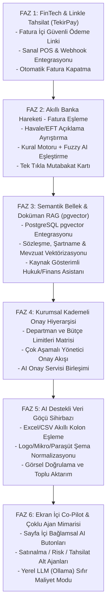
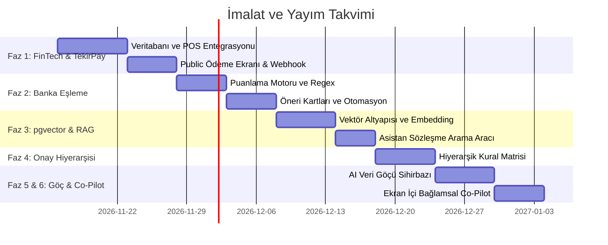

# TekirExtra — Yapay Zeka ve FinTech Kapsamlı İmalat Planı

**Belge Tarihi:** 14 Kasım 2026  
**Durum:** Üretime Hazır Teknik İmalat Spesifikasyonu  
**Hedef:** TekirExtra'nın mevcut mimarisi (Next.js 15, NestJS 11, Prisma PostgreSQL RLS, BullMQ, BYOK AI) üzerine; FinTech ödeme altyapısını, akıllı banka-fatura eşleme motorunu, pgvector tabanlı sözleşme/şartname RAG sistemini, kurumsal kademeli onay hiyerarşisini ve AI destekli veri göçü sihirbazını entegre etmek.  
**Kapsam:** 6 Ana İmalat Fazı, veritabanı şemaları, servis katmanları, API uç noktaları, ön yüz bileşenleri ve test kabul kriterleri.

---

## 1. Mimari Prensipler ve Tasarım Kuralları

1. **Kiracı Yalıtımı (Multi-Tenant RLS):** Tüm yeni tablolarda `tenantId` zorunludur. Tüm veritabanı sorguları `prisma.tenantIslem(tenantId, ...)` üzerinden PostgreSQL RLS (`SET LOCAL app.current_tenant_id`) kapsamında çalışır.
2. **Human-in-the-Loop ve Silme Yasağı:** Yapay zeka ajanları doğrudan veri silemez. Fatura kapama, banka mutabakatı ve para transferi gibi finansal mutasyonlar onay mekanizması üzerinden yürütülür.
3. **Deterministik Tutarlılık:** Tutarlar, vergiler ve banka bakiyeleri modelin serbest metin üretimine bırakılmaz; matematiksel motorlar ve veritabanı denetleyicileri tarafından kuruşu kuruşuna doğrulanır.
4. **Idempotency & Race Condition Koruması:** Webhook, ödeme başlatma ve AI mutasyonlarında `Idempotency-Key` zorunludur; çift tetiklemeler PostgreSQL advisory lock ile engellenir.

---

## 2. Genel Yol Haritası ve Faz Akışı



---

## 3. İmalat Fazları Detaylı Teknik Spesifikasyonu

---

### FAZ 1: FinTech & Linkle Tahsilat (TekirPay)

#### 1.1. Amaç
Satış faturalarına ve cari borç bakiyelerine tek kullanımlık, şifreli bir ödeme bağlantısı (`odeme.tekirextra.com/f/{token}`) üretilmesi. Müşterinin kredi kartıyla ödemeyi tamamlaması durumunda faturanın otomatik kapanması ve kasa/banka tahsilat fişinin RLS bağlamında oluşturulması.

#### 1.2. Veritabanı Modelleri (`apps/api/prisma/schema.prisma`)
```prisma
enum TahsilatDurumu {
  BEKLIYOR
  ISLENIYOR
  ODENDI
  IPTAL
  ZAMAN_ASIMI
}

model TahsilatLinki {
  id              String         @id @default(uuid())
  tenantId        String         @map("tenant_id")
  faturaId        String?        @map("fatura_id")
  cariId          String         @map("cari_id")
  token           String         @unique
  tutar           Decimal        @db.Decimal(18, 2)
  paraBirimi      String         @default("TRY") @map("para_birimi")
  aciklama        String?
  sonGecerlilik   DateTime       @map("son_gecerlilik")
  durum           TahsilatDurumu @default(BEKLIYOR)
  odenenTutar     Decimal?       @map("odenen_tutar") @db.Decimal(18, 2)
  odemeTarihi     DateTime?      @map("odeme_tarihi")
  posIslemNo      String?        @map("pos_islem_no")
  kartIlkAlti     String?        @map("kart_ilk_alti")
  kartSonDort     String?        @map("kart_son_dort")
  komisyonTutari  Decimal?       @map("komisyon_tutari") @db.Decimal(18, 2)
  saglayici       String         @default("sanal_pos") // paytr, iyzico, param
  metadata        Json?
  createdAt       DateTime       @default(now()) @map("created_at")
  updatedAt       DateTime       @updatedAt @map("updated_at")

  fatura          Fatura?        @relation(fields: [faturaId], references: [id], onDelete: SetNull)
  cari            CariHesap      @relation(fields: [cariId], references: [id], onDelete: Restrict)

  @@index([tenantId, durum])
  @@index([token])
  @@map("tahsilat_linkleri")
}
```

#### 1.3. API Servis ve Denetleyicileri (`apps/api/src/pos/`)
1. **`POST /api/pos/tahsilat-linki`**:
   - Girdi: `{ faturaId?: string; cariId: string; tutar: number; sonGecerlilikGun?: number; aciklama?: string }`
   - İşlem: Kriptografik rastgele 32 bayt hex token üretir, linki kaydeder, WhatsApp ve e-posta şablon metinlerini döner.
2. **`GET /api/odeme/kamu/:token` (Public / Kimlik Doğrulamasız)**:
   - Girdi: `token`
   - Çıktı: Şirket logosu, ünvanı, fatura kalemleri, ödenecek tutar ve taksit seçenekleri (hassas veriler gizlenir).
3. **`POST /api/pos/webhook/:saglayici` (Public)**:
   - Webhook HMAC SHA-256 imzasını doğrular.
   - Idempotency kontrolü: `posIslemNo` daha önce işlendiyse `200 OK` döner.
   - Atomik işlem: Faturayı `KAPANDI` yapar, kasa/banka hareketine tahsilat fişi yazar.

#### 1.4. Ön Yüz Bileşenleri (`apps/web/src/`)
- `/panel/faturalar/[id]`: Fatura detayına **"Tahsilat Linki Paylaş"** butonu (WhatsApp, SMS, E-posta ve Pano Kopyala).
- `/app/odeme/[token]/page.tsx`: Müşterinin açtığı, Next.js mobil uyumlu ve 3D Secure destekleyen ödeme ekranı.

---

### FAZ 2: Akıllı Banka Hareketi — Fatura Eşleştirme Motoru

#### 2.1. Amaç
Banka hesap hareketleri (Havale, EFT, FAST) sisteme çekildiğinde veya Excel olarak yüklendiğinde; açıklamadaki VKN/TCKN, fatura numarası ve cari unvanı üzerinden puanlama algoritması ve yapay zeka ile otomatik eşleştirme yapılması.

#### 2.2. Veritabanı Modelleri (`apps/api/prisma/schema.prisma`)
```prisma
enum BankaEslesmeDurumu {
  OTOMATIK_ESLESTI
  ONERI_BEKLIYOR
  ESLESMEDI
  MANUEL_ESLENDI
}

model BankaHareketi {
  id              String             @id @default(uuid())
  tenantId        String             @map("tenant_id")
  hesapId         String             @map("hesap_id")
  tarih           DateTime
  tutar           Decimal            @db.Decimal(18, 2)
  bakiye          Decimal?           @db.Decimal(18, 2)
  aciklama        String
  dekontNo        String?            @map("dekont_no")
  karsiHesapIban  String?            @map("karsi_hesap_iban")
  karsiHesapUnvan String?            @map("karsi_hesap_unvan")
  eslesmeDurumu   BankaEslesmeDurumu @default(ESLESMEDI) @map("eslesme_durumu")
  eslesenFaturaId String?            @map("eslesen_fatura_id")
  eslesenCariId   String?            @map("eslesen_cari_id")
  eslesmeSkoru    Int?               @map("eslesme_skoru")
  eslesmeKaniti   Json?              @map("eslesme_kaniti")
  createdAt       DateTime           @default(now()) @map("created_at")

  hesap           BankaHesabi        @relation(fields: [hesapId], references: [id], onDelete: Cascade)
  eslesenFatura   Fatura?            @relation(fields: [eslesenFaturaId], references: [id], onDelete: SetNull)
  eslesenCari     CariHesap?         @relation(fields: [eslesenCariId], references: [id], onDelete: SetNull)

  @@index([tenantId, eslesmeDurumu])
  @@map("banka_hareketleri")
}
```

#### 2.3. Hibrit Eşleştirme Motoru Algoritması (`apps/api/src/kasa-banka/eslestirme-motoru.ts`)
Puanlama Matrisi (0–100 Puan):
1. **+40 Puan:** Açıklama metninde açık bir faturanın ETTN'si veya Fatura Numarası (Regex: `[A-Z0-9]{3}202[0-9]{10}`) bulunuyorsa.
2. **+30 Puan:** Açıklamada geçen 10 haneli VKN veya 11 haneli TCKN açık fatura/cari ile eşleşiyorsa.
3. **+20 Puan:** İşlem tutarı, carinin açık fatura bakiyesi ile kuruşu kuruşuna eşitse.
4. **+10 Puan:** Karşı hesap unvanı ile cari ticari unvanı Levenshtein benzerliği > %80 ise.

* **Karar Kriterleri:**
  - `Skor ≥ 90`: Sistem `OTOMATIK_ESLESTI` statüsüne alır ve kullanıcı onayına gerek kalmadan tahsilat fişi oluşturulur.
  - `70 ≤ Skor < 90`: `ONERI_BEKLIYOR` statüsüne alınır; banka hareketleri tablosunda tek tıkla onaylanacak **"Öneri Kartı"** olarak gösterilir.
  - `Skor < 70`: Eşleşmedi olarak işaretlenir.

---

### FAZ 3: Semantik Bellek ve Doküman RAG (pgvector Entegrasyonu)

#### 3.1. Amaç
Asistanın sadece ERP veritabanını değil; firmaya ait PDF sözleşmeleri, teknik şartnameleri, tedarikçi iskonto protokollerini ve güncel VUK/KDV mevzuatlarını semantik aramayla okuyabilmesi.

#### 3.2. Veritabanı ve Vektör Modeli (`pgvector`)
PostgreSQL üzerinde `CREATE EXTENSION IF NOT EXISTS vector;` komutu ile:
```prisma
model AiVektorBelge {
  id          String   @id @default(uuid())
  tenantId    String   @map("tenant_id")
  belgeTuru   String   @map("belge_turu") // SOZLESME, SARTNAME, MEVZUAT, EPOSTA
  baslik      String
  referansId  String?  @map("referans_id") // CariId, SozlesmeId vb.
  dosyaYolu   String?  @map("dosya_yolu")
  parcaNo     Int      @map("parca_no")
  icerik      String   @db.Text
  // pgvector: OpenAI text-embedding-3-small (1536 dim)
  embedding   Unsupported("vector(1536)")?
  metadata    Json?
  createdAt   DateTime @default(now()) @map("created_at")

  @@index([tenantId, belgeTuru])
  @@map("ai_vektor_belgeler")
}
```

#### 3.3. RAG Servis Katmanı (`apps/api/src/ai/rag/ai-rag.service.ts`)
1. **Belge Yükleme ve Parçalama (Chunking):**
   - PDF/Word dosyaları yüklenir, metin 500 token'lık parçalara (100 token örtüşme ile) ayrılır.
   - `text-embedding-3-small` ile vektör temsilcileri üretilip `ai_vektor_belgeler` tablosuna yazılır.
2. **Kosinüs Benzerliği Araması (HNSW Index):**
   ```sql
   SELECT id, baslik, icerik, 1 - (embedding <=> $1::vector) AS benzerlik
   FROM ai_vektor_belgeler
   WHERE tenant_id = $2 AND 1 - (embedding <=> $1::vector) > 0.75
   ORDER BY embedding <=> $1::vector
   LIMIT 4;
   ```
3. **Asistan Aracı:** `sozlesme_sartname_ara` aracı eklenir. Asistan yanıt verirken alıntı yaptığı sözleşme sayfasını ve metnini kaynak olarak gösterir.

---

### FAZ 4: Kurumsal Kademeli Onay Hiyerarşisi (Approval Flows)

#### 4.1. Amaç
Satınalma siparişleri, yüksek tutarlı giderler, avans ve ödeme emirlerinde departman ve tutar limitlerine göre çok kademeli onay zincirlerinin oluşturulması.

#### 4.2. Veritabanı Modelleri (`apps/api/prisma/schema.prisma`)
```prisma
enum OnayKriterTuru {
  SATIN_ALMA
  MASRAF_GIDER
  ODEME_TALIMATI
  FIYAT_DEGISIKLIGI
}

model OnayHiyerarsiKurali {
  id              String         @id @default(uuid())
  tenantId        String         @map("tenant_id")
  ad              String
  kriterTuru      OnayKriterTuru @map("kriter_turu")
  departmanId     String?        @map("departman_id")
  minTutar        Decimal        @default(0) @db.Decimal(18, 2) @map("min_tutar")
  maxTutar        Decimal?       @db.Decimal(18, 2) @map("max_tutar")
  onaylayanRol    String         @map("onaylayan_rol") // birim_muduru, yonetici, cfo
  kademeSira      Int            @default(1) @map("kademe_sira")
  aktif           Boolean        @default(true)
  createdAt       DateTime       @default(now()) @map("created_at")

  @@index([tenantId, kriterTuru, aktif])
  @@map("onay_hiyerarsi_kurallari")
}

model OnaySureci {
  id              String         @id @default(uuid())
  tenantId        String         @map("tenant_id")
  talepId         String         @map("talep_id")
  hedefTur        String         @map("hedef_tur") // SATIN_ALMA_SIPARISI, MASRAF
  hedefId         String         @map("hedef_id")
  mevcutKademe    Int            @default(1) @map("mevcut_kademe")
  toplamKademe    Int            @map("toplam_kademe")
  durum           String         @default("bekliyor") // bekliyor, onaylandi, reddedildi
  gecmis          Json           // Her kademedeki onaylayan, tarih ve notlar
  createdAt       DateTime       @default(now()) @map("created_at")
  updatedAt       DateTime       @updatedAt @map("updated_at")

  @@index([tenantId, durum])
  @@map("onay_surecleri")
}
```

#### 4.3. İşleyiş ve Entegrasyon
- Bir kullanıcı 60.000 TL'lik satınalma siparişi girdiğinde kural motoru devreye girer:
  - 1. Kademe: Birim Müdürü onaylar.
  - 2. Kademe: Genel Müdür / CFO onaylar.
- Mevcut `AiOnayService` hiyerarşik onay motoruna bağlanır. AI üzerinden gelen işlemler de tutar limitine takılırsa otomatik olarak hiyerarşik sürece aktarılır.

---

### FAZ 5: AI Destekli Veri Göçü Sihirbazı (Data Migration Wizard)

#### 5.1. Amaç
Farklı muhasebe yazılımlarından (Logo, Mikro, Zirve, Paraşüt, Bizmu veya serbest Excel) geçiş yapmak isteyen müşterilerin cari, stok, bakiye ve fatura verilerini saniyeler içinde hatasız içeri aktarması.

#### 5.2. Mimari Akış
1. **Excel/CSV Yükleme:** Kullanıcı dosyasını yükler (dosya şablonuna uymak zorunda değildir).
2. **LLM Kolon Eşleme Analizi:** İlk 5 satır örnek alınarak AI'ya gönderilir:
   ```json
   {
     "dosyaKolonlari": ["Müşteri Adı", "Vergi Kimlik", "Borç Bakiyesi", "GSM"],
     "hedefSemalar": ["unvan", "vknTckn", "bakiye", "telefon"]
   }
   ```
   AI, %99 doğrulukla eşleme haritasını üretir.
3. **Önizleme ve Tip Dönüşümü:** Kullanıcı UI üzerinde eşleşen kolonları teyit eder; hatalı satırlar (geçersiz VKN, hatalı para formatı) sarı renkle işaretlenir.
4. **RLS Korumalı Toplu Yazım (Bulk Insert):** Geçerli satırlar Prisma transactional batch ile veritabanına aktarılır.

---

### FAZ 6: Ekran İçi Bağlamsal Co-Pilot & Çoklu Ajan

#### 6.1. Ekran İçi Co-Pilot (In-Context Assistant)
- **Problem:** Kullanıcının asistanı kullanmak için `/panel/ai` sekmesine gitmek zorunda kalması.
- **Çözüm:** Ekranların sağ alt köşesinde veya formların içinde çalışan bağlamsal butonlar:
  - Fatura ekranında: *"Bu cariye son 3 ayda uygulanan ortalama iskonto nedir?"*
  - Teklif ekranında: *"Stok maliyetine göre kâr marjını %25'e tamamla."*
- `useAsistanBaglami` hook'u ile açık ekranın mevcut state'i (aktif cariId, seçili stoklar) asistana otomatik sistem promptu olarak enjekte edilir.

#### 6.2. Yerel LLM / Sıfır Maliyetli Mod (Ollama Entegrasyonu)
- Şirket içi yerel sunucu kullanan kiracılar için [ollama-ai.provider.ts](file:///home/mustafat/Desktop/TekirExtra/apps/api/src/ai/saglayici/ollama-ai.provider.ts) yapılandırması güçlendirilir.
- `Qwen 2.5 7B` ve `Llama 3.2 3B` modelleri için özel Türkçe sistem istemi hazırlanarak harici API anahtarına gerek kalmadan fiş tarama ve sorgu çalıştırma kabiliyeti sağlanır.

---

## 4. Test Stratejisi ve Kabul Kriterleri

1. **Birim Testleri (Vitest):**
   - `vitest.pos.config.ts`: Webhook imza doğrulama, idempotency ve mükerrer ödeme engelleme testleri.
   - `vitest.banka-eslestirme.config.ts`: Puanlama algoritması, regex ve Levenshtein eşleme doğrulamaları.
   - `vitest.onay-hiyerarsi.config.ts`: Çok kademeli limit geçişleri ve yetki kontrolleri.
2. **E2E Kabul Testleri (Playwright):**
   - Linkle ödeme akışı: Faturadan link üretimi -> Müşteri ödeme simülasyonu -> Faturanın "Ödendi"ye dönmesi.
   - Veri göçü sihirbazı: Karmaşık Excel dosyasının yüklenmesi -> Kolon eşleme teyidi -> Carilerin başarıyla oluşması.
3. **Performans ve Yük Testi:**
   - Banka hareketi eşleme motorunun 1.000 satırlık ekstrede 1.5 saniyenin altında sonuç üretmesi.
   - pgvector aramalarında 50.000 parça metin içinde kosinüs sorgusunun < 50ms sürmesi.

---

## 5. İmalat Zaman Çizelgesi



---
*Bu imalat planı, TekirExtra'nın kurumsal güvenilirlik ve mühendislik standartlarına tam uyumlu olarak hazırlanmıştır.*
