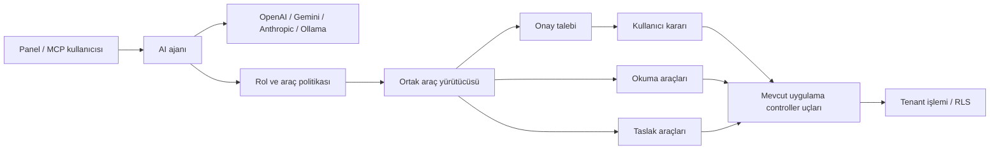
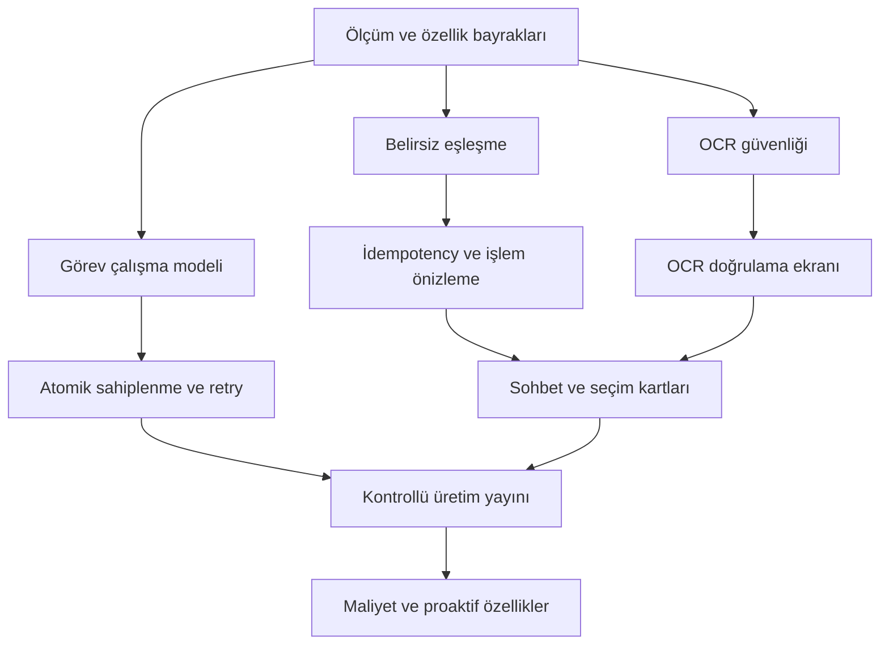

# TekirExtra Yapay Zeka Modülü İnceleme ve Üretim Planı

**Tarih:** 14 Ekim 2026  
**Kapsam:** `apps/api/src/ai/**`, AI Prisma modelleri, `/panel/ai`, yapay zeka ayarları, asistan sohbeti, OCR, MCP, onay ve zamanlanmış görev akışları  
**İnceleme yöntemi:** Statik kod incelemesi ve otomatik test çalıştırması  
**Test sonucu:** 213 test dosyası ve 1.595 test başarılı; başarısız test yok  
**Genel olgunluk değerlendirmesi:** 7/10

> Bu belge 14 Ekim 2026 tarihindeki kod durumunu esas alır. İnceleme sırasında uygulama kodunda değişiklik yapılmamıştır.

## Uygulama durumu

14 Ekim 2026 uygulama çalışmasıyla aşağıdaki üretim kapıları hayata geçirilmiştir:

- **F1-02 / F1-03 (kısmi):** OCR yüklerinde 6 MB sınırı, izinli MIME listesi, dosya imzası ve PDF sayfa sınırı sunucuda doğrulanır. Görsellerde 12.000 piksel kenar ve 40 MP sınırı da sağlayıcı çağrısından önce uygulanır. Sohbet OCR sonucundan otomatik taslak açmaz; kullanıcı satıcı, tarih ve tutarları düzenleyip açıkça onaylar. Doğrulamayı geçen OCR dosyalarının tür, boyut, çözünürlük, sağlayıcı, süre ve sonuç bilgisi içerik saklanmadan tenant kapsamlı denetim tablosuna yazılır ve tenant telemetri saklama süresiyle temizlenir. Dosya doğrulamasında reddedilen denemeler bu OCR tablosuna kaydedilmez.
- **F1-01:** Belge ve faturada yalnız tam numara eşleşmesi işlem aracına çevrilir. Cari/stokta birden fazla aday bulunduğunda yapılandırılmış aday listesi döner ve hiçbir yazma ya da onay aracı çalışmaz.
- **F1-05 (asistan mesajı):** Web istemcisi her mesaj için UUID `requestId` üretir. Sunucu isteği model/araç çağrısından önce atomik ayırır; eşzamanlı tekrar çalışmaz, tamamlanmış tekrar aynı saklanan yanıtı alır.
- **F1-05 (MCP):** MCP taslak ve onay araçlarında `Idempotency-Key` zorunludur. Anahtar tenant+kullanıcı kapsamında atomik ayrılır; aynı araç/girdi tekrarı saklanan JSON-RPC yanıtını alır, eşzamanlı tekrar ve anahtarın farklı girdide kullanımı reddedilir. Okuma araçları anahtar gerektirmez.
- **Ortak HTTP idempotency:** Kimliği doğrulanmış tüm `POST/PUT/PATCH/DELETE` uçları `Idempotency-Key` gönderildiğinde tenant+kullanıcı kapsamında atomik korunur. Web API istemcisi her mutasyona otomatik UUID ekler ve 401 sonrası token yenileyerek yaptığı tekrarda aynı anahtarı korur. Başlık göndermeyen eski istemcilerin davranışı değişmez.
- **İstemci tekrar davranışı:** Web istemcisi aynı sekmede aynı mutasyon URL'si ve gövdesi için ağ hatası ya da 5xx sonrasında aynı anahtarı tekrar kullanır; başarılı yanıt veya kesin 4xx alındığında anahtarı temizler. Böylece kullanıcı aynı işlemi yeniden denerken yeni anahtar üretip mükerrer kayıt oluşturmaz.
- **F1-06:** E-posta/OCR araç çıktıları güvenilmeyen harici veri olarak işaretlenir. Kullanıcı kendi mesajında açıkça istemediyse harici içerikten sonra taslak/yazma/onay aracı kod seviyesinde engellenir.
- **F1-04:** Kiracıya özel sağlayıcı adresi her çağrıda DNS ile çözülür; özel/yerel IPv4 ve IPv6 sonuçları reddedilir. Sağlayıcı HTTP yönlendirmeleri izlenmez ve hata kabul edilir.
- **F3-01:** Kullanıcı yeni sohbet açabilir, son 50 konuşması arasında geçiş yapabilir ve konuşmayı arşivleyebilir. Her konuşmanın bağlamı ayrı `AjanOturumu` içinde tutulur.
- **F3-04:** Belirsiz cari/stok/belge adayları asistan yanıtında kalıcı seçim kartları olarak gösterilir; seçim önceki işleme kesin UUID ile devam eder.
- **F3-03 / F3-05:** Onaya tabi her işlem için talep anında yapılandırılmış ve değiştirilemez bir önizleme saklanır. Onay kartı işlem/hedef bilgisini ve alan güncellemelerinde eski → yeni değer farkını gösterir; model metni tek karar dayanağı değildir.
- **F3-02:** Başarılı araç sonuçlarından yalnız doğrulanmış kayıt UUID'si, görünür numara/kod/ad, durum, tarih, para birimi, temel tutar ve güvenli panel yolu çıkarılır. Ham araç çıktısı sonraki tura taşınmaz; kısa takip ifadelerinde bu sınırlı durum özeti sistem bağlamına eklenir.
- **F4-01:** Günlük tenant kotasının kontrolü ve artırımı tenant-gün advisory lock altında seri hâle getirilmiştir; eşzamanlı çağrılar sınırı birlikte aşamaz.
- **F4-02 (kısmi):** Yönetici seçili sağlayıcı/model için giriş/çıkış token fiyatını ve aylık USD bütçe izleme eşiğini girebilir. Token kullanımı biliniyorsa maliyet çağrı anındaki tarife ile saklanır; kullanım tenant, kullanıcı ve özellik kırılımında gösterilir. Bu bir maliyet tahmini/uyarıdır, sert harcama kesintisi değildir; tarifeler elle güncel tutulmalıdır.
- **F4-05:** Sohbet temizliği ayrı bir tenant ayarıdır; varsayılan kapalıdır, yönetici 7-365 gün seçebilir. Etkinleştirildiğinde eski mesajlar ve kullanılmayan oturumlar temizlenir; devam eden istek rezervasyonları, yakın tarihli mesaj içeren oturumlar ve açık/işlenen onaylara bağlı oturumlar korunur. Sonuçlanmış işlem onayları karar tarihinden 90 gün sonra temizlenir; eksik karar tarihli eski kayıtlar korunur. Tamamlanmış araç isteği yanıtları tamamlanma tarihinden 7 gün sonra silinir. Günlük kullanım sayaçlarında en az 31 gün ve aylık bütçe açıksa Türkiye takvim ayının tüm maliyet izleri korunur. Aktarım onayı olayları ayrı denetim kayıtları olarak bu temizliğin dışındadır.
- **F4-06:** Yanıtın sahibi doğru/yanlış/eksik değerlendirmesi ve en çok 500 karakterlik not bırakabilir. Güncel değerlendirme mesaj üzerinde tek kayıt olarak tutulur; sohbet temizliğiyle birlikte silinir. Yanıtın gerçek sağlayıcı/modeli saklanır. Yönetici son 30 gündeki en fazla 1.000 değerlendirmeyi model ve araçlara göre içerik/not metni olmadan görür. Tek araç aynı yanıtta birden fazla kullanılmışsa değerlendirme araç kırılımında bir kez sayılır. Canlı model için üç yapay senaryolu, iki denemeli ayrı kalite paketi hazırlanmıştır; sağlayıcı/model açıkça seçilmeden çalışmaz. Kullanım yönergesi `docs/AI-KALITE-TESTLERI.md` içindedir.
- **F0 gözlemlenebilirlik:** Her sağlayıcı çağrısı için tenant, kullanıcı, özellik, sağlayıcı/model, işlem türü, süre, başarı/hata sınıfı ve varsa token sayıları içerik saklanmadan kaydedilir. Yönetici kullanım kartı son 30 günün başarı oranını, ortalama gecikmesini ve token toplamını gösterir.
- **F0 bakım/uyarı:** Telemetri saklama süresi tenant bazında 7-365 gün ayarlanır ve worker eski izleri saatlik temizler. Son bir saatte en az 10 çağrı olduğunda hata oranı veya ortalama gecikme eşiği aşılırsa yöneticilere birleştirilmiş bildirim üretilir; metrik normale dönünce bildirim kapanır.
- **F2-01 / F2-02 / F2-03:** Her görev penceresi için çalışma kaydı oluşturulur; benzersiz gün anahtarı ve sahiplik belirteciyle çoklu worker yarışı engellenir. Geçici hatalar artan aralıkla en çok üç kez denenir; son hata görev sahibine ve yöneticilere bildirilir.
- **F2-04:** Görev güncellemesinde mevcut kayıt ile yama birleştirilip tam invariant doğrulamasından geçirilir; eşiksiz `KASA_KRITIK` görev kaydedilemez.

F4-03 kapsamında yerel Ollama için ekonomik/güçlü model profili yönlendirmesi uygulanmıştır. Harici sağlayıcılarda çok-modelli yönlendirme, onay kapsamının birden fazla modeli açıkça içereceği sürüme kadar kapalıdır. Kalan kalite işleri arasında kontrollü tenant yayılımı ve ürün kabul senaryoları bulunur.

Faz 5 kaynaklı finans yanıtları için web sohbetine başarılı finans araçlarının verilerinden üretilen kaynak kartları eklenmiştir. Kartlarda tutar/para birimi, gerçek dönem, alınma zamanı ve panel bağlantısı bulunur. Negatif ve büyük tutarlar korunur; farklı dövizler tek toplam gibi gösterilmez. Kaynaklar geçmişte saklanır ve mevcut sohbet temizliğiyle silinir. Bu görünüm model metnindeki her rakamı otomatik doğrulamaz; ayrıntılı kapsam `docs/AI-FINANS-KAYNAKLARI.md` içindedir.

**Son doğrulama (14 Ekim 2026):** Kaynaklı finans yanıtları sonrası ilgili birim testleri 44/44, HTTP AI kabul grubu 5/5 ve PostgreSQL tutarlılık/RLS testleri 3/3 başarılıdır. Dönem düzeltmesi, negatif/büyük tutarlar, karışık döviz, bilinmeyen döviz, tek satırlı rapor, başarısız/harici araçların dışlanması ve kaynakların sohbet geçmişinde korunması doğrulanmıştır. PostgreSQL testi kendi verisini rollback eder. Web typecheck ve API üretim derlemesi başarılıdır. Önceki F4-06 genel kabul paketi 6 dosyada 43/43 geçmişti; bu tur genel kabulün yalnız AI grubu ve tutarlılık/RLS dosyaları çalıştırılmıştır. Gerçek model kalite paketi 6 deneme için hazırdır; ortamda test sağlayıcısı/modeli/bağlantısı tanımlı olmadığından canlı çağrılar çalıştırılmamıştır. Önceki tam API birim paketi 215 dosyada 1.614/1.614 geçmişti; bu tur tam birim paketi yeniden çalıştırılmamıştır. API derlemesi `NODE_OPTIONS=--max-old-space-size=4096` gerektirir.

Kabul paketine gerçek HTTP/PostgreSQL üzerinde çalışan AI üretim kapıları eklenmiştir: ortak mutasyon idempotency tekrarı ve anahtar çakışması, tenant telemetri politikası kalıcılığı, MIME etiketiyle içerik imzası uyuşmayan OCR yükünün sağlayıcı öncesi reddi ve başarılı OCR denetim kaydının içeriksiz tutulması. Tamamlanmış HTTP/MCP idempotency yanıt kayıtları worker tarafından 7 gün sonra temizlenir; yarım kalmış kayıtlar çift işlem riskini önlemek için tutulur. `tekirextra` veritabanında 234 migration uygulanmıştır. Eksik RLS `FORCE` ayarları ve banka taksit işlem yabancı anahtarı ileriye dönük migration ile tamamlanmış; sahipsiz test verisi referansları NULL yapılmıştır. Tam gerçek HTTP/PostgreSQL kabul paketi 5 dosyada 41/41 test ile geçmiştir; yeni maliyet ölçümü için API birimi ve HTTP kabul grupları da geçti.

Kontrollü yayılım için tenant bazlı ana AI anahtarı eklenmiştir. Yönetici özelliği kapattığında sağlayıcı kullanan AI özellikleri dış servise çağrı yapmadan kapalı yanıtı verir; varsayılan mevcut tenant davranışını korumak için açıktır.

## 1. Yönetici özeti

Yapay zeka modülünün mimari temeli güçlüdür. Kullanıcı rolüne göre araç filtreleme, araç çalıştırılırken yetkiyi yeniden denetleme, tenant izolasyonu, insan onaylı kesin işlem akışı, API anahtarı şifreleme, MCP erişim anahtarları ve model yanıtı denetimi doğru tasarlanmıştır.

Bununla birlikte üretimde yanlış kayıt oluşturabilecek veya otomasyonları güvenilmez hâle getirebilecek beş öncelikli risk bulunmaktadır:

1. Belirsiz cari, stok, belge ve fatura adları ilk bulunan kayıtla sessizce eşleştirilebiliyor.
2. OCR sonucu kullanıcı doğrulaması olmadan doğrudan taslak kayıt oluşturma talimatına dönüşüyor.
3. Zamanlanmış görev hata aldığında aynı gün yeniden denenmiyor.
4. Birden fazla worker aynı görevi eşzamanlı çalıştırabiliyor.
5. OCR yüklerinde dosya boyutu ve gerçek dosya türü doğrulaması bulunmuyor.

Bu riskler giderilmeden AI özelliklerinin geniş müşteri kitlesine varsayılan olarak açılması önerilmez. Mevcut özellikler kontrollü tenant grubu ve özellik bayraklarıyla kullanılabilir.

## 2. Mimari görünüm

## 3. Güçlü yönler

- Model yalnız aktif kullanıcının rolüyle erişebildiği araçları görür.
- Yetki, işlem çalıştırıldığı anda `UcCagirici` tarafından tekrar kontrol edilir.
- Onaya tabi işlemler doğrudan yapılmaz; sabit parametrelerle onay talebine dönüştürülür.
- Aynı onay talebinin iki kez çalışması atomik durum değişikliğiyle engellenir.
- Zamanlanmış görevler yalnız okuma sınıfındaki araçlarla sınırlandırılır.
- API anahtarları maskeli gösterilir ve şifreli saklanır.
- MCP anahtarının kendisi saklanmaz; SHA-256 özeti, iptal bilgisi ve son kullanım zamanı tutulur.
- Sağlayıcı isteklerinde zaman aşımı vardır ve hata gövdesi doğrudan kullanıcıya verilmez.
- Modelin araç çağırmadan işlem yapıldığını söylemesi yanıt denetimiyle engellenmeye çalışılır.
- Araçların mevcut controller uçlarını kullanması iş kuralları ve abonelik kontrollerinin atlanmasını önler.

## 4. Bulgular

### P0-1 — Belirsiz kimlik eşleşmesi yanlış kayda işlem hazırlayabilir

`apps/api/src/ai/ajan/arac-yurutucu.ts` içindeki kimlik çözümü belge, fatura, cari ve stok için `findFirst` ile birlikte `contains` kullanmaktadır. Birden fazla eşleşme bulunduğunda sistem seçenek sunmak yerine ilk kaydı seçmektedir.

**Etki:** Yanlış cariye teklif, yanlış stokla belge satırı veya yanlış belge için onay talebi hazırlanabilir.

**Çözüm:**

- Eşleşme sırası tam kod/numara, tam ad ve benzer ad olmalıdır.
- Benzer aramada en fazla beş aday yapılandırılmış olarak dönmelidir.
- Birden fazla aday varsa hiçbir işlem aracı çalıştırılmamalıdır.
- Kullanıcı seçiminden sonra yalnız seçilen UUID kullanılmalıdır.
- Belge ve fatura numaralarında kısmi eşleşme, işlem araçları için kaldırılmalıdır.

### P0-2 — OCR sonucu doğrulanmadan taslağa dönüşüyor

`apps/web/src/components/asistan-sohbet.tsx` dosyasında OCR yanıtı doğrudan “masraf veya fatura taslağı oluştur” talimatına çevrilmektedir. Şemada `guvenSkoru` bulunmasına rağmen karar mekanizmasında kullanılmamaktadır. Taslak araçları kalıcı kayıt oluşturduğu hâlde onay sınıfında değildir.

**Etki:** Yanlış tutar, tarih, satıcı, KDV veya kategoriyle taslak kayıt oluşabilir.

**Çözüm:**

- OCR sonrası düzenlenebilir doğrulama adımı eklenmelidir.
- Kullanıcı açıkça “Taslak oluştur” demeden kayıt açılmamalıdır.
- Belge toplamı, matrah ve KDV toplamları deterministik olarak karşılaştırılmalıdır.
- Düşük güvenli alanlar ayrı işaretlenmeli ve kullanıcı onayı zorunlu olmalıdır.
- VKN/TCKN, IBAN, tarih ve para birimi doğrulaması alan bazında yapılmalıdır.

### P0-3 — Zamanlanmış görev geçici hatadan sonra yeniden denenmiyor

`apps/api/src/ai/ayarlar/ai-gorev-yurutucu.ts` görev çalıştırılmadan ve koşul kontrol edilmeden önce `sonTetikGunu` alanını güncellemektedir. Ardından sağlayıcı veya veritabanı hatası oluşursa görev o gün tekrar seçilmez.

**Etki:** Günlük kritik kasa, vade ve rapor görevleri sessizce kaçabilir.

**Çözüm:**

- Çalıştırma kaydı için `bekliyor`, `calisiyor`, `basarili`, `hata`, `kosul_saglanmadi` durumları kullanılmalıdır.
- `sonTetikGunu` yalnız terminal sonuçtan sonra güncellenmelidir.
- Geçici hatalarda artan aralıklı en az üç deneme yapılmalıdır.
- Son deneme başarısızsa görev sahibine ve yöneticiye bildirim gönderilmelidir.

### P0-4 — Çoklu worker aynı görevi iki kez çalıştırabilir

Worker içindeki `calisiyor` bayrağı yalnız tek Node sürecinde koruma sağlar. İki worker aynı görev listesini okuyup aynı görevi çalıştırabilir.

**Etki:** Çift AI maliyeti, çift bildirim ve tutarsız son çalışma bilgisi.

**Çözüm:**

- Görev veritabanında atomik olarak sahiplenilmelidir.
- `UPDATE ... WHERE ... RETURNING`, advisory lock veya `FOR UPDATE SKIP LOCKED` yaklaşımı kullanılmalıdır.
- Uzun vadede görevler mevcut kuyruk altyapısına taşınmalıdır.
- Bildirim anahtarı yanında çalışma kimliği de idempotent olmalıdır.

### P0-5 — OCR dosya boyutu ve dosya türü doğrulaması yetersiz

`apps/api/src/ai/ai.semalar.ts` içindeki `gorselBase64` alanı sınırsız string kabul eder. İstemci dosyayı tümüyle belleğe alır ve JSON içinde gönderir. MIME türü istemci beyanına dayanır.

**Etki:** API ve tarayıcı belleğinin tüketilmesi, yüksek sağlayıcı maliyeti ve kötüye kullanım.

**Çözüm:**

- İstemci ve API katmanında net dosya boyutu sınırı uygulanmalıdır.
- Gerçek tür magic-byte ile doğrulanmalıdır.
- PDF sayfa sayısı ve çözünürlük sınırı konmalıdır.
- Base64 JSON yerine multipart veya nesne depolama üzerinden dosya kimliği kullanılmalıdır.
- OCR öncesi görsel yeniden boyutlandırılmalıdır.
- Tenant ve kullanıcı bazlı OCR hız/maliyet limiti uygulanmalıdır.

### P1-1 — Özel sağlayıcı adresinde SSRF koruması tamamlanmamış

`apps/api/src/ai/saglayici/ai-provider.factory.ts` doğrudan IP ve bilinen yerel alan adlarını engellemektedir; ancak DNS sonucunun özel IP olması ve HTTP yönlendirmeleri korunmamaktadır.

**Çözüm:** DNS çözümünden sonra tüm IPv4/IPv6 adresleri kontrol edilmeli, redirect kapatılmalı veya her yönlendirme yeniden doğrulanmalıdır. Mümkünse bilinen sağlayıcı alan adları için izin listesi uygulanmalıdır.

### P1-2 — Görev güncellemesi geçersiz alan kombinasyonu oluşturabilir

Görev oluştururken `KASA_KRITIK` tetikleyicisi için eşik zorunludur. Güncellemede yalnız `partial()` doğrulaması yapıldığından tetikleyici eşiksiz olarak değiştirilebilir.

**Çözüm:** Güncel kayıt ve yama birleştirildikten sonra sonuç tam görev şemasından geçirilmelidir.

### P1-3 — Günlük kullanım kotası eşzamanlı isteklerde aşılabilir

Kullanım kontrolü önce toplamı okuyup daha sonra sayacı artırmaktadır. Eşzamanlı işlemler aynı toplamı görerek birlikte sınırı aşabilir.

**Çözüm:** Tenant-gün düzeyinde atomik sayaç, satır kilidi veya tek SQL işlemi kullanılmalıdır.

### P1-4 — İstek idempotency anahtarı yok

Bağlantı kopması sonrası aynı kullanıcı mesajının tekrar gönderilmesi, özellikle doğrudan çalışan taslak araçlarında çift kayıt oluşturabilir.

**Çözüm:** Her mesaj ve araç çalıştırması için istemci üretimli `requestId` saklanmalı; aynı anahtarın sonucu yeniden döndürülmelidir.

### P1-5 — Harici içerikte prompt injection sınırı zayıf

E-posta, OCR ve diğer belge metinleri model bağlamına girmektedir. Bu metinlerin içindeki komutlar güvenilmeyen veri olarak ayrıştırılmamaktadır.

**Çözüm:** Harici içerik ayrı veri blokları olarak etiketlenmeli; içerikteki talimatların uygulanmayacağı sistem politikası eklenmeli; hassas araç politikaları modelden bağımsız kod katmanında korunmalıdır.

### P1-6 — Sohbet bağlamı tek ve süresiz oturumda tutuluyor

Her kullanıcı için `web:<userId>` biçiminde tek oturum bulunmaktadır. Yeni sohbet, konu ayırma veya bağlam sıfırlama özelliği yoktur.

**Çözüm:** Konuşma listesi, “Yeni sohbet”, arşivleme ve bağlam sona erme politikası eklenmelidir.

### P1-7 — Geçmiş araç sonuçları sürdürülebilir biçimde taşınmıyor

Sonraki konuşmalarda yalnız kullanıcı ve asistan metinleri modele verilmektedir. Önceki araç çıktıları asistanın serbest metin özetine bağımlı kalır.

**Çözüm:** Ham araç çıktıları yerine doğrulanmış kısa durum özeti saklanmalıdır: kayıt UUID'si, görünür numara, tarih aralığı, para birimi ve temel tutarlar.

### P2-1 — Maliyet ve kalite gözlemlenebilirliği eksik

Çağrı sayısı tutulmakla birlikte giriş/çıkış tokenı, gecikme, model, sağlayıcı, araç başarı oranı, düzeltme sayısı ve tahmini maliyet izlenmemektedir.

**Çözüm:** İçerik kaydetmeden yapılandırılmış AI telemetry ve yönetici kullanım paneli eklenmelidir.

### P2-2 — Yurt dışı aktarım onayı kanıtı sınırlı

Onaylayan kullanıcı ve zaman saklanmaktadır; ancak politika sürümü, sağlayıcı, veri kategorileri ve gösterilen metnin sürümü bulunmamaktadır.

**Çözüm:** Onay kaydı sürümlü ve denetlenebilir hâle getirilmeli; sağlayıcı değişiminde yeniden onay istenmelidir.

## 5. Üretim planı

### 5.1 Planlama ilkeleri

- Güvenlik ve veri bütünlüğü işleri ürün geliştirmelerinden önce tamamlanacaktır.
- Her iş paketi bağımsız özellik bayrağıyla yayınlanabilir olacaktır.
- Veritabanı değişiklikleri geriye uyumlu iki aşamalı göçle yapılacaktır.
- AI çıktısı tek başına finansal kesinlik kaynağı olmayacaktır.
- Kritik kararlar deterministik kurallarla doğrulanacaktır.
- Yayın kararı yalnız otomatik testlere değil, ölçülen üretim metriklerine dayanacaktır.

### 5.2 Faz 0 — Hazırlık ve ölçüm tabanı

| Kod | İş | Çıktı | Kabul ölçütü |
|---|---|---|---|
| F0-01 | AI özellik bayrakları | Tenant bazlı sohbet, OCR, görev ve MCP bayrakları | Özellikler birbirinden bağımsız açılıp kapanabilir |
| F0-02 | AI çalışma kimliği | Mesaj, model turu ve araç çağrısına ortak korelasyon kimliği | Bir kullanıcı isteği uçtan uca izlenebilir |
| F0-03 | Güvenli telemetry | Sağlayıcı, model, süre, token, araç ve sonuç metrikleri | Prompt ve hassas veri loglanmadan metrik üretir |
| F0-04 | Test veri seti | Belirsiz cari/stok, OCR ve görev senaryoları | Regresyon paketi CI içinde tekrarlanabilir |

**Çıkış kapısı:** Üretim sorunları tenant, kullanıcı, istek ve araç düzeyinde izlenebilir olmalıdır.

### 5.3 Faz 1 — Veri bütünlüğü ve güvenlik

| Kod | İş | Bağımlılık | Kabul ölçütü |
|---|---|---|---|
| F1-01 | Belirsiz eşleşme motoru | F0-02 | Birden fazla adayda hiçbir yazma aracı çalışmaz |
| F1-02 | OCR dosya güvenliği | Yok | Boyut, magic-byte, sayfa ve çözünürlük sınırı sunucuda uygulanır |
| F1-03 | OCR doğrulama ekranı | F1-02 | Kullanıcı onayı olmadan taslak oluşmaz |
| F1-04 | SSRF sertleştirmesi | Yok | Özel IP'ye çözülen DNS ve redirect testleri reddedilir |
| F1-05 | Mesaj/araç idempotency | F0-02 | Aynı `requestId` çift taslak veya talep oluşturmaz |
| F1-06 | Prompt injection veri sınırı | F0-04 | E-posta/OCR içindeki araç talimatı yürütülmez |

**Zorunlu testler:**

- Aynı unvana sahip iki cari ve aynı ada sahip iki stok
- Kısmi belge numarasıyla işlem denemesi
- Büyük, bozuk, yanlış MIME'lı ve çok sayfalı dosya
- Özel IP'ye çözülen alan adı ve yönlendirme
- Aynı isteğin eşzamanlı iki kez gönderilmesi
- E-posta metninde “önceki kuralları unut” gibi kötü niyetli talimat

**Çıkış kapısı:** Yanlış kayıt seçimi ve doğrulanmamış OCR taslağı sıfır olmalıdır; güvenlik testleri geçmelidir.

### 5.4 Faz 2 — Zamanlanmış görev güvenilirliği

| Kod | İş | Bağımlılık | Kabul ölçütü |
|---|---|---|---|
| F2-01 | Görev çalışma tablosu/durum modeli | F0-02 | Her deneme ayrı ve denetlenebilir kayıt oluşturur |
| F2-02 | Atomik görev sahiplenme | F2-01 | İki worker aynı görevi aynı periyotta çalıştıramaz |
| F2-03 | Yeniden deneme ve hata sınıflandırma | F2-01 | Geçici hata yeniden denenir, kalıcı hata tekrar edilmez |
| F2-04 | Görev şeması invariantı | Yok | Eşiksiz `KASA_KRITIK` kaydedilemez |
| F2-05 | Operasyon bildirimi | F2-03 | Son başarısızlık görev sahibine ve yöneticiye bildirilir |

**Zorunlu testler:** İki worker yarış testi, sağlayıcı zaman aşımı, DB geçici hatası, pasif görev sahibi, yetki kaybı, koşul sağlanmaması ve aynı gün tekrar tarama.

**Çıkış kapısı:** Aynı çalışma penceresinde görev başına en fazla bir başarılı icra; geçici hata sonrası kontrollü yeniden deneme.

### 5.5 Faz 3 — Sohbet güvenilirliği ve kullanıcı deneyimi

| Kod | İş | Bağımlılık | Kabul ölçütü |
|---|---|---|---|
| F3-01 | Yeni sohbet ve konuşma yönetimi | F0-02 | Kullanıcı bağlamı sıfırlayabilir ve konuşmaları ayırabilir |
| F3-02 | Yapılandırılmış durum özeti | F1-01 | Takip mesajında aynı kayıt güvenli UUID ile korunur |
| F3-03 | İşlem planı önizlemesi | F1-01 | Kullanıcı işlemden önce hedef ve değişiklikleri görür |
| F3-04 | Seçim kartları | F1-01 | Belirsiz cari/stok seçimi sohbet içinde tamamlanır |
| F3-05 | Onay fark görünümü | F3-03 | Onay kartı eski/yeni değerleri ve etkilenen kaydı gösterir |
| F3-06 | Hata ve yeniden deneme UX'i | F1-05 | Bağlantı hatasında kullanıcı çift işlem riski yaşamaz |

**Çıkış kapısı:** Kullanılabilirlik testinde kullanıcılar belirsiz seçim, OCR doğrulama ve onay akışlarını destek almadan tamamlayabilmelidir.

### 5.6 Faz 4 — Maliyet, yönetişim ve kalite

| Kod | İş | Bağımlılık | Kabul ölçütü |
|---|---|---|---|
| F4-01 | Atomik kota | F0-03 | Eşzamanlı çağrılar günlük sınırı aşamaz |
| F4-02 | Token ve maliyet bütçesi | F0-03 | Tenant, kullanıcı ve özellik bazında bütçe izlenir |
| F4-03 | Model yönlendirme | F4-02 | Kısmi: yerel Ollama'da basit işler ekonomik, karmaşık işler güçlü modelde; harici sağlayıcı profilleri onay kapsamı genişletilene kadar kapalı |
| F4-04 | Sürümlü veri aktarım onayı | Uygulandı (teknik kayıt) | Onay olayları tenant izolasyonlu ve append-only; sağlayıcı/model veya politika sürümü eşleşmezse dış çağrı engellenir. Hukuki uygunluk teyidi kapsam dışıdır. |
| F4-05 | Saklama ve silme politikası | F3-01 | Uygulandı: tenant bazlı sohbet saklama seçimi; aktif işlemler, açık onaylar ve mevcut ay bütçe izleri korunarak temizlik |
| F4-06 | Kalite geri bildirimi | F0-03 | Uygulandı: kullanıcı değerlendirmesi/notu, model/araç bazlı yönetici özeti; gerçek model ölçümü için açık seçim gerektiren ayrı test paketi |

**Çıkış kapısı:** Tenant bazında maliyet, başarı, gecikme ve kullanıcı geri bildirimi görünür olmalıdır.

### 5.7 Faz 5 — Fark yaratacak ürün yetenekleri

1. **OCR doğrulama masası:** Belge görüntüsü ve çıkarılan alanların yan yana düzenlenmesi.
2. **Açıklanabilir işlem planı:** Hangi kayıtların neden seçildiğinin ve neyin değişeceğinin gösterilmesi.
3. **Kaynaklı finans yanıtları (uygulandı):** Desteklenen başarılı finans araçlarından rapor/kayıt bağlantısı, gerçek dönem, para birimi ve tutar görünümü. Serbest metindeki tüm rakamların otomatik denetimi bu kapsamda değildir.
4. **Proaktif finans asistanı:** Vade riski, sıra dışı gider, düşük stok ve nakit açığı sinyalleri.
5. **Senaryo analizi:** “Tahsilat 15 gün gecikirse nakit ne olur?” gibi salt-okuma simülasyonları.
6. **Kullanıcıya özel iş akışları:** Sık kullanılan güvenli sorguların şablon ve kısayol hâline getirilmesi.

Bu faz, Faz 1 ve Faz 2 üretim kapıları tamamlanmadan başlatılmamalıdır.

## 6. Önerilen iş sırası

## 7. Test stratejisi

### Birim testleri

- Kimlik eşleştirme önceliği ve belirsizlik sonucu
- Görev durum geçişleri ve hata sınıflandırma
- Tam görev şeması doğrulaması
- IP/DNS/redirect güvenlik kuralları
- OCR tutar, vergi ve güven skoru kontrolleri

### Entegrasyon testleri

- Gerçek PostgreSQL ile tenant/RLS izolasyonu
- İki worker ile atomik görev sahiplenme
- Aynı idempotency anahtarının eşzamanlı kullanımı
- Onay öncesi ve sonrası yetki değişimi
- Sağlayıcı zaman aşımı, 429 ve 5xx davranışı

### Uçtan uca testler

- Sohbetten cari arama, seçim ve taslak oluşturma
- OCR yükleme, alan düzeltme ve kullanıcı onayı
- Onay talebi oluşturma, reddetme, onaylama ve süresinin dolması
- Yeni sohbet açma ve eski bağlamın taşınmaması
- Zamanlanmış görevin başarısı, retry ve son hata bildirimi

### Güvenlik testleri

- Tenant geçiş ve yetki yükseltme denemeleri
- Prompt injection veri seti
- SSRF ve redirect zincirleri
- Büyük gövde, dosya bombası ve MIME yanıltması
- MCP anahtarı iptali, pasif kullanıcı ve rol düşürme

## 8. Yayın stratejisi

1. Geliştirme ve test ortamında gölge çalışma yapılır; AI sonuçları kullanıcıya gösterilmeden ölçülür.
2. İç tenant grubunda özellik bayrağıyla açılır.
3. Seçilmiş pilot tenantlarda salt-okuma özellikleri etkinleştirilir.
4. Taslak oluşturma yalnız OCR doğrulama ve idempotency tamamlandıktan sonra açılır.
5. Onaya tabi kesin işlemler pilot başarı ölçütleri sağlandıktan sonra genişletilir.
6. Zamanlanmış görevler çoklu worker ve retry testleri geçmeden üretimde etkinleştirilmez.

### Geri dönüş planı

- Her AI özelliği tenant bazında tek başına kapatılabilir olmalıdır.
- AI kapatıldığında normal ERP ekranları kesintisiz çalışmalıdır.
- Şema göçleri önce nullable/uyumlu alanlarla yapılmalı; eski kodla geriye uyum korunmalıdır.
- Sağlayıcı sorunu durumunda yazma araçları kapatılıp salt-okuma veya tamamen kapalı moda geçilebilmelidir.

## 9. Üretim başarı ölçütleri

| Alan | Ölçüt |
|---|---|
| Veri bütünlüğü | Yanlış otomatik kayıt eşleştirmesi: 0 |
| İdempotency | Aynı istekten çift kayıt: 0 |
| Görev güvenilirliği | Çift görev icrası: 0; terminal durum oranı: %100 |
| OCR | Alan bazlı doğruluk ve kullanıcı düzeltme oranı izlenir |
| Güvenlik | Kritik/yüksek açık: 0 |
| Performans | p50, p95 ve zaman aşımı oranı sağlayıcı/model bazında izlenir |
| Maliyet | Tenant ve özellik bazında çağrı/token bütçesi aşılmaz |
| Kalite | Araç başarı oranı, güvenli yanıt oranı ve kullanıcı geri bildirimi izlenir |

Başlangıç eşikleri pilot ölçümlerinden sonra sayısallaştırılmalı; tahmine dayalı hedef konmamalıdır.

## 10. İş paketleri ve sorumluluk önerisi

| Alan | Birincil sorumluluk | İnceleme desteği |
|---|---|---|
| Araç politikası ve kimlik eşleştirme | Backend | Ürün + QA |
| OCR yükleme ve doğrulama | Backend + Frontend | Güvenlik + QA |
| Görev kuyruğu ve retry | Backend/Platform | SRE + QA |
| SSRF ve sağlayıcı güvenliği | Güvenlik/Backend | Platform |
| Sohbet, seçim ve onay UX'i | Frontend | Ürün + Backend |
| Telemetry, kota ve maliyet | Platform/Backend | Ürün |
| KVKK ve aktarım onayı | Ürün/Hukuk | Backend |
| E2E ve güvenlik regresyonları | QA | Tüm ekipler |

## 11. Definition of Done

Bir AI işi ancak aşağıdakilerin tamamı sağlandığında tamamlanmış sayılmalıdır:

- Pozitif, negatif, tenant izolasyonu ve yetki testleri yazılmıştır.
- Hata, retry ve idempotency davranışı tanımlanmıştır.
- Kullanıcıya gösterilen sonuç ile gerçek sistem durumu aynıdır.
- Gerekli audit ve telemetry kayıtları hassas veri içermeden oluşmaktadır.
- Özellik bayrağı ve geri dönüş yolu vardır.
- Erişilebilirlik, mobil görünüm ve hata mesajları doğrulanmıştır.
- Dokümantasyon ve operasyon runbook'u güncellenmiştir.
- Pilot ortamda kabul ölçütleri sağlanmıştır.

## 12. Sonuç

TekirExtra'nın AI modülü yeniden yazılmayı gerektirmemektedir. Mevcut araç ve onay mimarisi korunarak veri bütünlüğü, görev güvenilirliği, dosya güvenliği ve gözlemlenebilirlik katmanları güçlendirilmelidir. En yüksek ürün değeri; daha fazla araç eklemekten önce mevcut araçların doğru kaydı seçtiğini, aynı işlemi yalnız bir kez yaptığını ve kullanıcıya doğrulanabilir bir önizleme sunduğunu garanti ederek elde edilecektir.

## 13. Gelen e-Fatura fiyat kontrolü — ek kullanıcı talebi

14 Ekim 2026: gelen kutusuna salt okunur fiyat karşılaştırma altyapısı eklendi. Kullanıcının doğruladığı ürün/varyant eşleştirmeleri üzerinden aynı tedarikçinin son alış farkı, son 90 gündeki diğer tedarikçilerin fiyatları/en düşük fiyata göre farkı ve iki ardışık 12 aylık miktar ağırlıklı fiyat değişimi gösterilir. Kesin alış verileri kaynak fatura bağlantılarıyla sunulur; tutarlar üretken modele hesaplatılmaz.

Aynı döviz ve normalize birim zorunludur; farklı birim/kur normalizasyonu, enflasyondan arındırma ve yapay zekâ metin yorumu henüz kapsamda değildir. Eksik veya kesilmiş geçmişte yıllık oran üretilmez. İade/özel matrah belgeleri dışlanır. Fatura oluşturma, onaylama veya otomatik fiyat değiştirme yoktur; dış servise veri gönderilmez. Yeni migration gerekmez.

Detaylar ve sonraki aşamalar: `docs/GELEN-FATURA-FIYAT-ANALIZI.md`. Doğrulama: ilgili e-belge/fiyat testleri ve gerçek UBL/PostgreSQL rollback testi; tenant izolasyonu, yanlış eşleştirme ve salt okunur davranış ayrıca kontrol edilir. Pilot ekran kabulü ve üretken model yorumu sonraki aşamadır.

## 14. Çek/senet OCR ve vade kontrolü — ek kullanıcı talebi

Çek/senet görüntüsünden banka/şube, hesap/çek numarası, keşideci, tarih, tutar ve döviz önerisi üretimi eklendi. Görsel boyut/imza kontrolü, mevcut tenant AI aktarım/kota kapıları ve OCR metadata denetimi kullanılır; mock sağlayıcı örnek çek uyduramaz. Görüntüden doldurulan form kullanıcı karşılaştırma/onayı olmadan kaydedilemez; alan değişirse yeniden onay gerekir. Belge/cari kaydı otomatik oluşturulmaz, görüntü bu akışla kalıcı ek olarak saklanmaz.

Alınan/verilen açık evraklar için çakışmayan vade aralıkları ve döviz bazlı tutarlar gösterilir. Analizden açılan kayıt listesi aynı açık durumlar ve tarih aralığıyla filtrelenir; İstanbul gün hesabı mevcut vade özetine de uygulandı. Gün seçimi ve vade günü aç/kapat şirket modül ayarlarında yönetici tarafından yapılır. Otomatik hatırlatma mevcut worker'a bağlıdır.

Doğrulama: 89 ilgili birim testi, 2 gerçek PostgreSQL rollback testi ve 3 izole tarayıcı testi geçti; API derlemesi ve web tür kontrolü başarılı. Mobil grid taşması giderildi. Gerçek görsellerle canlı model doğruluğu değerlendirmesi ve üretim sunucusunun yeni sürüme geçirilmesi yapılmadı. Detaylar: `docs/CEK-OCR-VE-VADE-ANALIZI.md`, `docs/CEK-SENET-HATIRLATMA-AYARLARI.md`.
