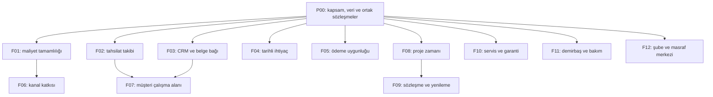

# TekirExtra — Değer yaratan modüller geliştirme ve üretime geçiş planı

**23 Ekim F04 taşınabilir işletim paketi:** [Compose/systemd şablonu, bakım-pause aktivasyonu ve Chromium dahil paket](F04-TASINABILIR-ISLETIM-PAKETI-2026-10-23.md) hazırlandı. Bağımlılık tabanı ve korumalı API/Prisma/workspace tek runtime’da toplandı; web, 598 tarayıcı dosyası ve işletim araçları eklendi. Onaylı manifestlerden türetilen 35.012 dosya ağsız Node 22 Compose doğrulamasından geçti. 9 komut, 27 kapı HTTP ve gerçek paket kapısı/Redis ile 5 I/O kontrolü başarılı; aynı hash’li runtime/browser ile sentetik PDF üretildi. Compose config ve systemd statik doğrulaması geçti. Gerçek env okunmadı, hedef/pilot servisi değiştirilmedi. Paket ve kanıtlar ayrı dizinlerde; hazırlık durumu hazirlandi, yayın/reboot kanıtı yok. Hedef seçimi, gerçek env/ağ/TLS, önceki unit devri, tam hedef Compose açılışı, reboot, yedek/restore, hacim ve alan pilotu açık. Aşağıdaki kayıtlar tarihsel dilimlerdir.

**23 Ekim F04 birleşik worker/HTTP devri:** [Aynı DB/Redis/ağda gerçek API/web ve worker geçişi](F04-BIRLESIK-HTTP-WORKER-GECISI-2026-10-23.md) tamamlandı. 5 HTTP/tarayıcı + 5 restore ve 16 birleşik kontrol geçti. Bakım/HTTP boşaltma → e-belge pause/aktif sıfır → kaynak worker exit 0 → hedef worker hazır → trafik açılışı sırası iki yönde doğrulandı. Eski HTTP/worker açıkken resume reddedildi; iki sürüm ayrı personel işleri işledi. Güncele dönüşte bekleyen e-belge işi tek yerel NotFound/dead-letter sonucuna ulaştı; restart sonrası HTTP 200 ve aynı tek deneme/sonuç korundu. Üç gerçek Chromium girişi, tarihsel plan/pay/talep korunumu ve beklenen iki mod audit’i geçti. Bu koşumda 226 tablo restore eşitliği, sabit paket bütünlüğü ve temizlik doğrulandı. Önceki SOAP/kapı/SIGKILL kabulleri ayrı kanıttır. Hedef systemd/Compose/TLS/proxy kurulumu, dış Redis kontrol yetkileri, gerçek sağlayıcı, hacim/kesinti bütçesi ve alan pilotu açık. Aşağıdaki kayıtlar tarihsel dilimlerdir.

**23 Ekim F04 korumalı API/web ve Redis geçiş kapısı:** [Yeni korumalı API + mevcut web ile yeni → bakım → eski → bakım → yeni trafik provası](F04-KORUMALI-API-WEB-VE-REDIS-GECIS-KAPISI-2026-10-23.md) tamamlandı. 27 kapı HTTP testi, 5 HTTP/tarayıcı + 5 restore ve 14 servis/trafik kontrolü geçti (10 önceki + 4 yeni). Eski trafik için Redis’te atomik pause/aktif sıfır kontrolü readiness öncesi/sonrası zorunlu; gözlem hatası/zaman aşımı geçişi reddeder. Eski trafik açıkken pause kaybı sonraki isteği upstream’e vermeden 503 ile bakıma aldı. Üç gerçek tarayıcı girişi, oturum/plan/pay/talep korunumu, bekleyen job verisi/sayaçları ve beklenen iki mod audit’i geçti. 221 tablo restore eşitliği, API/web paket bütünlüğü ve temizlik doğrulandı. Worker’lar bu API/web modunda kapalıdır; önceki tam worker kabulü ayrı kanıttır. Hedef proxy/TLS/servis kurulumu ve Redis kontrol düzlemi/worker-HTTP koordinasyonu, gerçek sağlayıcı, hacim/kesinti bütçesi ve alan pilotu açık. Aşağıdaki kayıtlar tarihsel dilimlerdir.

**23 Ekim F04 korumalı tam worker ve geri dönüş:** [Yeni sabit paket, gerçek Sovos adaptörü/internal SOAP ve pause ile eskiye dönüş](F04-KORUMALI-TAM-WORKER-VE-GERI-DONUS-2026-10-23.md) tamamlandı. Güncel tam API derlenip ayrı manifestli pakete alındı. 5 HTTP/tarayıcı + 5 restore testi ve 29 kontrol geçti (22 temel + 7). İlk gönderim tek SOAP çağrısıyla arşivlendi; arama desteği olmayan yeniden deneme doğal beş deneme/backoff ile 78.003 ms sonra tek dead-letter’a ulaştı, gönderim yapmadı. Eskiye dönüşte e-belge kuyruğu pause/aktif sıfır kaldı; eski worker bekleyen riskli işi almadan personel işi işledi. Güncele dönüşte pause korundu, resume sonrası koruma çalıştı; son rollback pause halinde sınandı. Fatura/arşiv ve F04 kayıt/ayar/audit korundu; 221 tablo restore eşitliği, paket bütünlüğü ve temizlik geçti. Gerçek sağlayıcı hesabı, hedef pause geçiş kapısı, güncel API/web trafik geçişi, doğal rezervasyon süresi, Redis kaybı, hedef hacim ve alan pilotu açık. Önceki aktif/SIGKILL modları tekrar koşulmadı. Aşağıdaki kayıtlar tarihsel dilimlerdir.

**23 Ekim F04 rezervasyon sonrası kesinti ve ürün düzeltmesi:** [Yerel sağlayıcı kabulünden sonra SIGKILL, benimseme ve arama desteği koruması](F04-EBELGE-REZERVASYON-SONRASI-KESINTI-2026-10-23.md) tamamlandı. Yeniden denemede belgeAra sunmayan adaptörün kontrolsüz yeniden gönderim yolu kapatıldı; ilk gönderim korunuyor. 75 servis, 5 HTTP/tarayıcı + 5 restore ve 6 gerçek DB/yerel sağlayıcı testi geçti; güncel tam API derlendi. Sağlayıcı fixture’ı belgeyi aldıktan sonra istemci SIGKILL ile kesildi. Taze rezervasyon 409 verdi; testte geçmiş tarihli hale getirilen aynı kayıt yeni süreçte benimsenip arşivlendi, gönderim bir kaldı. Desteksiz/başarısız aramada gönderim yapılmadı. 221 tablo restore eşitliği ve F04 kayıt/ayar/audit korunumu geçti; geçici DB/süreçler temizlendi. Bu doğrudan servis kabulüdür; önceki worker modları tekrar koşulmadı. Eski sabit paket yeni korumayı içermez. Gerçek sağlayıcı protokolü/hesap, yeni paketin tam worker/geri dönüş kabulü, doğal rezervasyon süresi, hedef işletim/hacim ve alan pilotu açık. Aşağıdaki kayıtlar tarihsel dilimlerdir.

**23 Ekim F04 aktif e-belge kesintisi/kurtarması:** [Sağlayıcısız aktif işte SIGTERM ve iki yönlü SIGKILL/stalled](F04-EBELGE-AKTIF-KESINTI-VE-KURTARMA-2026-10-23.md) tamamlandı. 5 HTTP/tarayıcı + 5 restore testi ve 37 paket/devir/aktif kontrolü geçti (önceki 30 + 7). Eski/güncel worker DB kilidinde bekleyen durum sorgusunu SIGTERM sonrası tamamlayıp exit 0 ile kapandı. Gönderim işi SIGKILL sonrası eski → güncel 126.397 ms, güncel → eski 131.218 ms içinde aynı kimlikle kurtarıldı; attemptsStarted=2, attemptsMade=1 ve stalledCounter=1 ile yerel kalıcı ret/dead-letter sonucuna ulaştı. İki dakikalık kilit değiştirilmedi. Önceki/yeni işler, dead-letter, fatura/e-belge ve F04 kayıt/ayar/audit içerikleri restart sonrası korundu. 221 tablo restore eşitliği ve paket bütünlüğü geçti; geçici kaynaklar temizlendi. Kabul sağlayıcı çağrısından önceki yerel yoldadır; rezervasyon sonrası kesinti, gerçek/belirsiz dış teslim, tekrarlı kesinti/Redis kaybı, hedef işletim/hacim, kapasite ve alan pilotu açık. Önceki personel aktif/SIGKILL modu tekrar koşulmadı. Aşağıdaki kayıtlar tarihsel dilimlerdir.

**23 Ekim F04 sağlayıcısız e-belge kuyruğu devri:** [Yerel ret, dead-letter ve eski → güncel → eski devir](F04-EBELGE-KUYRUK-DEVIR-PROVASI-2026-10-23.md) tamamlandı. 5 HTTP/tarayıcı + 5 restore testi ve 30 tam paket/devir kontrolü geçti (22 temel + 8 e-belge). Altı benzersiz işte yerel atlama/kalıcı ret, üç dead-letter kaydının korunması, aynı sentetik kimlikte dead-letter tüketici koruması ve diğer tenant faturasının reddi doğrulandı. Fatura/e-belge ve F04 kayıt/ayar/audit içerikleri korundu; 221 tablo restore eşitliği ve paket bütünlüğü geçti, geçici kaynaklar temizlendi. İlk koşum son HTTP transport kontrolünde durdu; gözlem hatası ayrıntılandırılıp prova zaman aşımı artırıldı, tekrar tam geçti; ilk hatanın kök nedeni kanıtlanmadı. Gerçek sağlayıcı teslimi/geçici hata, e-belge aktif iş kesintisi, hedef işletim/hacim, kapasite ve alan pilotu açık. Önceki personel aktif/SIGKILL kontrolleri bu modda tekrar koşulmadı. Aşağıdaki kayıtlar tarihsel dilimlerdir.

**23 Ekim F04 SIGKILL/stalled kurtarma:** [Kısmen commit edilmiş işte iki yönlü kurtarma](F04-WORKER-KURTARMA-PROVASI-2026-10-23.md) tamamlandı. 5 HTTP/tarayıcı + 5 restore testi ve 31 tam paket/devir/kurtarma kontrolü geçti (önceki 26 dahil). İlk bordro commit olmuşken ikinci INSERT bekletildi, kaynak worker SIGKILL ile kapatıldı. Beş dakikalık kilit değiştirilmeden eski → güncel 307.642 ms, güncel → eski 308.163 ms içinde aynı iş kurtarıldı; attemptsStarted=2, attemptsMade=1 ve stalledCounter=1 korundu. Yalnız eksik bordro oluşturuldu; restart sonrası beş bordro/kalem ve F04 plan/bağ/ayar/audit içerikleri değişmedi. 221 tablo restore eşitliği ve paket bütünlüğü doğrulandı; geçici trigger/function, servisler ve ağ temizlendi. İlk koşumun BullMQ 6 gözlem API hatası düzeltildi ve raporu korundu. Diğer kuyruklar/dış sağlayıcı, tekrarlı kesinti/Redis kaybı, hedef işletim/hacim, kapasite ve alan pilotu açık. Aşağıdaki kayıtlar tarihsel dilimlerdir.

**23 Ekim F04 aktif iş devri:** [Bir personelli aktif işte SIGTERM ve eski → güncel → eski devir](F04-AKTIF-WORKER-DEVIR-PROVASI-2026-10-23.md) tamamlandı. 5 HTTP/tarayıcı + 5 restore testi ve 26 tam paket/devir kontrolü geçti (önceki 22 dahil). Gerçek DB kilidinde bekleyen aktif işler SIGTERM sonrasında eski/güncel worker tarafından tamamlandı; ikisi de exit 0 ile kapandı. Dört yeni iş tek denemede kaldı; tek bordro ve beş kalemin içerik hash’i devir/restart sonrasında korundu. 219 tablo restore eşitliği, F04 kayıt/ayar/audit ve paket bütünlüğü doğrulandı; geçici kaynaklar temizlendi. İlk koşumun kilit gözlem hatası düzeltildi, raporu korundu. Kabul kısa DB beklemesi ve normal SIGTERM içindir; SIGKILL/stalled kurtarma, diğer kuyruklar/dış sağlayıcı, hedef işletim/hacim, kapasite ve alan pilotu açık. Aşağıdaki kayıtlar tarihsel dilimlerdir.

**23 Ekim F04 genel worker devri:** [Eski → güncel → eski genel worker provası](F04-GENEL-WORKER-DEVIR-PROVASI-2026-10-23.md) tamamlandı. 5 HTTP/tarayıcı + 5 restore testi ve 22 tam paket/devir kontrolü geçti (önceki 15 kontrol dahil). Ortak geçici Redis üzerinde üç gerçek BullMQ personel işi birer denemeyle tamamlandı; eski/güncel süreçlerin exit 0 ile durduğu doğrulandı. Güncel worker yeniden başlatması tamamlanan işleri tekrarlamadı. 219 tablo restore eşitliği, F04 plan/bağ/ayar/audit ve paket bütünlüğü korundu; geçici kaynaklar temizlendi. İlk koşumun prova üreticisi dizin hatası düzeltildi; raporu ayrı saklandı. Kabul boş kadroda bekleyen iş devridir; dolu/aktif iş, diğer kuyruklar, hedef işletim/hacim, kapasite ve alan pilotu açık. Aşağıdaki kayıtlar tarihsel dilimlerdir.

**22 Ekim F04 özel worker devri:** [Eski → güncel → eski ödeme sözü worker’ı](F04-WORKER-DEVIR-PROVASI-2026-10-22.md) aynı izole restore DB/SMTP üzerinde sınandı. 5 HTTP/tarayıcı + 5 restore testi ve 13 worker/devir kontrolü geçti. Önceki süreçlerin exit 0 ile durduğu doğrulanmadan yeni iş oluşturulmadı. Güncel paket ve tekrar eski paket geçmiş gönderimleri tekrarlamadı; dört farklı söz için dört ileti ve her birinde deneme 1 korundu. F04 kayıt/ayar/audit içerikleri ve paket hash’leri değişmedi; geçici kaynaklar temizlendi. Gerçek şirket/yayın değişmedi. Bu kabul taraması tamamlanmış özel worker’lar arasındadır; genel kuyruk devri, canlı SMTP kesintisi, hedef işletim/hacim, kapasite kararı ve alan pilotu açık. Aşağıdaki kayıtlar tarihsel dilimlerdir.

**22 Ekim F04 geçiş kapısı düzeltmeleri:** [URL eşdeğerliği ve bakım–hazırlık yarışı](F04-GECIS-KAPISI-URL-VE-BAKIM-YARISI-2026-10-22.md) kapatıldı. Eski sürümde büyük harf/son `/` biçimli plan bağlı isteklerin upstream’e geçmesi ve bekleyen hazırlığın yeni bakım komutunu aşması yeniden üretildi: ilk 15 kontrolde 7 hata vardı. Düzeltmeden sonra 18 odaklı HTTP, 5 gerçek HTTP/tarayıcı, 5 restore ve 10 servis geçişi kontrolü geçti. Geçiş bakım ve sıfır aktif istek gerektiriyor; durum revizyonu bekleyen eski hazırlığı geçersiz kılıyor. Önceki API/web paketleri aynı hash’lerle kullanıldı; F04 kayıtları ve beklenen mod audit’i korundu, geçici kaynaklar temizlendi. Değişiklik yalnız izole prova kapısı/testlerindedir; gerçek şirket/yayın değişmedi. Hedef işletim, worker devri, hacim, kapasite kararı ve alan pilotu açık. Aşağıdaki kayıtlar tarihsel dilimlerdir.

**22 Ekim F04 izole servis/trafik geçişi:** [Yeni → bakım → eski → bakım → yeni API/web provası](F04-IZOLE-SERVIS-VE-TRAFIK-GECISI-2026-10-22.md) tamamlandı. Tam güncel API derlendi; standalone paketin eksik runtime dosyaları düzeltilip ağsız Node 22 web kabulü geçti. 5 HTTP/tarayıcı + 5 restore testi ve 10 geçiş kontrolü başarılıdır. Tek giriş adresinde üç gerçek form girişi, 503 bakım kapısı, HTTP isteklerinin tamamlanması, hazır olmayan hedefin reddi ve eski sürümde yeni plan bağlı POST’un 409 ile engellenmesi doğrulandı. Plan/pay/talep bağı korundu; güncele dönüşte kapalı mod kalıp yönetici salt okunur açtı. Paketler ayrı dizinde aynı dosya hash’leriyle yeniden üretildi; geçici kaynaklar temizlendi. Gerçek şirket/yayın değişmedi. Bu test kapısı hedef reverse proxy/TLS/servis yöneticisine kurulmadı; worker devri, hedef hacim, kapasite kararı ve alan pilotu açık. Aşağıdaki kayıtlar tarihsel dilimlerdir.

**22 Ekim F04 özel ödeme sözü worker uyumu:** [19 Ekim özel worker paketi](F04-OZEL-ODEME-SOZU-WORKER-UYUMU-2026-10-22.md) yeni F04 şemasının geri yüklenmiş kopyasında doğrulandı. 5 güncel HTTP/tarayıcı + 5 restore testi ve 8 özel worker kontrolü geçti. İki gerçek worker süreciyle izole SMTP’de tek gönderim, yeniden başlatmada tekillik, tenant sınırı, yarım gönderimin belirsiz kalması ve salt okunur/pilot geçişi çalıştı. F04 kayıt/ayar/audit içerikleri ve paket hash’leri korundu; geçici kaynaklar temizlendi. Önceki genel worker/tam API/web kabulü ayrı kanıttır. Gerçek şirket/yayın değişmedi; gerçek servis/trafik geri dönüşü, alan pilotu, kapasite kararı ve hedef hacim kabulü açık. Aşağıdaki kayıtlar tarihsel dilimlerdir.

**22 Ekim F04 tam eski paket şema uyumu:** [19 Ekim tam API, genel worker ve standalone web](F04-TAM-ESKI-PAKET-SEMA-UYUMU-2026-10-22.md) restore edilen yeni şemada sınandı. 5 güncel HTTP/tarayıcı + 5 restore testi ve 15 tam paket kontrolü geçti. Gerçek giriş/fatura/anlık ihtiyaç, iş yazımı, worker bağı/bildirimi, yeniden başlatmada tekillik ve eski web’den parolalı giriş doğrulandı. Yeni F04 plan/pay/talep bağı, ayar ve audit içerikleri korundu; paket hash’leri eşleşti ve geçici kaynaklar temizlendi. Ürün/gerçek şirket/yayın değişmedi. Bu kanıt özel ödeme sözü worker’ını veya gerçek servis/trafik geri dönüşünü kapsamaz; alan pilotu, kapasite kararı ve hedef hacim kabulü de açık. Aşağıdaki kayıtlar tarihsel dilimlerdir.

**22 Ekim F04 şirket modu/audit restore kabulü:** [Güncel sürümle yedek/restore ve eski önizleme uyumu](F04-MOD-VE-AUDIT-GERI-YUKLEME-2026-10-22.md) doğrulandı. 5 gerçek HTTP/tarayıcı + 5 restore testi geçti; 219 public tablonun içeriği migration tekrarı, restore ve işlev kontrolleri boyunca korundu. Şirket pilot ayarı, yöneticinin dört mod audit kaydı ve planın güncel erişim bilgisi geri geldi; geçici DB’ler silindi. Ürün kaynağı/gerçek şirket/yayın değişmedi. Eski anlık modül kontrolü tam eski API/web/worker geri dönüşü değildir; alan pilotu, kapasite kararı, hedef hacim ve tam uygulama geri dönüşü açık. Aşağıdaki kayıtlar tarihsel dilimlerdir.

**22 Ekim F04 şirket modu ve kontrollü açılış:** [Yönetici ayarı, salt okunur ekranlar ve kapatma yarışı](F04-SIRKET-MODU-VE-KONTROLLU-ACILIS-2026-10-22.md) tamamlandı. Tarihli ihtiyaç varsayılan kapalıdır; yönetici şirket genelinde salt okunur/pilot/açık seçer ve değişiklik audit ile atomiktir. Yazma–kapatma yarışı, tekrar istekleri ve tenant/rol sınırları dahil 48 DB kabulü, 26 fixture tarayıcı ve 5 gerçek HTTP/tarayıcı testi geçti. Eski şemadan 1 önce/3 sonra kontrolünde varsayılan kapalı ve açık yönetici pilot seçimi doğrulandı. Yeni web üretim derlemesi geçti. Gerçek şirket ayarı/yayın değişmedi; alan pilotu, kapasite kararı, hedef hacim ve tam uygulama geri dönüşü açık. Aşağıdaki kayıtlar tarihsel dilimlerdir.

**22 Ekim F04 migration kilit/tekrar provası:** [Kontrollü yazma kilidi ve başarısız migration kurtarması](F04-MIGRATION-KILIT-VE-TEKRAR-PROVASI-2026-10-22.md) doğrulandı. İzole `RowExclusiveLock` altında 1 sn lock_timeout, P3018/55P03 hatası üretti; ikinci migration’da yarım DDL yoktu ve 213 eski tablo içeriği korundu. Kör tekrar P3009 ile engellendi. Nesne yokluğu kontrolünden sonra yalnız testte rolled-back işaretlenip geçiş tamamlandı. 1 geçiş öncesi, 3 sonrası ve 4 gerçek HTTP/tarayıcı testi geçti; geçici DB temizlendi. Üretim SQL’i, uygulama/web paketi veya gerçek şirket/yayın değişmedi. Hedef hacim/kesinti-kilit bütçesi, tam uygulama geri dönüşü, alan pilotu ve kapasite tercihi açık. Aşağıdaki kayıtlar tarihsel dilimlerdir.

**22 Ekim F04 mevcut veride ilk migration:** [F04 öncesi şemadan ilk ileri geçiş](F04-MEVCUT-VERIDE-ILK-MIGRATION-2026-10-22.md) izole fixture’da doğrulandı. 265 eski migration üzerine kısmi sipariş, çok depolu rezerv ve eski talep oluşturulup üç F04 migration’ı uygulandı; 213 eski tablonun içeriği değişmedi. Geçiş öncesi 1, sonrası 3 ve yükseltilmiş DB’de 4 gerçek HTTP/tarayıcı testi geçti. Eski kaynaklara otomatik tarih/atama/plan bağı eklenmedi; açık kullanıcı teyidinden sonra plan ve tek bağlı taslak çalıştı. 3739 ms yalnız küçük fixture deploy gözlemidir; gerçek hacimde kilit/süre kabulü değildir. Yeni uygulama derlemesi veya gerçek şirket/yayın yok. Alan pilotu, kapasite tercihi, hedef hacim ve tam uygulama geri dönüşü açık. Aşağıdaki kayıtlar tarihsel dilimlerdir.

**22 Ekim F04 geçiş/geri dönüş provası:** [Migration, yedek/restore ve eski önizleme API kontrolü](F04-GECIS-VE-GERI-DONUS-PROVASI-2026-10-22.md) tamamlandı. Yeni `--f04-prova` koşumunda 4 gerçek HTTP/tarayıcı ve restore sonrası 4 test geçti; dolu DB migration tekrarı ve 219 public tablonun yedek/restore içerik eşitliği doğrulandı. Tarihsel plan/pay/talep bağı, RLS ve değişmezlik korundu. 19 Ekim derlenmiş ihtiyaç modülü yeni şemada çalıştı; eski anlık sonuç yeni tarihli hesapla eşdeğer değildir. Tam eski API/web/worker geri dönüşü ve gerçek verili ileri migration süre/kilit kabulü yapılmadı. Yeni uygulama derlemesi veya gerçek şirket/yayın işlemi yok; somut geçiş yönergesi eklendi. Alan pilotu, kapasite tercihi ve tam yayın adayı kabulü açık. Aşağıdaki kayıtlar önceki dilimlere aittir.

**22 Ekim F04 pilot veri hazırlığı:** [Salt okunur örnek raporu ve alan kabulü yönergesi](F04-PILOT-VERI-HAZIRLIGI-2026-10-22.md) eklendi. En fazla on seçili örnek tek repeatable-read / DB READ ONLY transaction’da hesaplanır; kaynak belirsizliği ve reddedilen örnekler ayrı görünür. Rapor şirket geneli kapsama, kapasite tahsisi veya gerçek pilot kabulü sayılmaz. 41 PostgreSQL/RLS ve 4 gerçek HTTP/tarayıcı testi, tam API tür kontrolü ve odaklı API derlemesi geçti; önceki web paketi kullanıldı. Yeni migration, gerçek şirket yazımı veya yayın yok. Şirket/depo, alan sorumlusu, kapasite tercihi ve doğal işlerin alan kabulü bekleniyor; G0/G2 kapanmadı. Aşağıdaki kayıtlar önceki dilimlere aittir.

**22 Ekim F04 atomik plan–satın alma bağı:** [Tek plan → tek satın alma taslağı](F04-PLAN-SATIN-ALMA-BAGI-2026-10-22.md) tamamlandı. Kayıtlı plandan hazırlanan talebin güncellik/açık doğrulaması, taslak, bağlantı ve audit aynı transaction’da; eşzamanlı/ağ tekrarları tek talebe gider. Bağ iptalde korunur ve bağlı taslak değiştirilemez. Gerçek API kabulünde bulunan JSONB alan sırası karşılaştırması düzeltildi. Son pakette 37 DB/RLS, 23 fixture tarayıcı, 3 gerçek HTTP/tarayıcı ve 15 web yardımcı testi geçti; tam API/web tür kontrolleri ve web üretim derlemesi başarılı. Yeni migration yalnız izole kabul ortamına uygulandı; gerçek şirket/yayın değişmedi. Güvence aynı kayıtlı plan içindir; plansız girişler ve farklı planlar arası kapasite tahsisi kapsam dışıdır. Operasyon pilotu ve kapasite kararı açık. Aşağıdaki kayıtlar tarihsel dilimlerdir.

**22 Ekim F04 gerçek HTTP/tarayıcı kabulü:** [Birleşik kabul kaydı](F04-GERCEK-HTTP-TARAYICI-KABULU-2026-10-22.md) eklendi. İzole PostgreSQL ve derlenmiş gerçek controller/servislerle 2/2 test geçti: JWT/rol/tenant sınırları, parolalı Chromium girişi, üretim ataması, plan/pay/audit kaydı ve kaynak değişiminde değişmez geçmiş plan doğrulandı. Tam API tür kontrolü de başarılı; önceki süre aşımı kapandı. Önceki üretim web paketi kullanıldı; gerçek şirket/yayın değişmedi. Atomik plan–satın alma bağı, kapasite kararı ve operasyon pilotu açık. Aşağıdaki kayıtlar önceki dilimlere aittir.

**22 Ekim F04 plan yönetimi/atama UI dilimi:** [Üretim atama ve kayıtlı plan ekranları](F04-PLAN-YONETIMI-VE-URETIM-ATAMA-EKRANI-2026-10-22.md) tamamlandı. Açık depo/gün ataması, tarihli sonuçtan tekrar güvenli plan saklama, geçmiş plan/güncellik görünümü ve 20 kayıtlık tenant kapsamlı listeleme hazır. 31 PostgreSQL/RLS ve üretim web paketinde 21 fixture tarayıcı senaryosu geçti; F04 odaklı API ve tam web tür kontrolleri ile web üretim derlemesi başarılı. Tam API kontrolü, gerçek API ile birleşik HTTP/tarayıcı kabulü, atomik plan–satın alma bağı ve operasyon pilotu açık. Gerçek şirket/yayın değişmedi. Aşağıdaki kayıtlar önceki dilimlerin durumunu anlatır.

**22 Ekim F04-02 üretim/kalıcı plan dilimi:** [Rezerv dışı üretim ihtiyacı ve kalıcı plan kanıtı](F04-URETIM-TALEBI-VE-KALICI-PLAN-2026-10-22.md) eklendi. Üretim kalemine açık depo/gün atama API'si, tüm depolardaki aktif rezervlerden arındırılmış talep, atanmamış veya eski kaynakta yeterlilik engeli ve kaynak paylarıyla değişmez plan saklama API'si hazır. 257 stok/belge/üretim birim ve 29 PostgreSQL/RLS kabul testi, F04 odaklı ve web tür kontrolleri geçti. Tam API kontrolü düzeltme sonrası süre sınırına takıldı; yeni paket/HTTP-tarayıcı kabulü ve atama/plan yönetim ekranları açık. Gerçek şirket/yayın değişmedi. Kalıcı paylar tarihsel kanıttır; stok rezervi veya planlar arası kapasite tahsisi değildir. Önceki kayıtlar tarihsel dilimlerdir.

**22 Ekim F04-03 tarihli UI dilimi:** [Giriş tarihi ekranı ve tarihli talep aktarımı](F04-TARIHLI-IHTIYAC-EKRANI-2026-10-22.md) eklendi. Sipariş kaleminden gerekçeli doğrulama/kaldırma ekranı, ihtiyaç ekranında tarihli kapsam, dönem içi açık ve doğrulama revizyonuna duyarlı talep güncellik kontrolü hazır. 14 web yardımcı, 46 API odaklı, 20 PostgreSQL/RLS ve son üretim paketinde 13 fixture tarayıcı senaryosu geçti; API/web tür kontrolleri ve web üretim derlemesi başarılı. Değişen beş web kaynağı test kopyasıyla eşleşti. Gerçek şirket/yayın değişmedi; gerçek HTTP/tarayıcı birleşik kabulü, rezerv dışı talepler, kalıcı karşılama bağları ve operasyon pilotu açık.

**22 Ekim F04-02 veri/API dilimi:** [Doğrulanmış sipariş giriş tarihi ve kaynak adaptörü](F04-SIPARIS-GIRIS-TARIHI-2026-10-22.md) eklendi. Açık alış siparişi satırına sürümlü/gerekçeli tarih doğrulaması, kaynak değişiminde geçersizleşme ve kısmi teslim kalanı tarihli önizlemeye bağlandı. 182 stok/belge birim ve 19 gerçek PostgreSQL/RLS kabul testi ile tam API tür kontrolü geçti. Yeni migration yalnız izole kabul ortamında uygulandı; geçici DB silindi, gerçek şirket/yayın değişmedi. UI, rezerv dışı talepler, kalıcı karşılama bağları ve operasyon pilotu açık. Aşağıdaki hesap çekirdeği kaydı bu API diliminden önceki durumu anlatır.

**22 Ekim F04-02 hesap çekirdeği:** [Tarihli ihtiyaç motoru](F04-TARIHLI-IHTIYAC-MOTORU-2026-10-22.md) kaynak satırı/kapsam doğrulaması, rezerv tekilliği, doğrulanmış tarihli kalan giriş/talep ve dönem içi açık hesabıyla eklendi. Mevcut siparişlerin serbest metin teslim süresi doğrulanmış tarih sayılamadığından API/UI bağlantısı yapılmadı. Kaynak tarih modeli/adaptörü, DB/RLS kabulü, kalıcı karşılama bağları ve operasyon pilotu açık; F04-02 tamamlanmış veya yayına alınmış sayılmaz.

**19 Ekim F04 talep aktarımı:** [Stok açığından satın alma taslağı hazırlama](F04-STOKTAN-SATIN-ALMA-TALEBI-2026-10-19.md) localhost:3100 üzerinde yayında. Açık hedef formda ve kaydetme öncesinde yeniden okunur; bütçe/fiyat seçimi kullanıcıdadır. Mevcut taslak → onay → sipariş akışı korunur. 9 aktarım birim, 9 mevcut onay/bütçe birim ve 9 üretim tarayıcı senaryosu geçti; gerçek API ile form geçişi masaüstü/mobil doğrulandı. Stok ayırma, atomik plan/talep bağı ve tarihlendirilmiş MRP kapsamı açık.

**19 Ekim F04 ilk dilim:** [Yeni ihtiyaç için stok önizlemesi](F04-STOK-IHTIYAC-ONIZLEMESI-2026-10-19.md) localhost:3100 üzerinde yayında. Tek depo ve ana birimde rezerv yalnız bir kez düşülür; terminsiz yoldaki miktar yeterlilik hesabına katılmaz. 18 birim, 9 PostgreSQL/RLS ve 5 son üretim paketi tarayıcı testi ile gerçek API/web masaüstü-mobil kontrolü geçti. Tarihli giriş/talep motoru, varyant planı ve onaylı satın alma talebine aktarım açık; F04 bütünü tamamlanmış sayılmaz.

**19 Ekim F03 kapama hacim kabulü:** [5000/5001 kapama ve geçmiş sınırları doğrulandı](F03-KAPAMA-HACIM-KABULU-2026-10-19.md). 59 PostgreSQL/RLS, 17 üretim paketi fixture tarayıcı ve üç okuyucu birim testi geçti. 5000 gerçek kapama tam okunup pay yazıldı; 5001'de okuma/yazma bütünüyle reddedildi. 5000 pay geçmişinde yeni yazım, 5001'de okuma da engellendi. Pay/audit artmadı; uygulama paketi değişmedi. Gerçek şirket alan pilotu sonraki aşamadır; fiziksel stok/seri/lot kapsamı ayrı izlenir.

**19 Ekim F03 iade hacim kabulü:** [5000/5001 kaynak ve geçmiş sınırları doğrulandı](F03-IADE-HACIM-KABULU-2026-10-19.md). 57 PostgreSQL/RLS kabul, 16 üretim paketi fixture tarayıcı ve 9 okuyucu birim testi geçti. Gerçek DB'de 5000 iade okunup pay yazıldı; 5001'de bütün okuma/yazma reddedildi. 5000 pay geçmişinde yeni yazım, 5001'de okuma da engellendi; pay/audit artmadı. Uygulama/migration değişmedi. Gerçek şirket alan pilotu ve kapama dağıtımının ayrı hacim kapsamı açık.

**19 Ekim F03 iade revizyon sınırı:** [Mevcut payın kapasiteye ikinci kez eklenmesi düzeltildi](F03-IADE-REVIZYON-KAPASITESI-2026-10-19.md). 55/55 PostgreSQL/RLS kabulü ve üç gerçek HTTP/üretim Chromium senaryosu geçti. Bir kuruş sınır aşımı yeni pay/audit oluşturmadan reddedilir; diğer iadelerin payı korunur. Yeni API paketi localhost'a uygulandı; web/e-posta servisi sağlıklı kaldı. Diğer hacim sınırı kabulleri ve gerçek alan pilotu açık.

**19 Ekim F03 çok kaynaklı iade:** [Genel satış özeti ile iade payı kanıtı hizalandı](F03-COK-KAYNAKLI-IADE-DOGRULAMA-2026-10-19.md). Üç gerçek HTTP/üretim Chromium senaryosu ve dört regresyon testi geçti. İki kaynak faturanın tek iadesi tamamlanmadan net sonuç verilmediği, tamamlanınca fırsatların yalnız kendi payını gördüğü ve finans kayıtlarının korunması doğrulandı. Referans okuyucusunda 5000/5001 sınırı ve kapasite ihlalinin ilişkisiz iadeyi etkilememesi kontrol edildi. Diğer dağıtım sınırları ve gerçek alan pilotu açık.

**19 Ekim F02 devamı:** [Takip tasarımı ve iş listesinden kayıt açma](TAHSILAT-TAKIP-AKISI-2026-10-19.md) 35 üretim tarayıcı senaryosuyla localhost'a uygulandı. Kullanıcının açık talebiyle [söz günü e-posta hatırlatması](ODEME-SOZU-EPOSTA-HATIRLATMA-2026-10-19.md) ayrı worker'da etkin; 103 DB kabul ve 13 birim testi, yerel SMTP paket provası ve gerçek SMTP kimlik doğrulaması geçti. Genel worker açılmadı. Aşağıdaki önceki teslim/yayın sınırları tarihsel kayıtlardır.

**19 Ekim yerel manuel pilot yayını:** Kullanıcının seçtiği `localhost:3100` hedefinde [yeni sabit aday API/web geçişi](LOCALHOST-PILOT-YAYIN-2026-10-19.md) tamamlandı. 190 birleşik kabul, 55 API ve 18 web odaklı test geçti; güncel gerçek yedek ayrı PostgreSQL'e yüklendi ve 208 tablo özeti eşleşti. İki yeni iade migration'ı önce yedekte, sonra yerel hedefte uygulandı. Node 22 API/web sağlıklı; masaüstü/mobil oturumsuz giriş ve erişim koruması doğrulandı. Güncel şirket ayarlarında otomasyon/bildirim açık bulundu; ayarlar korunarak worker kapalı bırakıldı. Gerçek kullanıcı/doğal pilot ve alan kabulü, otomasyon pilotu, host reboot ve uygun önceki sürüme dönüş açık; birleşik REL görevleri tamamlandı sayılmaz.

**18 Ekim F02 cari söz özeti:** [Salt okunur ölçüm desteği](F02-CARI-SOZ-OZETI-2026-10-18.md) eklendi. İptal/revizyon geçmişi sayıda korunuyor; geçerli aktif sözlerin tutar/gerçekleşen/kalan/gecikmiş kalanı ve güncel gerçekleşme oranı döviz bazında, snapshot Türkiye gününe göre hesaplanıyor. İlk dilimde 51 web birim testi, tam web TypeScript kontrolü ve iki koşum birlikte 19 fixture tarayıcı senaryosu doğrulandı; son oran eklemesi ayrıca test edilmedi. Zamanında tutulma paydası, revizyon/iptal ve sonradan geri alınan ödeme kuralları karara bağlanmalı; tarihsel dönüşüm/takip süresi için olay geçmişi eksik. Gerçek pilot açık ve bu değişiklik önceki sabit üretim adayına dahil değil.

**18 Ekim sabit çekirdek adayı:** [API/web üretim paketi ve birleşik regresyon](CEKIRDEK-ADAY-VE-REGRESYON-2026-10-18.md). Üçüncü sabit kaynak adayında tam API/web üretim derlemeleri ve 190 birleşik test geçti. F03 gerçek parolalı tarayıcı akışı standalone paketten doğrulandı; migration tekrarı ve 22 tabloda dump/restore eşitliği başarılı, geçici DB silindi. Derlemeyi engelleyen dosya türü daraltması ve üretimde form etiketini koparan bileşen adı denetimi düzeltildi. REL-01/REL-03 teknik hazırlığı ilerledi; [Node 22 tam API/worker ve yeniden başlatma provasında](CEKIRDEK-RUNTIME-VE-ISLETIM-2026-10-18.md) 12 ek kontrol geçti. [PDF ve gerçek Node 22 tarayıcı akışı](CEKIRDEK-NODE22-PDF-VE-TARAYICI-2026-10-18.md) da 1 PDF ve 14 akış kontrolüyle doğrulandı; tarayıcılı dağıtım arşivi hazırlandı. [İşletim/toparlanma provasında](CEKIRDEK-ISLETIM-VE-TOPARLANMA-2026-10-18.md) 17 kontrol geçti: süreç hatası sonrası otomatik açılma, Redis kesintisi, özellik kapatma/açma ve 120 HTTP isteğinde sıfır hata doğrulandı. Yerel p95 195,90 ms üretim kapasitesi kabulü değildir. [Taşınabilir servis paketinde](CEKIRDEK-KALICI-SERVIS-PAKETI-2026-10-18.md) dosya doğrulayıcı, Compose ve systemd şablonu hazır; 7 doğrulayıcı testi ve 17 Compose/yeniden kurma kontrolü geçti. Hedef işletim/geri dönüş ve gerçek pilot/yayın kapıları henüz kapanmadı. Aday sabit kaynak kopyasına aittir; derleme sonrasındaki teklif-talebi değişiklikleri dahil sayılmaz.

**18 Ekim gerçek HTTP/tarayıcı dilimi:** [F03 birleşik teknik prova](F03-GERCEK-HTTP-TARAYICI-PROVASI-2026-10-18.md). Odaklı derlenmiş gerçek controller/servislerle teklif → sipariş → ortak kesin fatura → kesin iade → tarayıcıdan ticari dağıtım akışı geçti. Parolalı gerçek giriş, yenileme sonrası sonuç, finans kayıtlarının korunması, JWT/rol/tenant/mod sınırları doğrulandı. Gelen e-belge kaynak referansı fixture'dır; web ayrı kopyada geliştirme modunda çalışır. İki birleşik senaryo geçti; bu kayıt tam üretim paketi, dış sağlayıcı veya gerçek şirket pilotu kabulü değildir.

**18 Ekim karma ticari iade dilimi:** [Karma faturada açık ticari iade dağıtımı](F03-KARMA-TICARI-IADE-DAGITIMI-2026-10-18.md). Tek ve çok kaynaklı iadeler için gerekçeli, sürümlü pay API'si ile kaynakları ve tüm kaynaklardaki dağıtılan/kalan toplamı gösteren ekran eklendi; her iade `tam`, `eksik` veya `doğrulanamadı` durumunu gösterir. Kapasite ihlali ilgili iadeye bağlanır; yalnız bu ihlalle ilişkili net satış sonucu belirsiz kalır. Kaynak satışın KDV hariç matrahı ve brüt toplamı satırlarla birlikte doğrulanmadan dağıtım uygun sayılmaz. Çok kaynaklı iadede bütün geçerli paylar iade matrahına eşitlenince net satış, ilgili kaynak/fırsat payını düşer. Ortak faturanın genel belge-listesi `netSatis` alanı yalnız tüm satırlar tek fırsata kanıtlandığında hesaplanır; karma faturadaki fırsat neti fatura bazlı iade dağıtımı sonucunda gösterilir. Ortak sınırlı satır-sahipliği okuyucusu kapama, iade dağıtımı ve net satış doğrulamasında kullanılıyor. İade-faturası geçmişi için bileşik indeks migration'ı eklendi, henüz uygulanmadı. Prisma şema doğrulaması, API/web odaklı tür kontrolleri ve tam API/web üretim derlemeleri geçti (API derlemesi 3 GiB Node yığını kullandı; web derlemesi CSS/ESLint uyarıları verdi). API birim paketi 2.133/2.133, izole PostgreSQL/RLS kabulü 53/53 geçti. Fixture tarayıcı kabulü 15 senaryoda panel oturumu nedeniyle başarısız; gerçek HTTP/tarayıcı runner'ı geçici Docker DB başlangıcında 180 saniye zaman aşımına uğradı, testlere ulaşmadı. Gerçek HTTP/tarayıcı birleşik akışı ve pilot/yayın kabulü açık.

**18 Ekim satış/iade dilimi:** [Referanslı iade sonrası satış](F03-REFERANSLI-IADE-SONRASI-SATIS-2026-10-18.md). Tamamı aynı fırsata ait faturada tek kaynak referanslı kesin iadeler KDV hariç satış matrahından düşülür. Çok kaynaklı iadeler ancak tüm kaynak/fırsat payları geçerli ve iade toplamına tam eşit olduğunda, her kaynak fırsatında kendi payı kadar düşülür; kanıtsız tutarlar dağıtılamadı kalır. Kapama tutarı ticari iade yerine kullanılmaz. 45 geçici DB kabul testi, 92 birim testi ve yeni tarayıcı senaryosu geçti. Yeni karma dağıtım davranışı, birleşik satış kabulü ve gerçek pilot hâlâ açık.

**18 Ekim ek teslim:** [F03 kapama dağıtım özeti](F03-KAPAMA-DAGITIM-OZETI-2026-10-18.md). Mevcut açık pay dağıtımı kasa/banka, iade ve diğer türler bazında özetlenir; eksik dağıtım belirtilir, geçersiz kaynakta tutarlar gizlenir. 41 geçici PostgreSQL kabul testi geçti. Bu teslim net satış/iade sonucu veya gerçek pilot kabulü değildir; aşağıdaki 17 Ekim durum kaydı tarihsel başlangıçtır.

**Tarih:** 17 Ekim 2026 · **Sürüm:** 1.33 · **Durum:** F01/F02 teslimleri korunuyor. F02 dokuzuncu adayının 214 yerel teknik kontrolü geçti; gerçek pilot ve canlıya geçiş kullanıcı isteğiyle ertelendi. F03'te kaynak satırdan kesin fatura payı ve bütünü aynı fırsata ait faturada kapama görünümü geliştirildi; karma ödeme/iade satır dağılımı ve birleşik satış pilotu henüz tamamlanmadı.

**17 Ekim güncel durum:** Dokuzuncu adayda 214 yerel teknik kontrol geçti; [güncel aday kaydı](F02-DOKUZUNCU-ADAY-KABULU-2026-10-17.md). Kullanıcı gerçek pilot kabulü ve canlıya geçişi sonraya bıraktı. [F03 ilk dilimi](F03-FIRSAT-TEKLIF-BAGLARI-2026-10-17.md) teklif bağlama/çözme ve kapsam kontrollerini içerir. [İkinci dilim](F03-BELGE-ZINCIRI-2026-10-17.md) belge ilişkilerini, [üçüncü dilim](F03-FIRSATTAN-TEKLIF-OLUSTURMA-2026-10-17.md) atomik teklif oluşturmayı içerir. [Dördüncü dilim](F03-FATURA-PAYLARI-2026-10-17.md), yeni dönüşümlerde saklanan kaynak satır kimliğiyle kesin fatura paylarını ve yalnız bütün fatura doğrulandığında kapamaları gösterir. Eski kaynaklar tahmini eşleştirilmez; karma ödeme/iade tutarları oranla dağıtılmaz. Net satış/iade sonucu ve birleşik satış kabulü sırada. Aşağıdaki önceki aday ve koşum kayıtları tarihsel kanıttır.

**Son kaynak adayı:** [Yedinci aday ve PDF/F02 kabulü](F02-GUNCEL-KAYNAK-ADAYI-2026-10-16.md). Ayrı kaynak kopyasında API/web derlendi, standalone dizin öneki düzeltildi. 27 birim testi ve 6 derlenmiş PDF çıktısında çift dil koşulları/VD eki doğrulandı. 90 API ve 17 fixture tarayıcı kontrolü, migration tekrarı ve 14 tablo dump/restore eşitliği geçti; geçici DB silindi. Dördüncü adayın Node 22 runtime arşivi ve gerçek API ile 14 kontrolü yeni sürüme taşınmış sayılmaz. Gerçek şirket ayarları/iş kayıtları ve çalışan servisler bu çalışmada değiştirilmedi.

**Son tam akış provası:** [Standalone web ve gerçek API/worker](F02-TAM-AKIS-TARAYICI-PROVASI-2026-10-16.md). 11 paket/API/worker ve 3 gerçek tarayıcı senaryosu geçti. API yanıtı taklidi veya token enjeksiyonu olmadan form girişi, görüşme POST 201, yenileme sonrası geçmiş ve API'de kayıt sayısı doğrulandı; salt okunur masaüstü/mobil yazma sınırları geçti. Paket özetleri korundu, geçici kaynaklar temizlendi. Başlangıçta adaydan farklı 15 kaynak dosyası raporlandı; bu değişikliklere müdahale edilmedi. Gerçek şirket pilotu ve güncel kaynakların kabulü değildir.

**Son bağımlılık paketi:** [API/worker runtime paketi](F02-API-WORKER-RUNTIME-PAKETI-2026-10-16.md). Kilitli bağımlılıklar ayrı dizinde çevrimdışı kuruldu; workspace çıktıları ve Prisma istemcisi yeniden üretildi. 29 doğrudan bağımlılık, native Argon2, gerçek parolalı HTTP giriş, cari/fatura, F02 takip/söz/nakit işlemleri ve tam worker'ın geciken söz bağlantısı Node 22.23.2 altında geçti. Gerçek şirket verisi/servisi kullanılmadı; geçici kaynaklar temizlendi. Özgün aday kimliği korunuyor; runtime ayrı manifestle izleniyor.

**Son imaj/bağımlılık incelemesi:** [Eski tam imajlar ve host envanteri](F02-ESKI-IMAJ-UYUMU-VE-BAGIMLILIK-ENVANTERI-2026-10-16.md). Üç eski imaj sabit kimlikle izole ortamda sınandı: 10 kontrolün 8'i geçti, fatura detayı kaldırılmış kolon nedeniyle 500 ve web aynı origin proxy yolu 404 verdi. Geri dönüş paketi olarak uygun değiller. 29 doğrudan API bağımlılığı ile workspace dist/lockfile özetleri kaydedildi; mevcut kurulum envanteri temiz dağıtım paketi sayılmaz. Gerçek servisler ve şirket ayarları değiştirilmedi.

**Chromium ve arşiv sonucu:** Aynı runtime için Chromium/headless shell ve ffmpeg ayrıca paketlendi; ağsız Node 22 ortamında gerçek PDF servisinin Türkçe metin üretimi geçti. Böylece 11 API/worker kontrolü ve bir PDF kontrolü başarılı. Yaklaşık 361 MiB arşivin gzip, dosya özeti ve göreli yol kontrolleri geçti. Arşiv Node/OS kitaplıklarını ve web standalone'ı içermez; ayrıntılar runtime belgesinde.

**Son geri dönüş hazırlığı:** [F02 kapatma/yeniden açma provası](F02-KAPATMA-VE-GERI-ACMA-PROVASI-2026-10-16.md). 8 kontrolde geçmiş/finans özetleri korundu; yeniden açma ve duraklamada gelen söz tekrar bağ/bildirim üretmedi. Önceki hatırlatma bileşeninde itiraz engelinin bulunmadığı önizleme karşılaştırmasıyla kanıtlandı; SMTP çağrısı sıfır. V2 işletim belgesindeki yerinde checkout/porta göre öldürme adımları kontrollü paket/servis yönetimiyle değiştirildi. Gerçek şirket ve çalışan servisler değiştirilmedi; onaylı önceki dağıtım paketi hâlâ gerekli.

**Son teknik doğrulama:** [F02 kapasite ve sınır provası](F02-KAPASITE-VE-SINIR-PROVASI-2026-10-16.md). Gerçek derlenmiş servislerle 1.000/1.001 söz, 5.000/5.001 kaynak/pay, worker/nakit planında 100/101 cari, tekrar tekilliği ve 15 saniyelik transaction sınırında takip/bağ/audit rollback kontrollerinin 12'si geçti. Yerel süreler kaydedildi, geçici DB silindi. Şirket ayarları ve ürün kaynakları değiştirilmedi; üretim SLA/p95 kabulü değildir.

**Seçilmiş yerel pilot:** [TEKİR EKTRA ÖN MUHASEBE başlangıç kaydı](F02-TEKIR-EKTRA-PILOT-KAYDI-2026-10-16.md). Kullanıcı `admin@tekirextra.local`, ortam `localhost:3100`. Güncel gerçek yedek ayrı PostgreSQL'e yüklenerek uygulama rolüyle erişim doğrulandı. Yedek betiğinin GRANT kayıtlarını dışarıda bırakması düzeltildi. Salt okunur ekran teyidinden sonra `pilot` ayarı audit ile açıldı; yönetici yazma erişimi ve varsayılan manuel sorumlu doğrulandı. Deneme iş kaydı oluşturulmadı. Otomasyon/bildirimler kapalı; ilk doğal takip/söz örneği bekliyor.

**Pilot erteleme kararı:** Kullanıcı ilk gerçek takip kaydı adımını şimdilik atlamayı istedi. Doğal örnek ve buna bağlı alan kabulü ertelendi; pilot veya F02 paketi tamamlandı sayılmaz. Manuel pilot modu korunuyor; bu karar ayar veya iş kaydı değişikliği yapmaz.

**Mevcut web kontrolü:** Ayrı Chromium oturumlarında üç ek senaryo geçti: gerçek anonim giriş yönlendirmesi ve mevcut DB servis okumaları/yardımcı fixture'larla masaüstü/mobil salt okunur görünüm, filtreler ve yenileme. Bu teknik kontroller gerçek admin HTTP oturumu değildir; ardından kullanıcı salt okunur ekranı ayrıca teyit etti. Bu teyit doğal iş örneklerinin kabulü değildir.

**Son yayın hazırlığı:** [F02 yerel aday ve pilot runbook'u](F02-PILOT-VE-YAYIN-HAZIRLIGI-2026-10-16.md). Ayrı API derlemesi ve standalone web paketi, SHA-256 kimliği ve adaydan çalışma kontrolleri eklendi. Geri yükleme provasında bulunan aksansız arama fonksiyonunun boş `search_path` hatası ek migration ile düzeltildi; eski migration dosyaları korunuyor. Mevcut restore betiği SQL hatasında başarısız çıkar.

**Aday doğrulaması:** Dördüncü adayda 82 kaynak kabul ve 8 derlenmiş JWT/HTTP/RLS testi ile 17 standalone Chromium senaryosu: toplam 107 ayrı test geçti. API/web derlemeleri, migration tekrarı ve 14 tablo için sentetik dump/restore satır eşitliği başarılı. Tarayıcı API fixture'ları ve geçici PostgreSQL gerçek şirket pilotu değildir; API dağıtımı ayrıca üretim bağımlılıklarını gerektirir. Şirket/sorumlu/localhost seçildi; doğal iş örnekleri ve canlı kabul kapıları bekliyor.

**Son bildirim dilimi:** [Uygulama içi bildirim ve itiraz iletişim kontrolü](F02-KONTROLLU-BILDIRIM-VE-ITIRAZ-2026-10-16.md). Bir takibe tek bildirim, gerçek sorumluya uygulama içi teslimat ve kullanıcı tercihi bağlandı. Bu olay e-posta kuyruğu açmaz. Kapanış/sorumlu değişimi ve güncel rol/mod görünürlüğü uygulanır. Mevcut müşteri hatırlatma/ihtar servisinde açık itiraz aday, önizleme ve SMTP öncesi son kontrolde engeldir. Kalıcı onaylı e-posta snapshot'ı ve SMTP exactly-once garantisi bu dilimde eklenmedi.

**Bildirim doğrulaması:** 170 API ve 123 web birim testi, 82 geçici PostgreSQL/HTTP ve 17 üretim Chromium senaryosu: toplam 392 ayrı test geçti. API tam TypeScript kontrolü ve web üretim derlemesi başarılı. Gerçek alıcıya e-posta gönderilmedi; gerçek şirket pilotu değildir.

**Son otomasyon dilimi:** [Geciken ödeme sözünden otomatik takip](F02-GECIKEN-SOZDEN-OTOMATIK-TAKIP-2026-10-16.md). Ayrı varsayılan kapalı ayar ve aktif sorumlu seçimiyle worker taraması eklendi. Carinin açık takibi varsa bağlanır; yoksa yeni takip açılır. Her söz bir kez bağlanır; kapatılan takip yeniden açılmaz. Ayar/rol/mod, kaynak kalanı ve audit her cari transaction'ında yeniden doğrulanır. Migration gerçek şirkete uygulanmadı.

**Otomasyon doğrulaması:** 157 API ve 123 web birim testi, 74 geçici PostgreSQL/HTTP ve 13 üretim Chromium senaryosu: toplam 367 ayrı test geçti. API tam TypeScript kontrolü, Prisma doğrulaması/istemci üretimi ve web üretim derlemesi başarılı. Gerçek şirket pilotu veya üretim kapasitesi kabulü değildir.

**Son nakit dilimi:** [F02 ödeme sözlerinin nakit planına bağlanması](F02-ODEME-SOZU-NAKIT-PLANI-2026-10-16.md). Güncel söz kalanı aynı faturanın kalanından ayrılır; söz tarihinde ikinci alacak eklenmez. Ufuk giriş/çıkışı ve asıl fatura vadesine dayalı risk korunur. 150 API birim, 56 geçici PostgreSQL/HTTP ve 3 üretim Chromium senaryosu: toplam 209 ayrı test geçti; API tam TypeScript kontrolü ve web üretim derlemesi başarılı. Gerçek şirket pilotu değildir.

**Son operasyon dilimi:** [F02 takip, görüşme ve günlük iş listesi](F02-TAKIP-GORUSME-VE-IS-LISTESI-2026-10-15.md). Cari başına tek açık takip, kalıcı görüşme, itiraz, sorumlu ve sonraki işlem kaydı eklendi. Bugün/gecikenler, açık itirazlar ve sorumlu filtresi ayrı iş listesinde kullanılabilir. Yeni migration yalnız geçici PostgreSQL'de sınandı. Şirket modu açılmadı ve canlı yayın yapılmadı.

**Operasyon doğrulaması:** 93 API ve 123 web birim testi, 47 geçici PostgreSQL/HTTP ve 26 üretim Chromium senaryosu: toplam 289 ayrı test geçti. Web üretim derlemesi başarılı. Kabul gerçek şirket pilotu veya üretim kapasitesi ölçümü değildir.

**Önceki ekran dilimi:** [F02 cari detayında ödeme sözü ekranı](F02-CARI-ODEME-SOZU-EKRANI-2026-10-15.md). Tahsilat sekmesinde geçmiş/güncel gerçekleşme, ilgili carinin faturasına söz oluşturma, gerekçeli revizyon ve iptal eklendi. Hata ve çatışmada taslak korunur; rol/mod yazma sınırları ekrana taşındı. O dilimde 150 ayrı test ve web üretim derlemesi geçti.

**Önceki servis dilimi:** [F02 kalıcı ödeme sözü servisleri](F02-KALICI-ODEME-SOZU-SERVISLERI-2026-10-15.md). Tek aktif söz/fatura, geçmişi koruyan revizyon, sürüm kontrollü iptal, tekrar koruması, audit ve şirket modu eklendi. Kaynak adaptörü gerçek ödeme/geri alma kapasitesini aynı snapshot'ta okur. O teslimde 28 geçici PostgreSQL/HTTP ve 99 birim testi geçti. Şirket modu varsayılan kapalı; migration gerçek şirket veritabanına uygulanmadı.

**Önceki servis diliminin birleşik doğrulaması:** Mevcut F01 geçici PostgreSQL paketinin 45 testi de geçti; o teslimde toplam 172 ayrı test ve tam API TypeScript derlemesi başarılıydı. O dilimde web kaynakları değiştirilmedi.

**Önceki teknik dilim:** [F02 ödeme sözü uzlaştırma çekirdeği](F02-ODEME-SOZU-UZLASTIRMA-2026-10-15.md). Güncel kapamalar kaynak ödeme/fatura üzerinden paylaşılır; tekrar, eski ödeme, geri alma ve geçersiz hedef kuralları uygulanır. Kasa/banka işlem tarihinin gün hassasiyeti açıkça ele alınır.

**Önceki karşılaştırma doğrulaması:** [F01 önceki ölçümle karşılaştırma](F01-OLCUM-KARSILASTIRMA-2026-10-15.md). Önceki dosya, ekrandaki güncel ölçümle tarayıcıda karşılaştırılır. Farklı şirket/dönem/kaynak, aynı veya ters zaman, bozuk biçim ve tutarsız toplamlar engellenir. Ciro ve süre farkı tam ondalık hassasiyetle hesaplanır. 95 ayrı test ve web üretim derlemesi geçti. Gerçek pilot baz/sonuç ölçümü henüz alınmadı.

**Önceki ölçüm doğrulaması:** [F01 dönem inceleme özeti ve pilot ölçüm dosyası](F01-PILOT-OLCUMU-2026-10-15.md). Aynı satış dönemi için uyarı cirosu/satırları, aktif takipsiz uyarılar, inceleme durumları ve doğrulanmış kapanışların medyan süresi okunur. Şirket/dönem/sürüm/zaman ve kaynak kümesi özeti içeren JSON indirilebilir. Güncel kaynak ve takip aynı DB snapshot'ından okunur. O teslimde 150 ayrı test ve tam API/web üretim derlemeleri geçti.

**Önceki hacim doğrulaması:** [F01 çok ürünlü yarış ve hacim kontrolü](F01-COK-URUNLU-YARIS-VE-HACIM-2026-10-15.md). Satış maliyeti okumasındaki tekrarlı grup hesapları ve aynı birime eşzamanlı sorgular azaltıldı. Çok ürünlü fatura geri alma, gerçek toplu maliyet uygulaması ve ikinci kartta hata senaryoları eklendi. O teslimde 117 ayrı test ve tam API TypeScript derlemesi geçti. 2.000/10.000/20.000 satırda liste/Excel/kâr uyarısı tutarlılığı ve 20.001 satır koruması doğrulandı. Yerel ölçümler üretim SLA/p95 kabulü değildir.

**Önceki açılış doğrulaması:** [F01 şirket bazında kontrollü açılış](F01-KONTROLLU-ACILIS-2026-10-15.md). Kapalı, salt okunur, pilot ve açık modları servis katmanında uygulanır; ayar değişiklikleri denetim kaydına yazılır. O teslimde 132 ayrı test, tam API TypeScript ve web üretim derlemeleri geçti. Gerçek şirket modu açılmadı.

**Önceki kapanış doğrulaması:** [F01 varyant kapsamında kontrollü kapanış](F01-VARYANT-KAPSAMINDA-KAPANIS-2026-10-15.md). Doğru varyantın tam hareket kapsamıyla seçilen inceleme kapanabilir; diğer varyantın eksik kaydı açık kalır. Varyant kimliği kilit/kanıt/audit kapsamına alındı.

**Önceki varyant/birim/dönem doğrulaması:** [F01 varyant maliyet ayrımı ve kapalı dönem kabulü](F01-VARYANT-BIRIM-VE-KAPALI-DONEM-KABULU-2026-10-15.md).

**Önceki eşzamanlılık doğrulaması:** [F01 ayrı bağlantılarda eşzamanlılık kabulü](F01-ESZAMANLILIK-KABULU-2026-10-15.md).

**Önceki derleme doğrulaması:** [API asistan derleme ve kapsam düzeltmesi](API-ASISTAN-DERLEME-VE-KAPSAM-DUZELTMESI-2026-10-15.md).

**Önceki işlev teslimi:** [F01 kaynak doğrulaması ve kontrollü kapanış](F01-KAYNAK-DOGRULAMA-VE-KAPANIS-2026-10-15.md). Gerçek trafik/veri dağılımıyla yük bütçesi, ek çok kaynaklı yollar ve gerçek şirket pilotu sıradadır.

**Önceki takip teslimi:** [F01 kalıcı inceleme kaydı, yetkiler ve kabul kapsamı](F01-MALIYET-INCELEME-TAKIBI-2026-10-15.md).

**Önceki teslim:** [F01 filtreli Excel dışa aktarımı ve test sonuçları](F01-MALIYET-KONTROLU-DISA-AKTARIM-2026-10-15.md).

**İlk teslim:** [F01 kapsamı, doğrulama ve kalan işler](F01-MALIYET-KONTROLU-ILK-TESLIM-2026-10-15.md). CSV'deki `devam_ediyor`, görevin yalnız bir bölümünün uygulandığını belirtir; tüm kabul koşullarının kapandığı anlamına gelmez.

**Dayanak:** [Ürün incelemesi](DEGER-YARATAN-MODUL-VE-ILISKILENDIRME-INCELEMESI-2026-10-15.md), [isterler](ISTERLER.md), [mimari](MIMARI.md), [önceki ürün planı](URUN-URETIM-PLANI.md).

**İş listesi:** [58 görevlik CSV](DEGER-YARATAN-MODULLER-IS-LISTESI-2026-10-15.csv). İş kimlikleri bu belge ve CSV'de aynıdır.

## 1. Amaç, kapsam ve başlangıç durumu

Amaç; mevcut muhasebe ve operasyon kayıtlarını tahsilat, kâr güvenilirliği, satış dönüşümü ve teslim gerçekleşmesiyle sonuçlanan akışlara bağlamaktır. Plan, F01–F12 inceleme paketlerinin tamamını içerir. İlk uygulanacak çekirdek F01/F02/F03'tür; sektörel paketler kendi veri ve kullanım kapısından geçer.

Satın alma onayı, üçlü eşleştirme, POS ödeme linki, Vomsis banka senkronu, B2B kimliği/fiyatı, maliyet yeniden hesaplama/dağıtımı, bütçe, dönem kapatma ve bildirim altyapısı güncel kodda vardır. Bunlar tekrar yazılmayacak; mevcut servisleri ve iş kuralları kullanılacaktır. Eylül tarihli raporların tamamlanmamış görünen maddeleri yeni iş sayılmadan güncel kodla karşılaştırılacaktır.

Bu belge geliştirme/yayın uygulaması değildir. Kullanıcının talebi doğrultusunda plan hazırlanmıştır; üretim kayıtları, şirket ayarları ve çalışan servisler bu planlama için değiştirilmez. Mevcut S-01 kapsam/ister onayı, ilgili paketin gerçek geliştirme başlangıcında uygulanır. Önceki paketlerin onayları veya bu planın hazırlanması, yeni ödeme engeli/otomatik gönderim gibi ürün kararlarını kendiliğinden onaylamaz.

### Kapsam dışında kalan ilk sürüm işleri

- Bütün ERP'yi yeniden yazan iş akışı motoru veya mikroservis dönüşümü.
- Otomatik ve onaysız ödeme, maliyet doldurma, fatura kesinleştirme veya müşteri iletişimi.
- Yetersiz geçmişten AI talep/tahsilat tahmini ve tahminin gerçek mali kayıt gibi sunulması.
- Birinci fazda çok seviyeli tam MRP/sonlu kapasite optimizasyonu, bütün pazaryerleri ve bütün kargo sağlayıcıları.
- Onaylanmış muhasebe kapsamı olmadan amortisman/beyanname otomasyonu.

## 2. Teslim dalgaları ve öncelik

| Dalga | Paketler | Kullanıcının elde edeceği sonuç | Çıkış kapısı |
|---|---|---|---|
| A — Güvenilir finans ve satış | P00, F01, F02, F03 | Eksik maliyeti çözme, tahsilat takibi, fırsata bağlı ticari sonuç | Her paket kendi pilotunu geçer; birleşik kabul REL-01/02 |
| B — Operasyon ve ticari ilişkiler | F04, F05, F06, F07 | Tarihli ihtiyaç, farkı görünür ödeme hazırlığı, hakediş ve müşteri çalışma alanı | Seçilen sektör ve sağlayıcı verisiyle uçtan uca kanıt |
| C — Sektörel ürün paketleri | F08, F09, F10, F11, F12 | Proje zamanı, sözleşme, servis/garanti, varlık/bakım, şube/merkez | Her biri ayrı kapsam, veri modeli ve yayın adayı |

Sektör uyarlaması: ticaret/toptanda A → F04/F05/F07; üretimde F01 sonrası F04/F05/F11; hizmette F02 sonrası F08/F09; pazaryerinde F01 sonrası F06. Bir dalgadaki tüm paketlerin tamamlanması sonraki sektörel adayın keşfi için şart değildir; açık bağımlılıklar belirleyicidir.

## 3. Ekip ve takvim senaryosu

Takvim bir **planlama senaryosudur**: iki geliştirici, kısmi QA desteği, karar verebilen ürün sahibi ve muhasebe/operasyon temsilcisi; sprint iki hafta. Bunlar atanmış kişiler veya taahhüt edilmiş kapasite değildir. Sprint başına kapasitenin yaklaşık %70'i paket işlerine, kalanı regresyon/bakım ve destek işlerine ayrılır. İsimler ve gerçek kapasite P00-01'de kaydedilir.

| Çekirdek adımı | Süre zarfı | Çıktı |
|---|---|---|
| P00 — Kapsam, veri ve ortak sözleşmeler | 1 sprint | Pilot, karar kaydı, veri/rol/sözleşme taslağı |
| F01 — Maliyet tamamlılığı | 1–2 sprint | Önce salt okunur liste; ardından kontrollü çözüm pilotu |
| F02 — Tahsilat takibi | 2–3 sprint | Önce manuel takip/söz; ardından gerçekleşme ve bildirim |
| F03 — CRM belge bağı | 1–2 sprint | Teklif bağlama; ardından sonuç görünümü |
| Birleşik kabul ve yayın sağlamlaştırma | 1 sprint | REL-01–04; önceki paket pilotları yeniden bekletilmez |
| **Dalga A toplam senaryo** | **6–9 sprint / 12–18 hafta** | Kapasite ve veri hazırsa; takvim garantisi değildir |

F01'in ilk salt okunur teslimi, bütün Dalga A'nın bitmesini beklemez. F02/F03 keşfi devam eden F01 pilotuyla sınırlı ölçüde örtüşebilir; iki geliştirici için sınırsız paralel paket planlanmaz. Tek geliştirici için bu süreler mekanik olarak ikiye katlanmaz; iş listesi gerçek kapasiteyle yeniden sıralanır.

CSV'deki `S/M/L` göreli görev büyüklüğüdür; sırasıyla dar kapsamlı, birkaç bileşenli ve modüller arası/entegrasyon ağırlıklı işi gösterir. Kişi-gün tahmini değildir. `P0` çekirdek güvenilirlik/hazırlık, `P1` çekirdek iş değeri, `P2` operasyon genişlemesi, `P3` seçilecek sektörel kapsam sırasıdır; güvenlik açığı önem derecesi değildir. Sorumlu sütunundaki roller önerilen iş sahipleridir; atanmış kişi sayılmaz.

Dalga B/C için keşif öncesi takvim sabitlenmez. Her paketin Fxx-01 işi veri/entegrasyon ve kapsamı doğruladıktan sonra kendi tahmini güncellenir. Dış hesap açılması, sandbox erişimi, eski verinin tamamlanması ve uzman kabulü beklemeleri geliştirme süresinden ayrı izlenir.

## 4. Bağımlılıklar



Şema güçlü ürün ilişkilerini gösterir; CSV görev düzeyindeki zorunlu teknik sırayı tanımlar. F09'un temel sözleşme kaydı, F08 tamamlanmadan yapılabilir; zaman esaslı faturalama kapsamı F08'e bağlıdır. F06'nın ham hakediş mutabakatı F01'den bağımsız keşfedilebilir; kâr/katkı yayını F01 maliyet kapsamına bağlıdır. F04 → F05, F10 → F11 gibi yararlı ilişkiler zorunlu paket bağımlılığı yapılmaz.

## 5. Ortak teknik sözleşmeler

### 5.1 Kaynak, tutar ve ilişki kuralları

- Finansal hesaplar mevcut Decimal/kuruş motorlarıyla yapılır; API'de para ve hassas miktarlar decimal-string'dir. Döviz ve birim farklılıkları açık tutulur.
- Her analiz; dönem, alınma zamanı, filtre, hesap sürümü, kaynak kayıtları, eksiklikler ve kesilme/paginasyon bilgisini taşır. Alan adları P00-03'te tipli sözleşmeye bağlanır.
- `FaturaKapama` gerçek kapama kaynağıdır. Yeni tahsilat takibi bunun yerine ikinci bir alacak/tahsilat defteri kurmaz.
- `BelgeSatir.kaynakSatirId` ve teslim edilen miktarlar mevcut belge zincirinin kaynağıdır. Toplu faturada fırsat/sipariş dağılımı kanıtlanamıyorsa bütün fatura birkaç fırsata birden tam tutarıyla yazılmaz.
- İrsaliye/mal kabulün mevcut stok etkisi korunur: SAT-09/S-01 akışında rezerv/yoldaki çözümü ve stok hareketi fatura kesinleşmesiyle ilişkilidir. F04/F05 bu anlamı sessizce değiştiremez. Fiili teslim bilgisi ayrı operasyonel kanıt olabilir.
- Yeni ilişkiler aynı tenant, cari ve kaynak kapsamıyla sunucuda doğrulanır. Yalnız UUID'nin varlığı uygun ilişki kurmak için yeterli değildir.

### 5.2 Yetki ve denetim

| İşlem | Başlangıç rol tasarımı | Ek sınır |
|---|---|---|
| Maliyet listesini/etkiyi görme, uygulama | Yönetici, muhasebe, maliyet muhasebesi | Satışa ham maliyet açılmaz; uygulama dönem kontrolünden geçer |
| Tahsilat görüşmesi/söz kaydı | Yönetici, muhasebe; atanmış satış kullanıcısı | Satış yalnız yetkili cari/satış kapsamını görür; ödeme yazamaz |
| Fırsat–teklif bağı | Yönetici, satış | Aynı cari ve tenant; fatura/tahsilat alanları ayrıca filtrelenir |
| İhtiyaç görünümü | Depo, satın alma yetkilisi, üretim planlama | Miktar ve maliyet görünürlüğü ayrı |
| Ödeme uygunluğu/istisna | Yönetici, muhasebe, mevcut ödeme onay rolleri | Mevcut görev ayrılığı/TOTP korunur |
| Müşteri görünümü | Mevcut B2B veya tasarlanacak müşteri erişimi | Cari bağlamı sunucudan; iç not/maliyet/bordro dışarı çıkmaz |
| Proje zamanı | Kullanıcı kendi kaydı; proje sorumlusu onay | Personel ücretine erişim ayrı |

Tablo ürün tasarımıdır; projede ayrı bir satın alma rolü yoksa yeni rol uydurulmadan mevcut yetki modeliyle eşleştirilir. P00-05 bu eşlemeyi API, menü, veri dışa aktarımı ve AI araçlarında tek tek kaydeder. Yeni tenant tabloları için RLS/FORCE/politika, gerçek DB negatif testleri ve tenant uyumlu ilişki doğrulamaları zorunludur.

İlişkilendirme, çözüm, istisna ve durum değişiminde kim/ne zaman/neden/kaynak/sürüm denetim izi tutulur. AI açıklaması veya bir kullanıcının “görüldü” işareti ticari onayın yerine geçmez.

### 5.3 Olay teslimi ve tekrar güvenliği

P00-04 yalnız ihtiyaç duyan yeni ilişkiler için ortak olay sözleşmesi hazırlar. İlk salt okunur maliyet listesi bu altyapının tamamlanmasını beklemez. Yeni outbox kaydı domain değişikliğiyle aynı DB işleminde yazılır; worker en az bir kez teslim edebilir. Tüketici `(tenantId, olayId, tuketici)` tekilliğiyle idempotenttir. “Tam bir kez teslim” iddiası yapılmaz.

Olay gövdesi kimlik/sürüm taşır; kaynak yeniden yetkili bağlamda okunur. Mali veya kişisel veri gereksiz yere kuyruk/log içine kopyalanmaz. Retry, hata sınıfı, dead-letter ve kontrollü yeniden deneme görünürdür. Düzenli uzlaştırma taraması kaçmış kapama/geri alma gibi durumları güncel kaynaktan doğrular.

Yeni mutasyonlarda istek anahtarı, kaynak sürümü ve yarış kontrolü bulunur. Önizleme sonrası değişmiş bakiye/stok/maliyetle eski işlem yürütülmez. Çoklu kaynak işlemlerinde kilit sırası ve transaction sınırı belirlenir; açık transaction içinden tekrar bağımsız bağlantı açılmaz.

### 5.4 Kademeli açılış

Önerilen paket ayarları mevcut `ModulAyar` altyapısına sürümlü şemalarla eklenir. Kullanım modu: `kapali`, `salt_okunur`, `pilot`, `acik`. Mevcut ayarların anlamı değiştirilmez; yeni yetki ve özellik denetimleri sunucuda da uygulanır.

F01 için bu altyapı çalışma alanında uygulandı: `maliyet_kontrolu`, sürüm 1, varsayılan `kapali`. Yönetici Modül Ayarları ekranından şirket modunu seçer. Salt okunur modda inceleme yazımı ve kapanış yönetici dahil engellenir; pilot/açık modda mevcut yönetici/muhasebe izinleri geçerlidir. Pilot şirket bazındadır; kullanıcı bazında pilot listesi veya tamamlanmış alan kabulü anlamına gelmez. İşlem anında ayar yeniden okunur; ayar ve kapanış arasındaki kilit sırası gerçek PostgreSQL yarışlarıyla doğrulandı. [Teslim ve kabul kapsamı](F01-KONTROLLU-ACILIS-2026-10-15.md).

F05 ödeme engeli ilk sürümde varsayılan değildir. Dış iletişim, portal ve otomatik iş oluşturma ayrıca açılır. Bir özelliğin kapanması, eski bekleyen onayı/kuyruk işini kendiliğinden yürütülebilir yapmaz; işlem anında güncel ayar/yetki/sürüm tekrar doğrulanır.

## 6. P00 — Hazırlık ve ortak parçalar

| Kimlik | Teslimat | Kabul kanıtı |
|---|---|---|
| P00-01 | Pilot/ürün sahibi/alan uzmanı ve gerçek kapasite; kapsam ve karar defteri | Her çekirdek pakette sorumlu rol, kullanıcı akışı ve kapsam dışı işler yazılı |
| P00-02 | Seçilmiş pilotun salt okunur veri hazırlığı ve baz ölçümler | Kaynak eksikleri, ölçüm dönemi ve veri sahibi belli; örnekler diğer tenantlara taşmaz |
| P00-03 | Tipli analiz/ilişki/sayfalama/sürüm sözleşmeleri ve metrik tanımları | Aynı kaynak farklı ekranda aynı tutar/dönemi verir; bilinmeyen alanlar açık |
| P00-04 | Dar olay/outbox/tüketici sözleşmesi ve işletim tasarımı | Duplicate teslim etkisiz; worker restart/retry/uzlaştırma senaryosu tanımlı |
| P00-05 | Rol/alan matrisi ve paket ayarları | Menü gizlemekle kalmayan doğrudan API ve dosya erişim negatifleri |
| P00-06 | Sentetik kabul veri seti ve izole test koşumu | İki tenant, kısmi ödeme/teslim, kapalı dönem, döviz/birim ve eşzamanlılık fixture'ları |

P00 veri hazırlığı, mevcut ticari kayıtları düzeltmez. Gerekli gerçek veri düzeltmeleri ilgili modülün önizleme/onay akışıyla ayrı iş olarak yürür.

## 7. F01 — Kâr kalitesi ve maliyet tamamlama

**Sorumlular:** Backend + frontend; alan sahibi muhasebe/maliyet muhasebesi. **Bağlantılar:** `rapor/kar-zarar.ts`, `stok/satis-ozeti.ts`, `stok-maliyet.service.ts`, maliyet dağıtımı ve Düzeltme Merkezi.

| İş | Teslimat |
|---|---|
| F01-01 | Mevcut kâr/maliyet hesabından eksik satır envanteri ve neden sınıfları |
| F01-02 | Aynı filtreyle liste/özet/dışa aktarım API'si ve rapor uyarısından listeye geçiş |
| F01-03 | Düzeltme kaydı, mevcut çözüm ekranı ve kontrollü maliyet etki önizlemesi bağlantısı |
| F01-04 | Finans/RLS/dönem/yarış ve UI kabulü; pilot ölçümü |

**Veri:** İlk liste türetilir; ayrı bir maliyet defteri kurulmaz. Kalıcı takip için `DuzeltmeKaydi` kaynak ve tekillik düzeni kullanılır. Önerilen nedenler: `KAYNAK_GIRIS_EKSIK`, `NEGATIF_STOK_GECMISI`, `BIRIM_BELIRSIZ`, `VARYANT_PARTI_EKSIK`, `GIDER_DAGITIMI_BEKLIYOR`, `NEDEN_BELIRSIZ`. Bunlar bulgu sınıflarıdır; birincil neden kanıtlanmadan kesin teşhis gösterilmez. Meşru sıfır maliyet, maliyetin bilinmemesinden ayrılır; gerekiyorsa kaynak doğrulama durumu eklenir, eski sıfırlar otomatik sınıflandırılmaz.

**API/UI taslağı:** `GET /stok/maliyet-eksikleri`, `GET /stok/maliyet-eksikleri/ozet`; dönem/stok/depo/varyant/neden filtreleri ve sayfalama. Yollar öneridir; sözleşme incelemesinde mevcut rapor uçlarıyla birleştirilebilir. “Çözümü aç” mevcut maliyet/alış/açılış ekranına gider. “Yeniden hesapla” mevcut servis ve onaydan geçer; tespit endpoint'i hesap uygulamaz.

**Kurallar:** Liste ve toplamlar aynı kaynak seçimine dayanır. Kaynağın değişmesi eski önizlemeyi geçersiz kılar. Kapalı dönem maliyeti sessizce değiştirilmez; dönem açma ayrı yetkili işlem olarak kalır. Etki raporunda değişen hareket/satır/rapor kapsamı belirtilir; bütün şirket kârının değişimi doğrudan kanıtlanamıyorsa gösterilmez.

**Kabul F01-K1:** Geçerli alış/açılış kaynağı bulunan sentetik eksik satışta kullanıcı önce etkiyi görür; kontrollü çözüm sonrası aynı dönem listesi ve raporu uyuşur, takip kaydı gerçek kaynağa göre kapanır.

**Kabul F01-K2:** Kaynağı belirsiz veya dönemi kapalı satışta maliyet uydurulmaz/uygulanmaz; negatif/büyük tutar, birim ve varyant ayrımı korunur. Satış rolü maliyet endpoint'ini doğrudan çağırınca maliyet verisi alamaz.

**Pilot ölçümü:** Eksik satır ve ilgili ciro kapsamı; çözümün medyan süresi. Sayım dönemi ve “eksik” tanımı sabitlenir. Azalan satır sayısı, maliyet doğruluğunun tek başına kanıtı değildir.

Çalışma alanında `GET /rapor/maliyet-eksikleri/izleme` ve isteğe bağlı dönem özeti uygulandı. Yalnız satış belgesi dönemi uygulanır; ürün/bulgu/sayfa filtresi özete taşınmaz. Genel merkezdeki kapama ile kayıtlı maliyet doğrulamasıyla kapanış ayrı sayılır. Medyan, ilgili satış kohortunun doğrulanmış kapalı incelemelerinde açılıştan ilk doğrulama olayına kadar geçen takvim süresidir. Örnek yoksa null döner. İndirilen anlık dosyalar gerçek pilot baz/sonuç ölçümü için kullanılabilir; otomatik pilot kabulü veya kâr etkisi hesabı yapılmaz. [Tanım ve kabul kapsamı](F01-PILOT-OLCUMU-2026-10-15.md).

Önceki ölçüm dosyası güncel ölçümle tarayıcıda karşılaştırılabilir. Şirket, satış dönemi ve kaynak kümesi eşleşmeli; baz zamanı daha eski olmalıdır. Dosya sunucuya yüklenmez. Karşılaştırma dosya değerlerine dayanır; dosya imzası veya kaynak doğruluğu kanıtı değildir. Kapsam değiştiğinde zorla kıyas yapılmaz. [Dosya sözleşmesi ve kabul](F01-OLCUM-KARSILASTIRMA-2026-10-15.md).

## 8. F02 — Tahsilat operasyon merkezi

**Çalışma alanı ilerlemesi (16 Ekim):** F02-01/02/03/04 devam ediyor. [Kalıcı söz modeli ve API](F02-KALICI-ODEME-SOZU-SERVISLERI-2026-10-15.md), [söz ekranı](F02-CARI-ODEME-SOZU-EKRANI-2026-10-15.md), [takip/görüşme modeli ve günlük operasyon listesi](F02-TAKIP-GORUSME-VE-IS-LISTESI-2026-10-15.md), [söz paylarının nakit planına bağlantısı](F02-ODEME-SOZU-NAKIT-PLANI-2026-10-16.md), [geciken sözden otomatik takip](F02-GECIKEN-SOZDEN-OTOMATIK-TAKIP-2026-10-16.md) ve [bildirim/itiraz kontrolü](F02-KONTROLLU-BILDIRIM-VE-ITIRAZ-2026-10-16.md) eklendi. Bir faturada tek aktif söz, bir caride tek açık/bekleyen takip ve her söz için tek otomatik bağ DB'de korunur. İtiraz takip nedenidir; mali belgeyi değiştirmez. Gerçek şirket pilotu ve üretim/yayın kabulü henüz yok; paket tamamlanmadı.

**Sorumlular:** Backend + frontend + QA; alan sahibi muhasebe/tahsilat. **Bağlantılar:** Cari risk/öncelik, `FaturaKapama`, kasa-banka, POS, mutabakat, nakit akışı ve bildirim.

| İş | Teslimat |
|---|---|
| F02-01 | Ödeme sözü/itiraz/takip iş akışı ve aynı ödeme için tek sayım kararı |
| F02-02 | Şema/RLS, ödeme sözü/görüşme servisleri, kapama bağlantıları |
| F02-03 | Günlük iş listesi, gerçek ödeme/geri alma uzlaştırması ve kontrollü bildirim |
| F02-04 | Kısmi/çoklu kapama, tekrar, zaman/rol/tenant ve nakit kabulü |

**Önerilen veri modeli:** `TahsilatTakibi` (cari, sorumlu, sonraki işlem, durum), `TahsilatGorusmesi` (takip, tarih, kanal, kullanıcı notu), `OdemeSozu` (cari, veriliş zamanı, söz tarihi, tutar/döviz, revizyon/durum), `OdemeSozuHedefi` (söz, fatura, ayrılan tutar). İtiraz ilk sürümde takip nedenidir; dosya/kalem bazlı yaşam döngüsü gerekiyorsa ayrı `TahsilatItirazi` eklenir. Gerçekleşme bağı gerekiyorsa mevcut kapama kimliğine referanslı `OdemeSozuGerceklesme` tutulur; mali bakiye üretmez.

**Durumlar:** Takip `acik → beklemede → tamamlandi/iptal`. Söz `aktif → kismen_gerceklesti → gerceklesti`; söz tarihi geçti ve kalanı varsa `gecikti`; iptal gerekçeli. Revizyon eski sözü silmez. Ödeme geri alındığında durum güncel gerçek kaynaktan yeniden türetilir; tek yönlü “başarılı” damgası olarak kalmaz.

**İlk sürüm:** Bir söz/bir fatura ve aynı döviz; veri yapısı çoklu hedefi destekleyebilir ama çoklu dağıtım UI'si ikinci dilimdir. “Bugün aranacaklar”, “sözü geçenler”, “itirazlılar”, mevcut link/hatırlatma eylemleri. Otomatik dış iletişim varsayılan olarak başlamaz.

**API/UI taslağı:** `/cari/tahsilat-takipleri`, `/cari/odeme-sozleri`, takip altında görüşme/durum; cari detayına sekme ve öncelik listesinden erişim. Miktar ve kaynak sürümü sunucuda doğrulanır.

**Temel kurallar:** Söz nakit/bakiye yaratmaz. Eski tahsilat yeni sözün gerçekleşmesi sayılmaz; gerçek işlem zamanı ve kapama bağlantısı birlikte değerlendirilir. Bir kapama birden fazla söze kontrolsüz atanamaz; toplam atama kapamayı aşamaz. Nakit planında söz aynı faturanın beklenen tarih/dağılımını etkiler, ikinci alacak eklemez. Fatura iptali, kapama silinmesi/geri alınması ve POS iadesi uzlaştırılır.

**Kabul F02-K1:** Sentetik 1.000 TRY sözde yeni 400 TRY kapama `kismen_gerceklesti/600 kalan`, sonraki 600 TRY `gerceklesti` olur. Duplicate olay sonucu değiştirmez; 400 geri alınınca durum tekrar kısmiye döner.

**Kabul F02-K2:** Sözden önceki ödeme, farklı cari/döviz ve başka tenant kapaması gerçekleşme sayılmaz. İtirazlı fatura seçilmiş iletişim politikasına uyar; sözden nakit hareketi veya onaysız mesaj çıkmaz. Aynı fatura nakit planında çift görünmez.

**Pilot ölçümü:** Takip başına süre, verilen/tutulan sözler, vadesi geçen söz tutarı, takipten gerçek tahsilata dönüşüm. Revize/iptal sözler metriğin paydasından gizlice çıkarılmaz; ayrı gösterilir.

## 9. F03 — CRM–teklif–sipariş bağı

**Sorumlular:** Backend + frontend; alan sahibi satış. **Bağlantılar:** CRM, gelen e-posta, mevcut belge zinciri, fatura ve kapama.

| İş | Teslimat |
|---|---|
| F03-01 | Fırsat/belge kardinalitesi, sahiplik ve sonuç metriklerinin kararı |
| F03-02 | Tipli fırsat–belge bağları, mevcut belge bağlama ve güvenli çözme |
| F03-03 | Fırsatta teklif oluştur/bağla, belge zaman çizelgesi ve gerçek sonuç görünümü |
| F03-04 | Çoklu teklif/toplu fatura/iptal/rol testleri ve satış pilotu |

**Veri:** Önerilen `FirsatBelgeBagi`: tenant, fırsat, belge, bağ rolü, oluşturan, zaman ve değişiklik izi. Bir fırsatta birden çok teklif olabilir; bir belge için tek birincil fırsat bağı ilk kuraldır. Sonraki sipariş/fatura ilişkileri mevcut satır zincirinden türetilir. Karma toplu faturada satır dağılımı doğrulanamıyorsa tutar “dağıtılamadı” kalır; toplam tekrarlanmaz.

**İlk sürüm:** Mevcut teklif bağlama, fırsattan mevcut teklif servisiyle taslak açma, takip tarihi ve kazanma/kaybetme gerekçesi. Teklif sürümleri için mevcut kopya/kaynak ilişkisi doğrulanır; bulunmuyorsa sürüm bağı ayrıca tasarlanır. Fırsatın aşaması tek başına belge onaylamaz.

**API/UI taslağı:** `/crm/firsatlar/:id/belgeler` liste/bağla; `/crm/firsatlar/:id/ticari-sonuc`; mevcut teklif oluşturma/dönüştürme yolları korunur. İptal/bağ çözme mali belgenin kendisini silmez.

**Kabul F03-K1:** Aynı fırsata bağlı iki teklif ve bunlardan oluşan tek sipariş zaman çizelgesinde izlenir; gerçekleşen fatura ve tahsilat yalnız ilgili kaynak payıyla görünür. `kazanildi` tahmini tutarı ciro yerine kullanılmaz.

**Kabul F03-K2:** Başka cari/tenant belgesi bağlanamaz; karma faturanın bütün toplamı birkaç fırsata yazılamaz. İptal ve iade sonucu günceller; satışın yetkisiz maliyet alanları sonuç yanıtından çıkarılır.

**Pilot ölçümü:** Geçerli teklif paydasına göre kazanma oranı, fırsattan ilk siparişe süre ve ilişkilendirilebilen gerçekleşen tutar kapsamı.

## 10. Dalga A ilk sprintte hazırlanacak somut işler

1. P00-01/02: Pilot ve örnek işlemler; eksik maliyet, ödeme sözü ve fırsat bağlama karar kayıtları.
2. P00-03/05: Para/tarih/sürüm ve rol sözleşmeleri; P00-06 kabul veri setinin ilk örnekleri.
3. F01-01: Mevcut hesap kaynağını inceleyip neden/eksiklik listesini salt okunur hazırlama; güvenilir örnekle liste–rapor eşitliği.
4. F02-01 ve F03-01: Alan uzmanıyla durum/kardinalite kararları; otomatik işlem yazımı yok.
5. Sprint demosu: Bir kâr uyarısından ilgili eksik satıra geçişin prototipi ve gerçek kaynakla uyum kanıtı. Mutasyon/otomasyon henüz hazır değilse demo bunu açıkça gösterir.

Bu liste tek sprintte bütün F01/F02/F03'ün biteceği anlamına gelmez. Görevler gerçek kapasiteye göre seçilir; tamamlanmayan işin finansal etkisi kapalı kalır.

## 11. F04 — Tarihli stok ihtiyacı ve teslim uygunluğu

**Mevcut kaynaklar:** Satış rezervi, alış yoldakisi, reçete/üretim rezervi, kapasite ve satın alma talebi. **Başlangıç:** Tek depo, tek seviyeli onaylı reçete ve doğrulanmış giriş tarihleri.

| İş | Teslimat |
|---|---|
| F04-01 | Miktar/birim/rezerv/giriş tarihi sözleşmesi ve pilot veri yeterliliği |
| F04-02 | Salt okunur tarihli net ihtiyaç motoru ve talep–karşılama bağları |
| F04-03 | İhtiyaç ekranı, gerekçeli teslim önerisi ve onaylı satın alma talebine aktarım |
| F04-04 | Kısmi teslim/rezerv/birim/yarış testleri ve operasyon pilotu |

**Veri:** Tedarik süresi ve kaynak tarihleri mevcut kart/siparişten okunur. Öneri için `IhtiyacPlani` başlığı ve sürümlü kalem/snapshot yalnız kullanıcı planı saklayacaksa eklenir; ilk analiz türetilebilir. `IhtiyacKarsilamaBagi` stok talebi ile hangi doğrulanmış girişin kullanılacağını gösterir; yeni stok hareketi değildir.

**Hesap sınırı:** Kullanılabilir stok zaten satış rezervini düşüyorsa aynı açık sipariş yeniden düşülmez. Planlı üretim girişini hem mamul stoku hem ayrı giriş olarak çift sayma engellenir. İptal edilmiş giriş, karantina/kalite blokajı kanıtlı miktar ve belirsiz termin kesin kullanılabilir kabul edilmez. Çok seviyeli reçete sonraki kapsamdır; açıldığında çevrim ve derinlik sınırı gerekir.

**API/UI taslağı:** `/stok/ihtiyac-plani/onizle`, `/stok/ihtiyac-planlari`, plan altında `/satinalma-talebi`; öneri sürümü ve kaynak değişikliği kontrol edilir. Taslak açılması kalıcı yazmadır ve kullanıcı eylemidir.

**Kabul F04-K1:** Sentetik stok 10, mevcut rezerv 4, yeni talep 8 ve zamanında giriş yoksa kullanılabilir 6/eksik 2 çıkar; rezerv tekrar düşülmez. Kısmi teslim ve fatura zinciri mevcut SAT-09 davranışıyla tutarlıdır.

**Kabul F04-K2:** Giriş tarihi bilinmeyen sipariş “kesin yetişir” sonucu vermez. Varyant/birim farklı kalemler yanlış birleşmez; öneri hazırlanırken değişen stokla eski talep onaylanmaz. Talep aktarımında bütçe/onay süreci atlanmaz.

**Ölçüm:** Malzeme kaynaklı gecikme, acil talep sayısı ve doğrulanmış termin kapsaması. Zamanında teslim metriği gerçek teslim kanıtına dayanır.

## 12. F05 — Ödeme uygunluğu ve tedarikçi farkları

| İş | Teslimat |
|---|---|
| F05-01 | Fark sınıfları, tolerans/istisna ve uyarı/engel ürün kararları |
| F05-02 | Mevcut eşleştirme sonucundan sürümlü ödeme uygunluğu servisi |
| F05-03 | Ödeme adayında fark kartı; onay/aktarımda güncel kontrol ve gerekçeli istisna |
| F05-04 | Kısmi mal kabul/fatura/ödeme, eşzamanlı değişim ve geri dönüş kabulü |

**Veri:** İlk uyarı `DuzeltmeKaydi` ve kaynak faturaya dayanır. Engel kapsamı açılırsa `OdemeUygunlukKarari`/`OdemeIstisnasi` içinde kaynak sürümü, politika sürümü, tutar kapsamı, yetkili/gerekçe ve geçerlilik tutulur. Bankaya gönderildiği sanılan bir talimat gerçek ödeme değildir; mevcut banka gerçekleşmesi davranışı korunur.

**Önemli ön koşul:** Mevcut üçlü eşleştirme stok bazında karşılaştırma yapıyor ve bazı hesaplarda `number` kullanıyor. Ödeme engeline otorite olmadan önce varyant, normalize birim, döviz, kısmi teslim/fatura ve hassas tutar karşılaştırmaları doğrulanır; gerekiyorsa sözleşme genişletilir. Eski uyarının aynen sert engel yapılması planlanmaz.

**İlk sürüm:** Uyarı modu; `GET /kasa-banka/odeme-uygunlugu` taslağı ve ödeme adayında kaynaklar. Sert engel ayrı politika kararı ve ayrı pilot dilimidir. Talimat oluşturma/onaylama/gönderme kritik noktalarında kontrol gerekir; yalnız ekrandaki butonu pasifleştirmek yeterli değildir.

**Kabul F05-K1:** Tolerans üstü sentetik fark ödeme adayında görünür; uyarı modunda mevcut süreç çalışır. Engel modu ayrıca açılmışsa güncel kapsamı karşılayan istisna olmadan yetkili API mutasyonu da reddedilir.

**Kabul F05-K2:** İstisna sonrası değişen fatura/teslim/ödeme tutarı eski istisnayla geçmez. “Görüldü” veya kaydı kapatma kendiliğinden istisna oluşturmaz. Politika kapanınca bekleyen işler otomatik yürütülmez.

**Ölçüm:** Fark çözme süresi, istisna sayısı/nedeni ve farklı ödeme adayları. Tedarikçi performansı için vaat edilen tarih ve fiziksel teslim kanıtı ayrı tutulur; yalnız belge oluşturma tarihinden puan üretilmez.

## 13. F06 — Kanal katkısı ve hakediş

| İş | Teslimat |
|---|---|
| F06-01 | Tek kanal/hesap için resmi servis sözleşmesi, örnek veri ve katkı metriği |
| F06-02 | Dış işlem/hakediş/ödeme kayıtlarının idempotent alımı ve kaynak bağları |
| F06-03 | Banka mutabakatı, kesinti dağıtımı ve kanal/ürün katkı görünümü |
| F06-04 | İade/iptal/tekrar/sayfalama/döviz ve gerçek sandbox/pilot kabulü |

**Veri:** Mevcut `PazaryeriSiparis`, `PazaryeriKesinti`, fatura ve banka kayıtları esas alınır. Gerekli ek varlıklar: `PazaryeriFinansIslemi`, `PazaryeriHakedis`, `HakedisKaynakBagi` ve dağıtım payları. Tekillik sağlayıcı + hesap/bağlantı + dış işlem kimliği + işlem sürümüne göre belirlenir; aynı kimlik farklı hesapta çakışmaz. Ham sağlayıcı verisi saklanacaksa içerik, erişim ve saklama süresi açıkça seçilir.

**İlk sürüm:** Tek kanal/tek döviz, tarihli bir hakediş dönemi. Satış, iade, kesinti, hakediş ve banka girişi ayrı olaylardır. Mevcut giderleştirilmiş kesinti yeniden masraf yazılmaz. Katkı metriğinin kapsamı muhasebe sorumlusuyla tanımlanır ve genel net kârla aynı ad kullanılmaz.

**Dış bağımlılık:** Önceki incelemede doğrulanan [Trendyol finans servisleri](https://developers.trendyol.com/docs/cari-hesap-ekstresi-entegrasyonu) farklı kayıt kümeleri ve ödeme kimliği sunuyor. Geliştirme başlangıcında seçili hesabın tarih/sayfalama/işlem türü erişimleri tekrar doğrulanır; başka kanala aynı semantik kopyalanmaz.

**Kabul F06-K1:** Vergi kapsamı sadeleştirilmiş sentetik TRY örneğinde net satış 1.000, SMM 600, ilgili kesinti 100 ise tanımlı katkı 300 ve beklenen hakediş 900 olur; hakediş banka girişi ikinci gelir sayılmaz. Kesinti hem dağıtımda hem mevcut gider kaydında iki kez düşülmez.

**Kabul F06-K2:** Duplicate ve iptal/ters işlemler tutarları şişirmez; dağıtılamayan gider görünür kalır. Farklı dövizler karışmaz; dönem/sayfa kesilmesi tam sonuç gibi sunulmaz.

**Ölçüm:** Eşleşmemiş hakediş tutarı, tamamlanmış maliyet/kesinti kapsamı, fark çözme süresi. Sağlayıcı entegrasyonunun kodu bulunması canlı kabul yerine geçmez.

## 14. F07 — Müşteri/bayi çalışma alanı

| İş | Teslimat |
|---|---|
| F07-01 | Bayi hesabı ve süreli bağlantı erişim kapsamı; belge/itiraz ihtiyaçları |
| F07-02 | Cari bağlamlı sipariş/fatura/makbuz/ödeme durumu okuma servisleri |
| F07-03 | Müşteri çalışma alanı ve dar kapsamlı itiraz/iletişim eylemleri |
| F07-04 | Aynı tenant içi başka cari, süreli token, dosya ve maliyet gizliliği kabulü |

**Veri:** Mevcut `User.bayiCariId`, B2B uçları, cari mutabakat tokenları ve POS linkleri yeniden kullanılır. Kalıcı hesap ve süreli token aynı yetkiyi taşımaz. F02 itiraz modeli yeterliyse ikinci itiraz defteri açılmaz. F03 tamamlanmadan yalnız kaynak belge durumları gösterilebilir; “fırsat sonucu” görünümü kapalı kalır.

**API/UI taslağı:** Mevcut `/b2b` ailesinde sipariş geçmişi ve cari bağlamlı belge uçları; maliyet/iç not/bordro alanı içermeyen açık DTO. Dosya bağlantıları da belge sahipliğini ve erişim süresini doğrular.

**Kabul F07-K1:** Bayi yalnız kendi cari sipariş/fatura/makbuzunu görür; kendi geçerli mutabakat bağlantısıyla yanıtlayabilir ve mevcut ödeme bağlantısını açabilir.

**Kabul F07-K2:** Başka cari UUID'si ve doğrudan dosya adresiyle erişim reddedilir; süresi dolan/iptal edilen token çalışmaz. İtiraz kaydı fatura/kapama veya maliyet verisini değiştirmez.

**Ölçüm:** Portalda belge görüntüleme ve destekten istenen belge sayısı; itirazların çözülme süresi. Görüntüleme sayısı tahsilat başarısı diye sunulmaz.

## 15. F08 — Proje zamanı ve hakediş

| İş | Teslimat |
|---|---|
| F08-01 | İş kırılımı, çalışma/ücret/faturalama ve onay politikaları |
| F08-02 | Çalışma kayıtları, onay geçmişi ve tarihli maliyet/fiyat sürümleri |
| F08-03 | Zaman çizelgesi, proje sonucu ve onaylı faturalanabilir iş havuzu |
| F08-04 | Çakışma/geri alma/ücret gizliliği ve kısmi faturalama kabulü |

**Veri:** Önerilen `ProjeCalismaKaydi` (kullanıcı/personel, proje/alt kırılım, gün/dakika, iş türü, faturalandırılabilir durum), `CalismaOnayi`, tarihli maliyet/fiyat profili ve mevcut fatura satırına dağıtım bağı. Bir çalışma kaydı yeniden faturalandırılabilir kalamaz; kısmi faturalama payı izlenir.

**İlk sürüm:** Günlük süre ve yönetici onayı; canlı süre sayacı, GPS ve otomatik personel takibi kapsam dışıdır. Personel bordro verisinden keyfi sabit çalışma saatiyle maliyet türetilmez; onaylı maliyet politikası ve tarihli oran kullanılır. Hizmet bedeli işçilik maliyetinden ayrıdır.

**Kabul F08-K1:** Onaylı 8 saatin 3 saati faturalandığında kalan havuz 5 saattir; aynı 3 saat ikinci kez faturalanamaz. İptal/iade kaynağa göre dağılımı düzeltir.

**Kabul F08-K2:** Kullanıcı kendi süre kaydını girebilir ama personel ücretini göremez. Başkasının/kapanmış dönemin onaylı kaydı yetkisiz değişmez; revizyon iz bırakır.

**Ölçüm:** Onaylı/faturalanmamış süre ve tutar, onay bekleme süresi, tanımı açık proje katkısı.

## 16. F09 — Sözleşme ve yenileme

| İş | Teslimat |
|---|---|
| F09-01 | Sözleşme türü, yenileme/iptal ve ücret revizyonu kapsamı |
| F09-02 | Sözleşme/sürüm ve mevcut tekrarlayan fatura/ek ilişkileri |
| F09-03 | Yenileme takvimi, bildirim ve kontrollü fatura şablonuna aktarım |
| F09-04 | Tarih/sürüm/tekrar/iptal ve eski şablon uyumluluğu kabulü |

**Veri:** `TicariSozlesme`, `SozlesmeSurumu`, dönem/bedel/vade ve `TekrarlayanFatura` veya proje bağı. Şirketin kendi SaaS aboneliği (`TenantAbonelik`) ile müşterinin ticari sözleşmesi ayrıdır; kira sözleşmesi zorla genel sözleşmeye dönüştürülmez.

**İlk sürüm:** Süre, yenileme/uyarı tarihleri, ek ve onaylı bedel/vade değişikliği. Yeni faturalama motoru kurulmaz; mevcut tekrarlayan fatura şablonuna kullanıcı kontrollü bağ verilir. Otomatik yenileme/fiyat endeksleme varsayılan değildir.

**Kabul F09-K1:** Yenileme uyarısı aynı dönem için tekrar gönderim fırtınası yaratmaz; onaylı yeni sürüm yalnız geçerli dönemden itibaren ilgili şablona uygulanır.

**Kabul F09-K2:** İptal/yenilememe yeni dönemi durdurur; geçmiş faturayı yeniden yazmaz. Saat dilimi/ay sonu ve ilk sürümden önceki şablonlar çalışır. Zaman esaslı hizmet hesabı F08 kanıtına bağlıdır.

**Ölçüm:** Süresi yaklaşan ve kararsız sözleşmeler, unutulan yenileme, sözleşmeyle ilişkilendirilebilen fatura kapsamı.

## 17. F10 — İade, servis ve garanti

| İş | Teslimat |
|---|---|
| F10-01 | Ürün sahipliği/seri/garanti, servis kararı ve mali iade sınırları |
| F10-02 | Servis talebi, olaylar, müşteri ürünü kabulü ve parça/işçilik kayıtları |
| F10-03 | Servis çalışma alanı, müşteri onayı ve mevcut stok/fatura/iade bağlantıları |
| F10-04 | Aynı seri/çift sarf/değişim/iade ve müşteri erişimi kabulü |

**Veri:** `ServisTalebi`, `ServisOlayi`, `ServisKalemi`, satış satırı/seri/lot bağı ve garanti koşulu snapshot'ı. Müşteriye ait servis ürünü işletmenin satılabilir stoğu değildir; kabul kaydı mülkiyet ve konum ayrımı taşır.

**Akış:** Talep → ürün kabul/inceleme → karar/teklif → gerekiyorsa müşteri onayı → onarım/değişim/iade → teslim/kapanış. Her talep otomatik iade faturası veya parça sarfı oluşturmaz. Bu işlemler mevcut domain servislerinden, kullanıcı onayı ve dönem kontrolüyle yürür.

**Kabul F10-K1:** Parça sarfı bir kez stoktan çıkar; talep tekrar açıldığında kendiliğinden ikinci sarf oluşmaz. Garanti/değişim kararı ilgili satış/seri ve teslim kaydına bağlıdır.

**Kabul F10-K2:** Servis ürünü işletme envanterini şişirmez; mali iade/iptal kaynak ilişkisinin tersini korur. Müşteri yalnız kendi talebini görür; yasal garanti süresi veya mevzuat uygunluğu sabit kod varsayımıyla ilan edilmez.

**Ölçüm:** Karara ve çözüme süre, tekrar arıza, talep başına parça/işçilik maliyet kapsamı.

## 18. F11 — Demirbaş ve bakım

| İş | Teslimat |
|---|---|
| F11-01 | Varlık/mülkiyet/zimmet ve bakım kapsamı; amortisman ayrımı |
| F11-02 | Varlık, konum/zimmet geçmişi, bakım planı ve iş emri |
| F11-03 | Bakım takvimi, yedek parça/masraf ve üretim kapasitesi ilişkisi |
| F11-04 | Tekrarlı bakım/çift tüketim/zimmet/kapasite ve gider kapsamı kabulü |

**Veri:** `Varlik`, `VarlikZimmetOlayi`, `BakimPlani`, `BakimIsEmri` ve satın alma/fatura/masraf bağlantıları. Personel işyeri, depo ve varlık konumu aynı alan kabul edilmez. Mevcut stok ürünü referans olabilir; aynı alım bedeli hem satılabilir stok hem demirbaş gideri olarak iki kez işlenmez.

**İlk sürüm:** Varlık kaydı, zimmet ve kullanıcı onaylı periyodik bakım. İş emrinde tüketilen yedek parça stoktan, dış hizmet mevcut masraftan izlenir. Bir makinenin bakım nedeniyle kullanılamaması üretim kapasitesine tarihli blokaj olarak bağlanır.

**Kabul F11-K1:** Aynı plan/dönem bir bakım işi üretir; işin tekrar teslimi ikinci parça tüketimi/masraf yaratmaz. Bakım kapasite blokajı bitince doğru kaldırılır; aynı makinedeki başka aktif bakımın blokajı yanlışlıkla açılmaz.

**Kabul F11-K2:** Zimmet geçmişi silinmez; görevden ayrılan kişinin aktif zimmeti görünür. Amortisman ve resmi muhasebe çıktıları ilk sürüme dahil değildir; ayrı kurallar ve uzman kabulü olmadan otomatik mali kayıt oluşmaz.

**Ölçüm:** Vadesi geçen bakım, plansız duruş, açık zimmet ve kaynağı izlenen bakım maliyeti.

## 19. F12 — Şube ve masraf merkezi

| İş | Teslimat |
|---|---|
| F12-01 | Şube/merkez sahipliği, belge dağıtımı, yetki ve eski veri stratejisi |
| F12-02 | Sözlükler, tarihli dağıtımlar ve geriye uyumlu nullable bağlar |
| F12-03 | Belge/masraf/bütçe/rapor entegrasyonu ve merkez kapsamlı yetki |
| F12-04 | Yuvarlama/toplam/erişim/eski veri ve kademeli göç kabulü |

**Veri:** `Sube`, `MasrafMerkezi` ve gerektiğinde `BelgeDagitimPayi`; mevcut proje/alt kırılım korunur. Tek merkez basit alanla, çok merkez satır/tutar dağıtımıyla temsil edilir. Veri modeli tek tenant içi şube içindir; şirketler arası konsolidasyon bu pakete otomatik dahil olmaz.

**Göç:** Yeni alanlar nullable eklenir; eski kayıtlar “atanmamış” kalır. Depo veya personel işyerinden sessiz otomatik şube çıkarılmaz. Gerekli geçmiş ataması önizleme, kullanıcı onayı, dönem sınırı ve denetim iziyle yapılır.

**Kabul F12-K1:** Kaynak 1.000 TRY iki merkeze dağıtıldığında pay toplamı tam 1.000'dir; şirket toplamı değişmez. Kuruş yuvarlama kuralı son payda dengelenir; aynı gider hem proje hem merkez toplamından iki kez şirket toplamına girmez.

**Kabul F12-K2:** Şube kapsamlı kullanıcı doğrudan liste/rapor/Excel/PDF/AI aracından başka şubeyi okuyamaz. Atanmamış eski kayıtlar kaybolmaz, yetki kararı açıkça uygulanır; özellik kapalıyken mevcut şirket raporları çalışır.

**Ölçüm:** Dağıtılmamış tutar ve kaynak sayısı, merkez raporlarının genel toplamla eşitliği, yetki test kapsamı.

## 20. Veri geçişi ve geriye uyum

| Dilim | Yaklaşım | Kontrol |
|---|---|---|
| Yeni tablolar | Önce şema/indeks/RLS; sonra kapalı özellikli kod | Eski kodla birlikte çalışma, uygulama DB rolüyle negatif test |
| Mevcut tabloya alan | Nullable veya açık varsayılan; veri anlamı değişmez | Eski veri/JSON kayıtları ve eski istemciler çalışır |
| Geçmiş ilişki kurma | Önce salt okunur aday/önizleme; kullanıcı seçimiyle küçük partiler | Yanlış bağları silmeden/finans değiştirmeden çözme yolu |
| Olayların devreye alınması | Başlangıç kesim zamanı ve aynı kaydı işlemeyecek replay kuralı | Geçmiş ödeme/siparişe ikinci finans etkisi yok |
| Enum/iş kuralı | Eski API/worker/rapor tüketicileri önce uyumlandırılır | Bir sonraki dağıtım önceki sürümü okuyabilir |
| Büyük indeks/veri seti | Gerçek hacim/DB sürümüyle uygulanabilir yöntem; kilit süresi provası | Göç süresi ve geri dönüş runbook'u kayıtlı |

Kaynak sistemde olmayan eski ödeme sözü/fırsat bağı tahminle doldurulmaz. Tahmini eşleme adaydır; onaylanmış ilişki gibi yazılmaz. Yeni tabloların otomatik `CASCADE` davranışı mali/denetim geçmişini istemeden yok etmemelidir; silme politikası model bazında kararlaştırılır.

Şema değişikliğini geri almak ile özellik kapatmak farklıdır. İlk tercih ileri uyumlu kod/özellik geri dönüşüdür; üretim verisini silen migration rollback varsayılan değildir. Geri yükleme, test edilmiş yedek ve açık operasyon planıyla yapılır.

## 21. Test matrisi

| Kontrol | Hedef | Örnek |
|---|---|---|
| Saf hesap/durum | Tutar/miktar/tarih ve sınır durumları | F02 kısmi söz; F04 rezerv; F06 ters kesinti |
| Gerçek PostgreSQL/RLS | Tenant, ilişki tekilliği, kilit ve transaction | Başka tenant FK adayı, eşzamanlı kapama/sipariş |
| HTTP/rol | JWT, yetki, alan görünürlüğü, yanlış girdi | Satışın maliyet export'una erişimi; portal cari atlatması |
| Chromium | Kullanıcının iş sonucuna ulaşması | Uyarıdan çözüme; söz kaydı; fırsata teklif bağlama |
| Replay/worker | Duplicate teslim ve yeniden başlatma | Kapama olayı iki kez; gecikmiş iptal; dead-letter yeniden deneme |
| Entegrasyon sözleşmesi | Sağlayıcı örnekleri, imza ve sayfalama | F06 eksik sayfa, ters işlem, farklı hesapta aynı harici ID |
| Finansal eşitlik | Kaynak, liste, rapor ve dışa aktarım uyumu | Çoklu döviz, iadeler, kapalı dönem, büyük decimal-string |
| Eski veri/geri dönüş | Yeni alanı olmayan kayıt, kapatılmış özellik | Eski sohbet/rapor snapshot'ı; bağsız eski fatura |

Sentetik finans testleri izole şirketlerde rollback/temizlik kanıtıyla çalışır. Gerçek şirket verisiyle dış sağlayıcı testi, gereken kapsam/erişim/harcama kararı olmadan başlatılmaz. Sağlık endpoint'i gerçek model, ödeme teslimi veya e-belge kabulünün kanıtı sayılmaz. Geçen test sayısı için hedef konmaz; kritik kabul senaryolarının kapsamı esas alınır.

Performans P00-02'de gerçek hacme göre bütçelenir: normal liste, ağır analiz ve worker için veri seti/ölçüm koşulu ve p95 hedefi yazılır. Hedef belirlenmeden “üretim performansı kabul edildi” denmez. Kritik listelerde sayfalama, sabit filtre kapsamı ve sorgu başına sınırsız geçmiş okumama kontrol edilir.

## 22. Pilot ve yayın planı

### Durumlar

Her paket `planlandi → kapsam_netlesti → gelistiriliyor → kod_testi_gecti → pilot → yayin_adayi → yayinda → kabul_edildi` durumlarından geçer. Bekleme/engel nedeni ayrıca tutulur. Güncel görev durumları CSV ve yukarıdaki teslim kayıtlarında tutulur; F01/F02'nin kısmi teslimleri tüm paketin veya birleşik REL görevlerinin tamamlandığı anlamına gelmez.

### Giriş ve çıkış kapıları

1. **G0 / Kapsam:** İş akışı, ürün kararları, pilot sorumlusu, kapsam dışı işler ve veri yeterliliği belli.
2. **G1 / Kod:** Uygun test matrisi, gerçek DB/RLS, audit/idempotency ve geriye uyum kanıtı var.
3. **G2 / Pilot:** Paket bazında örnek gerçek işlerin sonucu alan sahibi tarafından doğrulanmış; iletişim/ödeme/maliyet gibi yan etkiler açık kapsamla yürütülmüş.
4. **G3 / Yayın adayı:** API/web/worker sürüm ve dosya kimliği, şema durumu, gereken özellik ayarları, geri dönüş ve kısa kesinti planı hazır.
5. **G4 / Yayın:** Somut aday için mevcut yetkilendirmeye göre kontrollü geçiş; sağlık ve kaynak/ekran örneği doğrulaması.
6. **G5 / Kabul:** Pilot metriği, hatalar, tekrar/geri alma davranışı ve kalan sınırlamalar kaydedilmiş. Tek başarılı örnek genel kararlılık yerine geçmez.

| İş | Teslimat |
|---|---|
| REL-01 | Çekirdeğin birleşik finans/yetki/veri geçişi regresyonu |
| REL-02 | Seçilmiş kullanıcılarla pilot, baz/sonuç ölçümü ve alan kabulü |
| REL-03 | Aday build, migration provası, geri dönüş ve operasyon runbook'u |
| REL-04 | Kontrollü yayın, sağlık/sürüm doğrulaması ve yayın sonrası kabul kaydı |

Bu işler ilk Dalga A için birer görevdir; sonraki her paket kendi G0–G5 kapılarını tekrar uygular. CSV'deki ilk REL görevlerinin tamamlanması gelecekteki bütün paketleri yayınlanmış saymaz.

Birleşik çekirdek koşumunda sıra REL-01 → REL-03 → REL-02 → REL-04'tür: regresyondan sonra aday hazırlanır, birleşik kullanıcı pilotu bu somut adayda yapılır ve ardından yayınlanır. Paket içi erken pilotlar ile yayın sonrası kabul ayrıca kaydedilir; iş kimliğinin numarası tek başına uygulama sırası değildir.

### Pilot örnekleri

- F01: Eksik kaynaklı satış, meşru sıfır maliyet, negatif stok geçmişi, kapalı dönem ve varyant/birim ayrımı.
- F02: Tam/kısmi/geri alınmış ödeme, geciken/revize söz, itiraz ve aynı döviz sınırı.
- F03: Birden fazla teklif, tek sipariş, karma toplu fatura, iade ve yanlış cari bağı.
- F04/F05: Kısmi teslim/fatura, güvenilmez termin, değişmiş stok/fark ve istisna.
- F06/F07: Sağlayıcı ters işlemi, eksik sayfa, dağıtılamayan kesinti ve başka müşterinin belgesine erişim.

Pilot örnekleri ürün davranışını kanıtlamak içindir; gerçek şirkette deneme amacıyla sahte ödeme/fatura/stok hareketi oluşturulmaz. Gerekli özel durumlar izole fixture'da, doğal gerçek işlemler ise yetkili kullanıcıyla sınanır.

### Özellik kapatma ve geri dönüş

Yeni otomasyon kapatıldığında ana manuel ERP akışı çalışır; kayıtlar/bağlar silinmez. Yeni düzeltme veya öneri eski kaynak sürümüyle yürütülmez. Geri dönen kod yeni şemayı okuyabilmelidir. F05 gibi yeni bir engel kuralını eski sürüm bilmiyorsa ilgili mutasyon kontrollü durdurulur/salt okunur tutulur; kuralı atlayan geri dönüş yapılmaz. Olay tüketimi durdurulduğunda tekrar başlama kesim noktası ve kuyruk durumu kaydedilir.

Kalıcı çalışma için servis yönetimi, reboot sonrası açılış, yedek/geri yükleme ve dış izleme kanıtları yayın kapısında incelenir. Geçici `/tmp` kopyaları tek başına kalıcı geri dönüş/yedek planı değildir.

## 23. Metrik sözlüğü ve kabul kaydı

| Metrik | Kaynak/payda | Yanlış yorumun önlenmesi |
|---|---|---|
| Eksik maliyet kapsamı | Aynı dönem/kaynak filtresindeki eksik satır ve ciro | Sıfır maliyet otomatik eksik değildir |
| Tutulan ödeme sözü | Tarihi gelen sözler; revizyon/iptal ayrı | Yeni söz eski ödemeyle tutturulmaz |
| Teklif dönüşümü | Dönemi/sürümü belirli teklifler ve kaynak siparişler | Tahmini fırsat tutarı gerçek satış değildir |
| Termin başarısı | Taahhüt ve gerçek teslim kanıtı olan satırlar | Belge oluşturma tarihi teslim sayılmaz |
| Hakediş farkı | Tam alınmış sağlayıcı dönemi ve banka bağları | Eksik sayfa sıfır fark sayılmaz |
| Portal katkısı | Geçerli kullanıcı/oturum ve belge talebi sonucu | Görüntüleme ödeme başarısı değildir |
| Proje faturalanmamış iş | Onaylı süre − geçerli fatura payı | İptal/geri alma hesaba katılır |

İyileşme yüzdeleri P00-02 baz ölçümü sonrası ürün sahibiyle belirlenir. Parasal geri dönüş veya satış artışı önceden garanti edilmez.

```text
Paket / görevler:
Sorumlu kişiler ve pilot kullanıcı:
İster/kapsam karar kaydı:
Veri yeterliliği ve baz ölçüm:
Kod/API/UI ve migration sürümü:
Hesap / DB-RLS / HTTP / E2E sonuçları:
Gerçek dış servis kabulü (geçti / atlandı ve nedeni):
Pilot sonucu / metrik dönemi:
Yayın adayı, yetkilendirme ve geçiş kaydı:
Özellik kapatma / geri dönüş kanıtı:
Açık işler, riskler ve sonraki karar:
```

## 24. Açık ürün kararları

| Karar | Gerektiği aşama | Hazırlığa kadar sınır |
|---|---|---|
| İlk sektör/pilot ve kapasite | P00-01 | Genel çekirdek sırası öneri olarak kalır |
| Maliyet eksikliğinin tanımı/sıfır maliyet | F01-01 | Tespit salt okunur; maliyet doldurma yok |
| Söz revizyonu, ödeme atama ve itiraz iletişimi | F02-01 | Manuel takip; otomatik dış iletişim yok |
| Fırsat/belge sahipliği ve sürüm | F03-01 | Yanlış tüm belge tutarı dağıtımı yok |
| Stok/giriş/termin kapsamı | F04-01 | Tek depo/tek seviye ve bilinen veri; kesin teslim garantisi yok |
| Fark toleransı ve engel/istisna | F05-01 | Uyarı; yeni ödeme engeli kapalı |
| Kanal/sağlayıcı ve katkı tanımı | F06-01 | Ham veri/örnek doğrulaması; ticari kâr iddiası yok |
| Portal kullanıcı/token kapsamı | F07-01 | Mevcut erişim sınırları korunur |
| Zaman ücreti/hakediş | F08-01 | Ücret hesabı/faturalama otomasyonu yok |
| Yenileme/bedel değişimi | F09-01 | Bildirim ve manuel onay |
| Servis mülkiyeti/garanti ve varlık/muhasebe ayrımı | F10-01 / F11-01 | Otomatik mali kayıt yok |
| Şube boyutu, eski veri ve erişim | F12-01 | Eski kayıtlar atanmamış; tenant sınırı değişmez |

Bu kararlar ilgili paketin başında alınır; bütün programı baştan durdurmak için kullanılmaz. Seçilmemiş sektörel paketlerin keşfi beklerken onaylı çekirdek işleri ilerleyebilir.

## 25. Kaynak dosyalar ve izlenebilirlik

- [İnceleme ve F01–F12 gerekçeleri](DEGER-YARATAN-MODUL-VE-ILISKILENDIRME-INCELEMESI-2026-10-15.md).
- [Prisma şeması](../apps/api/prisma/schema.prisma): `FaturaKapama`, `BelgeSatir`, `SatinAlmaTalebi`, `DuzeltmeKaydi`, `Bildirim`, `Proje`, `TenantAbonelik`.
- [Belge servisi](../apps/api/src/belgeler/belgeler.service.ts), [maliyet servisi](../apps/api/src/stok/stok-maliyet.service.ts), [kâr/zarar](../apps/api/src/rapor/kar-zarar.ts), [dönem kilidi](../apps/api/src/donem-kapatma/donem-kilidi.service.ts).
- [Tahsilat riski](../apps/api/src/cari/tahsilat-riski.ts), [POS servisi](../apps/api/src/pos/pos.service.ts), [nakit akışı](../apps/api/src/nakit-akisi/nakit-akisi.service.ts), [CRM servisi](../apps/api/src/crm/crm-firsat.service.ts).
- [Satın alma](../apps/api/src/satin-alma/satin-alma.service.ts), [üçlü eşleştirme](../apps/api/src/satin-alma/uclu-eslestirme.ts), [ödeme talimatı](../apps/api/src/kasa-banka/odeme-talimati.service.ts).
- [Üretim](../apps/api/src/uretim/uretim.service.ts), [B2B](../apps/api/src/b2b/b2b.service.ts), [projeler](../apps/api/src/projeler/projeler.service.ts), [pazaryeri](../apps/api/src/pazaryeri/pazaryeri.service.ts), [ayarlar](../apps/api/src/core/ayarlar/ayarlar.service.ts).

API yolları, yeni varlık adları, rol eşlemeleri ve bayraklar bu plandaki tasarım önerileridir; mevcut endpoint/model varmış gibi kullanılmaz. Her Fxx-01 kararından sonra ilgili sözleşme ve CSV iş kapsamı birlikte güncellenir. Önceki ürün planındaki tamamlanan altyapılar bu planın yeni görevleri olarak tekrar sayılmaz.
