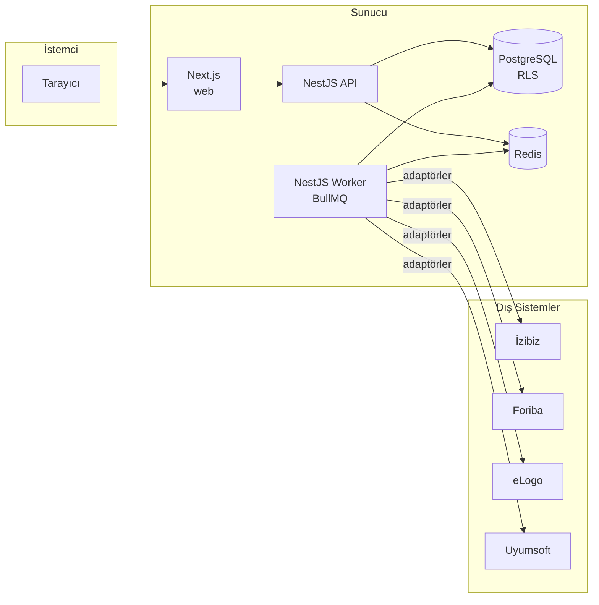

# TekirExtra — Mimari Tasarım Dokümanı

**Sürüm:** 0.3
**Tarih:** 2026-07-12
**Dayanak:** [ISTERLER.md](./ISTERLER.md) v0.4

---

## 1. Genel Bakış

TekirExtra, **modüler monolit** olarak tasarlanmış çok kiracılı bir SaaS
uygulamasıdır. İlk sürümde tek dağıtılabilir backend + ayrı işçi (worker)
süreci vardır; modül sınırları net tutulduğu için ileride e-belge katmanı
ayrı servise kopartılabilir (bkz. ISTERLER §8).



| Bileşen | Görev |
|---|---|
| **web** (Next.js) | Arayüz; API'ye HTTP ile konuşur, kendi başına veri tutmaz |
| **api** (NestJS) | Tüm iş kuralları, REST API, kimlik doğrulama, RBAC |
| **worker** (NestJS) | BullMQ kuyruklarını işler: e-belge gönderim, durum sorgulama, gelen belge çekme |
| **PostgreSQL** | Tek veritabanı; kiracı yalıtımı Row-Level Security ile |
| **Redis** | BullMQ kuyruk deposu + kısa ömürlü önbellek |
| **Metabase** | Gömülü analiz panoları (ayrı servis, salt-okunur DB erişimi — bkz. §10) |

**Neden modüler monolit?** Ekip küçük, alan (domain) henüz oturuyor;
mikroservis operasyon yükü v1.0'da gereksiz. Sınırlar NestJS modülleriyle
korunur; tek riskli yük olan e-belge trafiği zaten worker sürecine ayrıktır.

---

## 2. Depo Yapısı (Monorepo)

pnpm workspaces + Turborepo. Tek dil (TypeScript) kararının meyvesi burada
toplanır: DTO'lar ve hesaplama kuralları tek pakette yaşar, iki uç da onu kullanır.

```
TekirExtra/
├── apps/
│   ├── api/          # NestJS API + worker (aynı kod tabanı, iki giriş noktası)
│   └── web/          # Next.js arayüz
├── packages/
│   ├── shared/       # DTO'lar, zod şemaları, enum'lar, fatura hesaplama motoru
│   └── baglanti/     # Dış bağlantı adaptör aileleri:
│       ├── ebelge/      #   İzibiz, Foriba, eLogo, Uyumsoft (v1.0)
│       ├── pazaryeri/   #   Trendyol, Hepsiburada, N11, Amazon TR (v1.1+)
│       ├── pos/         #   iyzico, PayTR, banka sanal POS'ları (v1.1+)
│       └── banka/       #   hesap hareketi çekme + ödeme talimatı (v1.1+)
├── docs/
├── docker-compose.yml
└── turbo.json
```

**Fatura hesaplama motoru `packages/shared` içindedir:** satır/genel iskonto,
KDV, tevkifat ve kuruş yuvarlama kuralları saf fonksiyonlardır; frontend anlık
önizleme için, backend kesinleştirme için aynı kodu çalıştırır (FTR-04).
Uyuşmazlık ihtimali sıfırlanır.

---

## 3. Çok Kiracılık (Multi-Tenancy)

**Strateji: paylaşımlı veritabanı, paylaşımlı şema, `tenant_id` sütunu + PostgreSQL RLS.**

Firma-başına-şema ve firma-başına-veritabanı alternatifleri; binlerce KOBİ
hedefinde migrasyon ve bağlantı havuzu maliyeti nedeniyle elendi.

Yalıtım iki katmanda zorlanır (KLN-06):

1. **Uygulama katmanı:** JWT içindeki `tenant_id`, her istekte bir NestJS
   guard/interceptor ile bağlama (request context) yazılır; tüm sorgular bu
   bağlamdan geçer.
2. **Veritabanı katmanı (asıl güvence):** Kiracıya ait her tabloda RLS aktiftir:

```sql
ALTER TABLE faturalar ENABLE ROW LEVEL SECURITY;
CREATE POLICY tenant_isolation ON faturalar
  USING (tenant_id = current_setting('app.tenant_id')::uuid);
```

Uygulama, her transaction başında `SET LOCAL app.tenant_id = '<uuid>'` çalıştırır.
Uygulamanın DB kullanıcısı `BYPASSRLS` yetkisi **taşımaz**; kod hatası olsa bile
başka kiracının satırı dönmez (ISTERLER kabul ölçütü 6).

---

## 4. Backend Modül Yapısı (NestJS)

```
apps/api/src/
├── core/            # config, veritabanı, RLS bağlam yönetimi, audit interceptor,
│                    #   ayar altyapısı (§4.2), eylem kural motoru (§4.3)
├── auth/            # oturum, JWT, TOTP, parola politikası
├── tenant/          # firma kaydı (onboarding), sistem ayarları, kullanıcı/rol yönetimi,
│                    #   dış bağlantı yönetimi (§5)
├── cari/            # cari kartlar, hareketler, ekstre, yaşlandırma
├── stok/            # ürün/hizmet kartları, hareketler, sayım
├── fatura/          # taslak→kesin yaşam döngüsü, numaralandırma, PDF, iade/proforma
├── ebelge/          # e-belge kayıtları, durum makinesi, kuyruk üreticileri
├── kasa-banka/      # kasa/banka hesapları, tahsilat/tediye, virman, çek/senet
├── rapor/           # panel özetleri, KDV özeti, satış raporları, PDF/Excel dışa aktarım
└── worker/          # BullMQ işleyicileri (ayrı giriş noktası: main.worker.ts)
```

Modüller arası kural: bir modül diğerinin repository'sine değil, dışa açtığı
servisine bağımlıdır (ör. `fatura` → `stok.StokHareketService`). Bu, ileride
servis ayrıştırmayı mümkün kılan disiplindir.

### 4.2 Ayar Altyapısı (AYR-01/02/03)

İki ayrı ayar düzlemi vardır ve karışmaz:

- **Sistem ayarları** (`tenant` modülü): firma bilgileri, kullanıcı/roller,
  dış bağlantılar, güvenlik politikaları, mevzuat parametreleri. Yalnızca
  modüller-üstü ayarlar burada yaşar.
- **Modül ayarları**: her modül kendi ayar sayfasına sahiptir (fatura serileri,
  varsayılan KDV, cari vade, stok birimleri, varsayılan kasa...).

Ortak altyapı (`core/ayarlar`): her modül, ayarlarını **zod şeması** olarak
bildirir (`registerModulAyar('fatura', FaturaAyarSemasi, varsayilanlar)`).
Değerler tek tabloda saklanır — `modul_ayarlari (tenant_id, modul, ayarlar JSONB)` —
okuma/yazma/doğrulama/önbellekleme altyapıdan gelir. Frontend'de ayar sayfaları
aynı zod şemasından form üretir; yeni modül ayarı eklemek şemaya alan eklemekten
ibarettir (AYR-03).

### 4.3 Kayıt Eylem Kural Motoru (AYR-04..07)

Her varlık (fatura, cari, stok kartı, fiş...) için izinli eylemler
(`sil | duzenle | kopyala | iptal | pasife-al`) tek merkezden hesaplanır:

```typescript
// Her varlık bir eylem politikası bildirir:
registerEylemPolitikasi('fatura', {
  duzenle: (f, ctx) => f.durum === 'taslak' && ctx.rolYetkili('muhasebe'),
  sil:     (f, ctx) => f.durum === 'taslak' && ctx.rolYetkili('muhasebe'),
  iptal:   (f, ctx) => f.durum === 'kesin'  && ctx.rolYetkili('muhasebe'),
  kopyala: (f, ctx) => ctx.rolYetkili('satis'),   // kesin fatura da kopyalanır
});
```

- Kural girdileri: kaydın **durumu**, kullanıcının **rolü**, **bağlı kayıtlar**
  (ör. hareketi olan cari silinemez → pasife alınır).
- Liste/detay API yanıtları her kayıtla birlikte `izinliEylemler: [...]` alanı
  döner (AYR-06); frontend düğmeleri buna göre çizer.
- Asıl denetim sunucudadır: mutasyon uçları aynı politikayı guard olarak
  çalıştırır; arayüz atlatılsa bile kural delinmez.
- Kopyalama altyapısı geneldir: politika izin veriyorsa varlığın `kopyala()`
  dönüştürücüsü yeni taslak üretir (yeni numara/tarih, bağlantılar sıfırlanmış — AYR-07).

### 4.1 ORM Kararı: Prisma

TypeORM yerine **Prisma** seçildi: şema-önce yaklaşım, üstün tip üretimi ve
migrasyon deneyimi. RLS gereksinimi olan `SET LOCAL`, Prisma'nın interaktif
transaction'ları + client extension ile karşılanır (her tenant-scoped sorgu
`$transaction` içinde `SET LOCAL` sonrası koşar). Parasal alanlar `Decimal`
(NUMERIC) olarak eşlenir (NFR-10).

---

## 5. Dış Bağlantı ve Adaptör Mimarisi (EBLG-01, ENT-01)

Beş bağlantı ailesi aynı deseni paylaşır: **e-belge** (v1.0), **pazaryeri**,
**sanal POS**, **banka** ve **SMS** (v1.1+). Ortak model v1.0'da kurulur:

- Tek tablo: `baglantilar (tenant_id, aile, saglayici, sifreli_config, durum, ...)`
  — aile: `ebelge | pazaryeri | pos | banka | sms`. Firma her aileden bağımsız
  sağlayıcı(lar) seçer, erişim bilgilerini girer, bağlantıyı test eder.
  e-belge ailesinde firma başına tek aktif bağlantı; pazaryerinde birden çok
  bağlantı aynı anda aktif olabilir (Trendyol + Hepsiburada + ...).
- Her ailenin kendi adaptör arayüzü vardır; kimlik şifreleme, bağlantı testi,
  durum izleme ve log maskeleme altyapısı ortaktır.

### 5.1 e-Belge Adaptörü (v1.0)

`packages/baglanti/ebelge` çekirdek arayüzü tanımlar; her sağlayıcı bir implementasyondur:

```typescript
export interface EntegratorAdapter {
  readonly saglayici: 'izibiz' | 'foriba' | 'elogo' | 'uyumsoft';

  baglantiTest(cfg: EntegratorConfig): Promise<BaglantiSonuc>;
  mukellefSorgula(cfg: EntegratorConfig, vknTckn: string): Promise<MukellefDurum>;
  belgeGonder(cfg: EntegratorConfig, belge: UblBelge): Promise<GonderimSonuc>;
  durumSorgula(cfg: EntegratorConfig, belgeRef: string): Promise<BelgeDurum>;
  gelenBelgeleriCek(cfg: EntegratorConfig, sonrasi: Date): Promise<GelenBelge[]>;
  yanitGonder(cfg: EntegratorConfig, belgeRef: string, yanit: 'kabul' | 'ret',
              gerekce?: string): Promise<GonderimSonuc>;
}
```

- **UBL-TR üretimi adaptörün dışındadır:** `ebelge` modülü faturadan UBL-TR 1.2
  XML'ini tek bir yerde üretir (EBLG-03); adaptör yalnızca taşıma/zarf/kimlik
  farklarını kapatır. Format hatası dört sağlayıcıda birden değil tek yerde düzelir.
- **Çözümleme:** `BaglantiRegistry`, firmanın `baglantilar` kaydındaki
  aile + sağlayıcı adına göre adaptörü döndürür (basit strategy/factory).
- **Kimlik bilgileri:** AES-256-GCM ile şifrelenip saklanır (EBLG-01b);
  ana anahtar ortam değişkeni/secret yöneticisinden gelir, loglarda maskeleme
  interceptor'ü ile korunur.
- Sağlayıcıların durum kodları, ortak `BelgeDurum` enum'ına adaptör içinde
  normalize edilir (`kuyrukta | iletildi | kabul | ret | hata`) — EBLG-04.

### 5.2 Gelecek Aileler (v1.1+, mimaride hazır)

| Aile | Arayüz özeti | Not |
|---|---|---|
| `pazaryeri` | `siparisleriCek`, `stokFiyatGonder`, `komisyonKayitlariCek` | Sipariş → toplu faturalaştırma `fatura` modülü üzerinden; sağlayıcılar: Trendyol, Hepsiburada, N11, Amazon TR (ENT-02/03/08) |
| `pos` | `tahsilatBaslat`, `odemeLinkiOlustur`, `durumSorgula`, `iadeEt` | iyzico Checkout Form ile PayTR Link API (HMAC doğrulamalı callback) adaptörleri ve ileride doğrudan banka sanal POS'ları aynı arayüzde. Tahsilat önce ayrı POS hesabına ve cariye, sağlayıcı ödemesi ise POS → banka virmanı olarak işlenir; brüt/net/komisyon ayrımı korunur (ENT-04/05). Kart verisi TekirExtra'ya **asla girmez** — yönlendirme/iframe ile sağlayıcıda kalır (PCI-DSS kapsamı dışında kalma ilkesi) |
| `banka` | `hareketleriAl`, `odemeTalimatiGonder` | Vomsis adaptörü App Key/Secret ile token alır, eşlenen hesapları `lastId` imleciyle artımlı çeker. Alternatif sağlayıcılar Bearer anahtarlı webhook kullanabilir. Hareketler idempotent biçimde ekstre kutusuna düşer; eşleştirme motoru öneri üretir, kullanıcı onaylar (ENT-06). Ödeme talimatı çift onay + zorunlu TOTP ile korunur (ENT-07) |
| `sms` | `smsGonder` | Netgsm REST API ile ödeme bağlantısı gönderilir; sağlayıcı görev kimliği, gönderim zamanı ve hata ayrı izlenir. API alt kullanıcısı ve onaylı gönderici başlığı şifreli bağlantı yapılandırmasında tutulur (ENT-05). |

Banka ödeme talimatı para çıkışından ayrı bir güvenlik durum makinesidir:
`onay_bekliyor → onaylandi → gonderildi | basarisiz`. Talimatı oluşturan kullanıcı
onaylayamaz; ikinci kullanıcı onay anında kendi TOTP kodunu yeniden doğrular.
Sağlayıcıdan başarı alınmadan banka/muhasebe hareketi üretilmez (ENT-07).

Bu ailelerin veri modeli yer tutucuları (§7) ve kuyruk isim alanları (§6)
v1.0 şemasında ayrılmıştır; adaptör kodu v1.1'de yazılır.

---

## 6. Asenkron İşleme (BullMQ)

| Kuyruk | Tetikleyici | İş |
|---|---|---|
| `ebelge.gonder` | Fatura kesinleşince | Mükellef sorgula → e-Fatura/e-Arşiv yönlendir (EBLG-02) → UBL üret → adaptörle gönder |
| `ebelge.durum` | Zamanlanmış (5 dk) | "kuyrukta/iletildi" belgelerin durumunu sorgula, değişince kaydet |
| `ebelge.gelen` | Zamanlanmış (15 dk) | Firma başına gelen e-Faturaları çek, onay kuyruğuna düşür (EBLG-05) |
| `rapor.disa-aktar` | Kullanıcı isteği | Büyük PDF/Excel üretimini arka planda yap, hazır olunca bildir |

v1.1+ için ayrılan kuyruk isim alanları: `pazaryeri.siparis`, `pazaryeri.stok-fiyat`,
`pos.tahsilat`, `banka.hareket`, `banka.talimat`.

- Yeniden deneme: üstel geri çekilme ile 5 deneme; tükenirse belge `hata`
  durumuna düşer ve kullanıcı arayüzünden düzeltilip yeniden kuyruklanır (EBLG-08).
- Her iş `tenant_id` taşır; worker da işi RLS bağlamı kurarak işler.
- Zamanlanmış işler firma bazında yayılır (fan-out) — tek firmanın hatası
  diğerlerini bloklamaz.

---

## 7. Veri Modeli (Ana Tablolar)

Tüm kiracıya ait tablolarda: `id UUID PK`, `tenant_id UUID` (RLS), `created_at`,
`updated_at`, `created_by`. Parasal alanlar `NUMERIC(15,2)`, birim fiyat
`NUMERIC(15,4)`, miktar `NUMERIC(15,3)`.

| Tablo | Not |
|---|---|
| `tenants` | Firma: unvan, VKN, vergi dairesi, logo; abonelik alanlarına genişlemeye açık (KLN-08) |
| `users`, `user_roles` | KLN-01/02; roller: yonetici, muhasebe, satis, salt_okunur |
| `baglantilar` | Dış bağlantılar: aile (ebelge/pazaryeri/pos/banka) + sağlayıcı + şifreli kimlik bilgileri (ENT-01); e-belgede firma başına tek aktif, pazaryerinde çoklu |
| `modul_ayarlari` | Modül başına JSONB ayarlar; zod şemasıyla doğrulanır (AYR-01/03) |
| `cari_hesaplar` | Tip: musteri/tedarikci/her_ikisi; döviz cinsi; e-fatura mükellefiyet önbelleği |
| `cari_hareketler` | Borç/alacak; kaynak belgeye (fatura/fiş) referans — bakiye her zaman hareketlerden türetilir |
| `stok_kartlari` | Ürün/hizmet ayrımı; KDV oranı parametrik (V-02) |
| `stok_hareketleri` | Giriş/çıkış/iade/sayım-düzeltme; ağırlıklı ortalama maliyet alanları (STK-08) |
| `faturalar` | Durum makinesi: `taslak → kesin → iptal`; tip: satis/alis/satis_iade/alis_iade/proforma |
| `fatura_satirlari` | Kalem, miktar, birim fiyat, iskonto, KDV; tutarlar kesinleşmede dondurulur |
| `fatura_serileri` | Firma+seri başına kesintisiz sayaç; `SELECT ... FOR UPDATE` ile atomik artış (FTR-06) |
| `ebelge_kayitlari` | Faturaya 1-1; tür (efatura/earsiv), durum, entegratör referansı, hata mesajı |
| `ebelge_arsiv` | Gönderilen/alınan XML + PDF; 10 yıl saklama (EBLG-09), soğuk depoya taşınabilir yapı |
| `kasalar`, `banka_hesaplari` | Çoklu, dövizli (KSB-01) |
| `kasa_banka_hareketleri` | Kasa, banka ve POS hesabı tahsilat/tediye/virmanları; cari hareketle eşleşir (KSB-02, KSB-07, ENT-04) |
| `cek_senetler` | Portföy/ciro/tahsil/karşılıksız durum makinesi (KSB-05) |
| `audit_log` | KLN-04; RLS'li ama uygulamadan salt-ekleme (append-only) |
| `auth_kimlikler` | e-posta → (tenant, user) rehberi; **bilinçli olarak RLS'siz** — oturum açarken kiracı bağlamı henüz yoktur. Parola içermez, e-posta sistem genelinde tekildir |
| `oturumlar` | Refresh token'lar (hash); RLS'siz — token yenileme ön-kimlik aşamasında yapılır |
| `eposta_dogrulamalar` | Kayıt doğrulama token'ları (hash, süreli — KLN-09); RLS'siz, aynı gerekçe |

v1.1+ entegrasyon aileleri için tablolar (`pazaryeri_siparisleri`,
`pos_tahsilatlari`, `banka_hareket_havuzu`, `odeme_talimatlari`) v1.0'da
**oluşturulmaz**; ancak `baglantilar`, `kasa_banka_hareketleri` ve `faturalar`
bu kayıtlara referans alabilecek şekilde (kaynak türü + kaynak ref alanı)
tasarlanır.

**Değişmezlik kuralı (NFR-08):** `kesin` durumundaki fatura ve işlenmiş
kasa/banka fişlerinde `UPDATE/DELETE` veritabanı trigger'ı ile reddedilir;
düzeltme yalnızca iptal/iade/ters kayıtla yapılır.

---

## 8. API Tasarımı

- REST, `/api/v1/...` ön ekli; OpenAPI şeması NestJS dekoratörlerinden üretilir.
- Kimlik: kısa ömürlü JWT access token (15 dk) + httpOnly refresh token.
  JWT taşır: `user_id`, `tenant_id`, `roles`. TOTP (KLN-05) girişte ikinci adım.
- Yetki: rol bazlı guard'lar endpoint seviyesinde (`@Roller('muhasebe')`);
  arayüz gizlese de asıl kapı API'dedir (KLN-02).
- Doğrulama: zod şemaları `packages/shared`'dan gelir; aynı şema frontend
  formunda da çalışır.
- Sayfalama: cursor tabanlı (100k+ fatura hedefi, NFR-03); liste uçları
  filtre + sıralama parametreleri alır.

---

## 9. Frontend Mimarisi (Next.js)

- **App Router**, oturumlu sayfalar CSR ağırlıklı; SSR yalnızca ilk yük ve
  yetki yönlendirmesi için.
- **Veri katmanı:** TanStack Query (önbellek, optimistic update, arka plan
  yenileme — e-belge durum rozetleri için polling).
- **Formlar:** react-hook-form + zod (paylaşılan şemalar). Fatura kalem
  ızgarası klavye-öncelikli tasarlanır (NFR-13: 1 dakikada fatura).
- **Tablolar:** TanStack Table — sanallaştırma ile büyük listeler.
- **UI kiti:** shadcn/ui + Tailwind; bileşenler kopyalanıp sahiplenildiği için
  uzun vadede bağımlılık riski düşük. Türkçe yerelleştirme i18n altyapısıyla (NFR-11).
- Rol bazlı menü/route koruması; API'nin 403'ü her durumda son sözü söyler.

---

## 10. Gömülü Analitik Katmanı (Metabase — RPR-07)

Metabase (AGPL-3.0; Clojure/TypeScript), **ayrı bir Docker servisi** olarak
çalışır — TekirExtra koduyla derlenmez, ağ üzerinden konuşur; bu sayede AGPL
yükümlülüğü TekirExtra koduna **bulaşmaz** (yalnızca Metabase'in kendisinde
değişiklik yapılırsa o değişikliklerin kaynağı açılır; hedefimiz değişiklik
yapmadan kullanmaktır).

```
[TekirExtra web] --imzalı embed URL (iframe)--> [Metabase] --salt-okunur--> [PostgreSQL]
```

- **Veri erişimi:** Metabase, ana veritabanına özel bir **salt-okunur DB
  kullanıcısı** ile bağlanır; bu kullanıcının yalnızca raporlama görünümlerine
  (view) erişimi vardır, `BYPASSRLS` yetkisi yoktur. Yük büyüyünce okuma
  replikasına yönlendirilebilir.
- **Kiracı yalıtımı:** Statik (guest) gömme kullanılır — OSS planda ücretsizdir.
  Gömme URL'si backend'de **imzalı JWT** ile üretilir ve `tenant_id` **kilitli
  parametre** olarak gömülür: kullanıcı parametreyi değiştiremez, pano yalnızca
  kendi firmasının verisini gösterir. İmza anahtarı yalnızca API'de durur.
- **İş bölümü:** Operasyonel/mali belgeler (ekstre, KDV özeti, resmi çıktılar)
  **yerli rapor araç setinde** (RPR-06) kalır — biçim ve mevzuat hassasiyeti
  yüksektir. Metabase; trend/analiz panoları (satış trendi, nakit akış, cari
  risk, stok analizi) için kullanılır.
- **Kısıtlar (OSS plan):** Gelişmiş white-label (logo/tema tam özelleştirme) ve
  interaktif drill-through gömme **Pro/Enterprise** lisansı ister. v1'de statik
  panolarla başlanır; talep doğarsa lisans değerlendirilir (ISTERLER A-05).
- **Dağıtım:** `docker-compose`'a `metabase` + kendi meta-veritabanı eklenir;
  hazır panolar sürümlenebilir şekilde (Metabase serialization/API) tutulur.

## 11. Güvenlik Özeti

| Konu | Karar |
|---|---|
| Parola | argon2id; politika: min 10 karakter (KLN-01) |
| Kiracı yalıtımı | RLS (bkz. §3) + JWT `tenant_id`; `BYPASSRLS` yok |
| Kimlik bilgisi saklama | Entegratör bilgileri AES-256-GCM; anahtar secret yöneticisinde (EBLG-01b) |
| Taşıma | Her yerde TLS; HSTS (NFR-04) |
| OWASP | zod ile girdi doğrulama, Prisma parametrik sorgu, CSRF (SameSite + token), CSP başlıkları (NFR-07) |
| Denetim izi | Global audit interceptor: kim/ne zaman/ne — mutasyon uçlarında otomatik (KLN-04) |
| KVKK | Cari kişisel verileri için anonimleştirme prosedürü; veri envanteri dokümante edilir (NFR-05) |

---

## 12. Dağıtım ve İşletim

- **docker-compose.yml** altı servis: `web`, `api`, `worker`, `postgres`, `redis`, `metabase` (NFR-14).
- Migrasyonlar dağıtımda otomatik (`prisma migrate deploy`); geri dönüş
  prosedürü yedekle birlikte belgelenir (NFR-09).
- Loglama: yapılandırılmış JSON (pino); e-belge trafiği ayrı log akışında,
  kimlik bilgileri maskeli (NFR-16).
- Sağlık uçları: `/health` (api, worker); kuyruk derinliği metriği dışa açılır.
- Yedekleme: günlük `pg_dump` + WAL arşivi; `ebelge_arsiv` nesne depolamaya
  (S3 uyumlu) taşınabilir tasarlanır.

---

## 13. Geliştirme Sırası Önerisi

> **Süreç kuralı (ISTERLER S-01):** Aşağıdaki her modül aşamasına başlanmadan
> önce ilgili ister bölümü ürün sahibiyle gözden geçirilir ve onaylanır;
> değişen kararlar önce dokümana işlenir.

1. **İskelet:** monorepo, Docker Compose, CI, Prisma şema çekirdeği, RLS altyapısı
2. **Kimlik + kiracı + çekirdek altyapılar:** kayıt (onboarding), oturum, roller,
   audit, ayar altyapısı (§4.2), eylem kural motoru (§4.3), ortak bağlantı modeli (§5)
3. **Cari + stok:** kartlar, hareketler, ekstre
4. **Fatura:** hesaplama motoru (shared), taslak→kesin akışı, numaralandırma, PDF
5. **Kasa/banka:** fişler, virman, fatura kapama
6. **e-Belge:** UBL-TR üretici, adaptör arayüzü + sahte (mock) adaptör, kuyruklar;
   ardından İzibiz → diğer üç adaptör
7. **Raporlar + panel:** ortak rapor araç seti (RPR-06), modül rapor sekmeleri,
   Metabase kurulumu + hazır panolar (§10), kabul senaryolarının uçtan uca testleri

Her aşama, ISTERLER §6'daki kabul senaryolarına doğru ilerleyen dikey dilimler
halinde planlanmalıdır (arayüzüyle birlikte biten modül).

---

## 14. Açık Teknik Konular

| No | Konu | Not |
|---|---|---|
| T-01 | Entegratör API'lerinin gerçek sözleşme detayları | Her sağlayıcıdan geliştirici hesabı + dokümantasyon edinilmeli; adaptörler mock ile başlar |
| T-02 | PDF üretim kütüphanesi | **Karar (2026-07-13, 4. aşama S-01):** Playwright/Chromium tabanlı HTML→PDF (fatura şablonu = HTML). Dosya ekleri depolaması MinIO (S3 uyumlu) |
| T-03 | Excel dışa aktarım | Aday: exceljs |
| T-04 | e-Arşiv günlük raporlama sorumluluğu | Entegratörlerin hangileri otomatik yapıyor doğrulanmalı (EBLG-07) |
