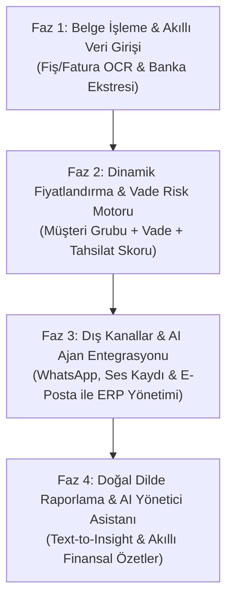
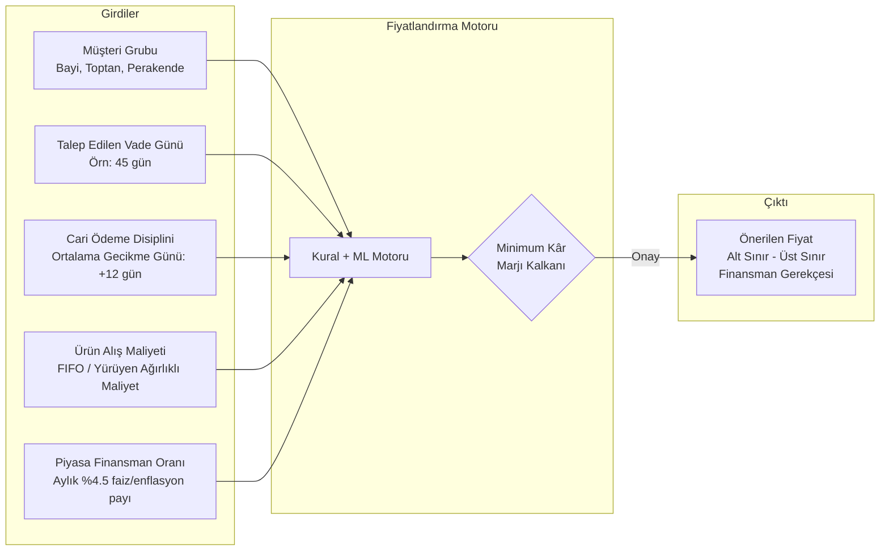

# TekirExtra — Yapay Zeka (AI) Entegrasyon ve Yol Haritası Planı

**Tarih:** 11 Ekim 2026  
**Sürüm:** 1.0  
**Hedef Kitle:** Yazılım Geliştirme Ekibi, Sistem Mimarları, Ürün Yöneticisi  
**Dayanak Belgeler:** [docs/ISTERLER.md](file:///home/mustafat/Desktop/TekirExtra/docs/ISTERLER.md), [docs/MIMARI.md](file:///home/mustafat/Desktop/TekirExtra/docs/MIMARI.md)

---

## 🎯 1. Yönetici Özeti ve Vizyon

TekirExtra, çok kiracılı (multi-tenant) ve regülasyona tam uyumlu bir ön muhasebe ve ERP platformudur. Bu planın amacı; TekirExtra platformuna yapay zeka yeteneklerini entegre ederek:

1. **Operasyonel Veri Giriş Yükünü Azaltmak:** Fiş/fatura tarama (OCR/Vision) ve ekstre ayrıştırma ile veri giriş hızını %80 artırmak.
2. **Dış Kanallardan Uzaktan ERP Yönetimi (Conversational AI):** WhatsApp, E-posta ve Sesli mesajlar aracılığıyla uzaktan güvenli taslak teklif/fatura ve görev oluşturabilmek.
3. **Akıllı Fiyatlandırma & Kârlılık Koruması:** Müşteri grubu, ödeme disiplini geçmişi ve istenen vadeye göre kârlılığı maksimize eden dinamik fiyat tahmin motorunu devreye almak.
4. **Doğal Dille Raporlama & Finansal Asistanlık:** KOBİ yöneticilerinin doğal dilde sorduğu sorulara (Text-to-SQL/Report) anlık doğru yanıtlar sunmak.

> [!IMPORTANT]
> **Kritik Mimari İlkeler:**
> - **RLS (Row-Level Security) İzolasyonu:** Hiçbir AI modeli veya harici entegrasyon doğrudan kontrolsüz DB erişimi yapamaz; tüm işlemler `tenant_id` bağlamı ve PostgreSQL RLS politikaları altında gerçekleşir.
> - **Human-in-the-Loop (İnsan Onayı):** AI hiçbir zaman finansal kayıtları doğrudan "kesinleştirilmiş" veya GİB'e gönderilmiş olarak kaydetmez. Her işlem **TASLAK (DRAFT)** olarak üretilir ve kullanıcı onayına sunulur.
> - **Deterministik Güvenlik Kalkanı:** Fiyatlama ve vergi hesaplamalarında LLM tek başına yetkili değildir; `packages/shared` hesaplama kuralları ve minimum kâr marjı kuralları kalkan olarak çalışır.

---

## 🗺️ 2. Fazlandırma ve Yol Haritası Genel Bakışı



| Faz | Odak Alanı | Durum | Risk / Zorluk | Beklenen Etki |
|---|---|---|---|---|
| **Faz 1** | Fiş/Fatura OCR & Banka Ekstre Ayrıştırma | ✅ **Tamamlandı** | Düşük / Orta | 🚀 Anında kullanıcı memnuniyeti, zamandan tasarruf |
| **Faz 2** | Müşteri Grubu & Vade Bazlı Fiyat Tahminleme | ✅ **Tamamlandı** | Orta | 💰 Şirket kârlılığını artırma, vade maliyeti zararlarını önleme |
| **Faz 3** | WhatsApp & E-posta Destekli Conversational AI Ajanı | ✅ **Tamamlandı** | Orta / Yüksek | 🌟 Sahada mobil çalışan satışçı ve KOBİ patronu için devrim |
| **Faz 4** | Doğal Dille Raporlama & Analitik Asistan | ⏳ **Sırada** | Orta | 📊 Patron raporlama ihtiyacını anlık karşılama |

---

## 📌 3. Faz Detayları ve Teknik Tasarımlar

---

### FAZ 1: Belge İşleme ve Akıllı Veri Girişi (Görsel/PDF OCR & Banka Ekstreleri)

#### 1.1 Amaç ve Kapsam
Mevcut durumda taslak olarak bırakılan [`apps/api/src/ai/ai.service.ts`](file:///home/mustafat/Desktop/TekirExtra/apps/api/src/ai/ai.service.ts) modülünün gerçek bir multimodal LLM (Gemini 2.5 Flash / Claude 3.5 Sonnet Vision veya OpenAI GPT-4o-mini) ile canlandırılması.

#### 1.2 Teknik Mimari & Akış
1. **Fiş / Fatura Yükleme:**
   - Web arayüzünden veya mobilden fiş fotoğrafı veya PDF faturası yüklenir.
   - Dosya S3/yerel depolamaya alınır, `POST /ai/ocr/tara` çağrılır.
2. **Yapılandırılmış Veri Çıkarımı (Structured JSON):**
   - Vision API'ye Zod şeması zorlamasıyla prompt iletilir:
     - Belge Türü (`FIS`, `FATURA`, `E_ARSIV`)
     - Belge Tarihi (`YYYY-MM-DD`)
     - Satıcı Ünvanı ve VKN/TCKN
     - Fiş / Fatura No
     - KDV Matrah Ayrımı (%1, %10, %20 matrah ve KDV tutarları)
     - Toplam Tutar
     - Kalem Detayları (Açıklama, Miktar, Birim Fiyat)
3. **Cari & Masraf Kalemi Eşleme:**
   - VKN/TCKN'den sistemde kayıtlı cari hesap aranır; yoksa otomatik yeni cari taslağı önerilir.
   - Harcama türüne göre uygun `masrafKategorisiId` eşleştirilir.
4. **Kullanıcı Onayı:**
   - Kullanıcı ekranda yan yana görsel ve okunan veriyi görür; tek tıkla **"Masraf Kaydına Dönüştür"** veya **"Alış Faturasına Dönüştür"** butonuna basar.

#### 1.3 Veri Modeli ve API Uçları
- `POST /ai/ocr/tara` -> `{ dosyaId: string, belgeTuru: "masraf" | "fatura" }`
- `POST /ai/ekstre/ayristir` -> `{ dosyaId: string, bankaKodu: string }`

---

### FAZ 2: Müşteri Grubu ve Vade Bazlı Dinamik Fiyat Tahminleme

#### 2.1 Amaç ve Kapsam
Satış temsilcisi teklif, sipariş veya fatura hazırlarken; müşterinin ait olduğu gruba (bayi, perakende vb.), talep ettiği vadeye (peşin, 30g, 60g, 90g) ve müşterinin geçmiş ödeme disiplinine göre en uygun, kârlı ve risk-arındırılmış fiyatı otomatik hesaplamak.

#### 2.2 Matematiksel ve Karar Modeli (Hibrit Yapı)



1. **Efektif Vade Günü Hesabı:**
   $$\text{Efektif Vade} = \text{Talep Edilen Vade} + \max(0, \text{Cari.gecikmeGun})$$
2. **Vade Finansman Maliyeti:**
   $$\text{Finansman Çarpanı} = 1 + \left( \frac{\text{Aylık Finansman Oranı}}{30} \times \text{Efektif Vade} \right)$$
3. **Müşteri Grubu Bazlı İskonto:**
   Müşteri grubuna tanımlı taban katsayı (örn: Bayi = 0.85, Toptan = 0.90, Perakende = 1.00).
4. **Güvenlik Duvarı (Stop-Loss Kalkanı):**
   Önerilen fiyat hiçbir durumda $\text{FIFO Maliyeti} \times (1 + \text{Asgari Marj})$ değerinin altına inemez.

#### 2.3 TekirExtra Entegrasyonu
- [`apps/api/src/stok/stok.controller.ts`](file:///home/mustafat/Desktop/TekirExtra/apps/api/src/stok/stok.controller.ts) altındaki `GET /stok/:id/tavsiye-fiyat` ucuna `vadeGun`, `miktar`, `odemeTuru` query parametreleri eklenir.
- [`nakit-akisi.hesap.ts`](file:///home/mustafat/Desktop/TekirExtra/apps/api/src/nakit-akisi/nakit-akisi.hesap.ts) içerisindeki `CariTahsilatProfili` verileri (ağırlıklı ortalama gecikme günü) fiyatlama servisine enjekte edilir.
- Teklif/Fatura UI ekranında fiyat giriş kutusunun yanına **"✨ AI Fiyat Önerisi ve Gerekçesi"** modalı eklenir.

---

### FAZ 3: Dış Kanallar ve AI Ajan Entegrasyonu (WhatsApp, E-posta, Sesli Mesaj)

#### 3.1 Amaç ve Kapsam
Kullanıcıların sahada, yoldayken veya ofis dışındayken WhatsApp, E-posta ve Sesli Mesajlar ile TekirExtra ile konuşarak işlem yapabilmesini sağlamak.

#### 3.2 Güvenlik ve Kimlik Doğrulama Mimarisi (Multi-Tenant Güvenliği)
1. **Numara/E-posta Eşleme:** WhatsApp mesajı geldiğinde gelen telefon numarası `users.telefon` ile sorgulanır.
2. **Kullanıcı & Kiracı Tespiti:** Kullanıcının aktif `tenant_id`'si ve rolü (muhasebe, satis, yonetici) belirlenir.
3. **Oturum / PIN Doğrulama:**
   - Kritik işlemler için ilk etkileşimde kullanıcıya 4 haneli PIN sorulur veya SMS/OTP gönderilir.
   - Oturum 12 saat boyunca geçerli kalır.

#### 3.3 Ajanın Kullanacağı Araçlar (Tools / Function Calling)
NestJS tarafında tanımlanacak izole araç seti:

| Araç Adı | Açıklama | AI Yetkisi |
|---|---|---|
| `bakiyeSorgula(cariAdi)` | Bir carinin güncel borç/alacak bakiyesini getirir. | Otomatik Yanıtlar |
| `stokSorgula(urunAdi)` | Depolardaki mevcut stok adedini ve liste fiyatını söyler. | Otomatik Yanıtlar |
| `teklifTaslagiHazirla(cari, kalemler, vade)` | Müşteriye özel taslak teklif kaydı açar. | **Taslak Oluşturur + Onay Linki Döner** |
| `faturaTaslagiHazirla(cari, kalemler)` | Alış/satış faturası taslağı oluşturur. | **Taslak Oluşturur + Onay Linki Döner** |
| `belgeGonder(belgeTuru, belgeId, kanal, alici)` | Onaylanan teklif/faturayı PDF ekli olarak WhatsApp veya E-posta ile ilgili kişiye iletir. | **Onay Sonrası Dağıtım / Bildirim** |
| `cariEkstreGonder(cariId, kanal, alici)` | Carinin güncel hesap ekstresini (PDF/Excel) ilgili yetkiliye gönderir. | **Kullanıcı Talimatı ile Gönderim** |
| `odemeHatirlatmasiYap(faturaId, kanal)` | Vadesi yaklaşan/geciken faturanın ödeme hatırlatmasını cariye iletir. | **Talimat ile İletişim** |
| `crmGorevOlustur(baslik, cari, atanan)` | CRM modülünde görev açar ve personele atar. | Görev Oluşturur |

#### 3.4 Örnek Etkileşim Akışları

**Akış 1: WhatsApp Sesli Mesaj ile Teklif Hazırlama ve Onay**
1. Kullanıcı ses kaydı gönderir: *"Yılmaz Ticarete 50 koli a4 kağıt için 60 gün vadeli teklif açalım, birim fiyatı 120 TL olsun."*
2. Whisper API / Gemini Audio sesi metne çevirir.
3. LLM niyeti çıkarır -> `teklifTaslagiHazirla(cari: "Yılmaz Ticaret", urun: "a4 kağıt", miktar: 50, fiyat: 120, vade: 60)`.
4. Sistem `Cari` ve `Stok` eşleşmesini yapar, KDV hesaplar.
5. Veritabanına `DRAFT` statüsünde teklif kaydedilir.
6. WhatsApp'a yanıt döner:  
   *"✅ Yılmaz Ticaret A.Ş. için 50 Adet A4 Kağıt (120 TL + KDV) teklifi TASLAK olarak hazırlandı. Toplam: 7.200 TL.  
   👉 [Teklifi İncele ve Onayla (Bağlantı)] veya 'ONAYLA' yazabilirsiniz."*

**Akış 2: Onaylanan Belgenin Müşteriye Gönderilmesi & Dağıtımı**
1. Kullanıcı yanıtlar: *"Teklifi onayla ve müşterinin muhasebe yetkilisi Ahmet Bey'e e-posta ile, WhatsApp'tan da özetini at."*
2. Ajan eylemleri sıraya koyar:
   - Teklif durumu `ONAYLANDI` yapılır ve PDF motoru (`faturaPdfHtml`) ile profesyonel PDF üretilir.
   - Carinin yetkili kişileri (`cari_kisiler`) listesinden "Ahmet Bey" ve kayıtlı e-postası / telefonu bulunur.
   - `belgeGonder` aracı tetiklenir: E-posta ekine PDF eklenerek gönderilir (`epostaGonderim` tablosuna loglanır).
   - WhatsApp üzerinden müşteriye şık bir özet mesaj iletilir: *"Sayın Ahmet Bey, Yılmaz Ticaret için hazırlanan TEK-2026-0042 nolu teklifimiz e-postanıza iletilmiştir. PDF bağlantısı: ... "*
3. Kullanıcıya rapor verilir: *"✅ TEK-2026-0042 onaylandı, PDF Ahmet Bey'e (ahmet@yilmaz.com) e-posta ile ve 0532... numarasına WhatsApp'tan başarıyla iletildi."*

**Akış 3: Gelen E-postadan CRM Görevi ve Talep Oluşturma**
1. `destek@sirket.com` adresine müşteriden gelen e-posta Postmark/SendGrid Inbound Webhook ile TekirExtra'ya iletilir.
2. AI e-posta konusunu ve içeriğini sınıflandırır:
   - Aciliyet: Yüksek
   - Tür: Ürün Arızası / İade Talebi
   - İlgili Cari: ABC İnşaat (gönderen e-postadan tespit edildi)
3. TekirExtra CRM'de görev açılır ve teknik destek sorumlusuna bildirim gönderilir.

**Akış 4: Diğer Operasyonel Talimatlar (Ekstre, Hatırlatma, Sevkiyat Bilgisi)**
- *Kullanıcı:* *"Kaya Ltd'ye son 6 aylık cari ekstresini PDF olarak e-posta at."*  
  -> Ajan [`cari-ekstre-pdf.ts`](file:///home/mustafat/Desktop/TekirExtra/apps/api/src/cari/cari-ekstre-pdf.ts) motorunu çalıştırır, carinin muhasebe e-postasına ekstre gönderir ve kullanıcıya teyit verir.
- *Kullanıcı:* *"Gecikmiş faturası olan tüm müşterilere nazik bir ödeme hatırlatması SMS/WhatsApp taslağı hazırla."*  
  -> Ajan gecikmiş faturaları listeler, mesaj taslaklarını hazırlar ve patronun tek onayıyla (`ONAYLA`) ilgili kişilere toplu gönderir.

---

### FAZ 4: Doğal Dille Raporlama & Finansal Asistanlık (Text-to-SQL / ChatBI)

#### 4.1 Amaç ve Kapsam
KOBİ patronlarının ve mali işler ekiplerinin rapor ekranlarında karmaşık filtrelerle uğraşmadan; sohbet penceresinden şirketin finansal durumunu sorgulayabilmesi.

#### 4.2 Güvenlik ve RLS Mimarisi (SQL Injection & Tenant Sızıntısı Koruması)
> [!CAUTION]
> LLM tarafından üretilen ham SQL sorguları **asla doğrudan DB üzerinde çalıştırılamaz!**

1. **Semantic Layer (Semantik Katman):** LLM'e tüm DB şeması verilmez; yalnızca izinli DTO'lar, View'lar veya Prisma sorgu şablonları araç olarak sunulur.
2. **Zorunlu Parametrik Sorgular:** Her sorguya `WHERE tenant_id = :aktifTenant` koşulu kod seviyesinde zorunlu olarak eklenir.
3. **Read-Only Veritabanı Kullanıcısı:** Sorgular yalnızca `SELECT` yetkisi olan ve RLS uygulayan PostgreSQL kullanıcısı üzerinden koşturulur.

#### 4.3 Otomatik Yönetici Brifingi (Haftalık/Aylık AI CFO Bülteni)
- Her Pazartesi sabahı veya ayın 1'inde yöneticinin paneline ve e-postasına özet kart düşer:
  - *"Bu hafta vadesi dolan 145.000 TL alacağınız var; en yüksek riskli alacak 40.000 TL ile X firmasındadır."*
  - *"Geçen aya göre cironuz %14 arttı, ancak kârlılığınız nakliye maliyetlerindeki %28 artış sebebiyle %3 geriledi."*

---

## 🛠️ 4. Veritabanı Modelleri ve Prisma Taslağı

Bu mimariyi desteklemek için TekirExtra veritabanına eklenecek yeni modeller:

```prisma
// 1. Dış Kanallar ve İletişim Oturumu
model AjanOturumu {
  id            String    @id @default(uuid())
  tenantId      String    @map("tenant_id")
  userId        String    @map("user_id")
  kanal         String    // "WHATSAPP", "TELEGRAM", "EMAIL"
  kanalKimlik   String    @map("kanal_kimlik") // Telefon no veya e-posta
  pinKodu       String?   @map("pin_kodu")
  pinDogrulandi Boolean   @default(false) @map("pin_dogrulandi")
  sonEtkilesim  DateTime  @default(now()) @map("son_etkilesim")
  created_at    DateTime  @default(now())

  tenant        Tenant    @relation(fields: [tenantId], references: [id], onDelete: Cascade)
  user          User      @relation(fields: [userId], references: [id], onDelete: Cascade)

  mesajlar      AjanMesajGecmisi[]

  @@unique([tenantId, kanal, kanalKimlik])
  @@map("ajan_oturumlari")
}

model AjanMesajGecmisi {
  id          String      @id @default(uuid())
  oturumId    String      @map("oturum_id")
  rol         String      // "user", "assistant", "system", "tool"
  icerik      String
  aracCagrisi Json?       @map("arac_cagrisi")
  created_at  DateTime    @default(now())

  oturum      AjanOturumu @relation(fields: [oturumId], references: [id], onDelete: Cascade)

  @@map("ajan_mesaj_gecmisi")
}

// 2. OCR ve Taranan Belgeler
model BelgeOcrKaydi {
  id            String    @id @default(uuid())
  tenantId      String    @map("tenant_id")
  dosyaYolu     String    @map("dosya_yolu")
  belgeTuru     String    // "FIS", "FATURA", "EKSTRE"
  hamMetin      String?   @map("ham_metin") @db.Text
  cikarilanVeri Json      @map("cikarilan_veri") // Zod çıktısı JSON
  durum         String    @default("BEKLIYOR") // "BEKLIYOR", "ISLENDI", "REDDEDILDI"
  kaynakKayitId String?   @map("kaynak_kayit_id") // MasrafId veya FaturaId
  created_at    DateTime  @default(now())

  @@map("belge_ocr_kayitlari")
}

// 3. AI Fiyatlandırma ve Risk Geçmişi
model FiyatOneriLog {
  id              String    @id @default(uuid())
  tenantId        String    @map("tenant_id")
  stokId          String    @map("stok_id")
  cariId          String?   @map("cari_id")
  talepVadeGun    Int       @map("talep_vade_gun")
  hesaplananMaliyet Decimal @map("hesaplanan_maliyet") @db.Numeric(15, 2)
  onerilenFiyat   Decimal   @map("onerilen_fiyat") @db.Numeric(15, 2)
  uygulananFiyat  Decimal?  @map("uygulanan_fiyat") @db.Numeric(15, 2)
  kabulEdildi     Boolean?  @map("kabul_edildi")
  gerekceMetni    String?   @map("gerekce_metni")
  created_at      DateTime  @default(now())

  @@map("fiyat_oneri_loglari")
}
```

---

## 📅 5. Sprint Bazlı Uygulama Planı ve Görev Dağılımı

### Sprint 1: OCR Motoru ve Masraf/Fiş Okuma (2 Hafta)
### Sprint 1: OCR & Belge Okuma Motoru (Tamamlandı ✅)
- [x] Multimodal AI Sağlayıcı entegrasyonu (Gemini Flash / OpenAI Vision istemcisi).
- [x] `ocrTaramaSemasi` Zod şemasının genişletilmesi (KDV ayrıştırma, kalemler).
- [x] `POST /ai/ocr/tara` API ucunun tamamlanması ve testleri (`BelgeOcrKaydi` modeliyle).
- [x] Web arayüzünde Fiş Yükleme -> Otomatik Masraf Önizleme modülü (`apps/web/src/components/masraf-ocr-modal.tsx`).
- [x] Birim ve entegrasyon testlerinin yazılması (`src/ai/ai.service.test.ts`).

### Sprint 2: Dinamik Fiyatlandırma & Vade Risk Motoru (Kurala dayalı olarak yapıldı — AI-12 fiyat önerisi `stok/fiyat-onerisi.ts`; ML motoru ve `ai/fiyatlandirma` yok, 2026-10-17 tespiti)
- [x] `packages/shared` veya `apps/api/src/ai/fiyatlandirma` içine saf matematiksel vade/maliyet motorunun yazılması.
- [x] Carinin geçmiş ödeme gecikme verilerinin (`CariTahsilatProfili`) fiyat servisine bağlanması.
- [x] Minimum kâr marjı kalkanının (stop-loss) devreye alınması.
- [x] Teklif ve Fatura ekranlarına "AI Fiyat Önerisi" popover/kart bileşeninin eklenmesi (`apps/web/src/components/ai-fiyat-onerisi.tsx`).
- [x] Geçmiş teklifler üzerinden geriye dönük doğrulama testleri (`src/ai/fiyatlandirma/ai-fiyat-motoru.test.ts`).

### Sprint 3: Dış Kanallar, WhatsApp & Çoklu Kanal AI Ajanı (Kaldırıldı — AI-10: WhatsApp/e-posta kanalı, PIN ve simülatör bu pakette yok; dış kanal ayrı pakette imza doğrulamalı webhook ile gelecek. 2026-10-17 tespiti)
- [x] Meta WhatsApp Cloud API / Webhook altyapısının kurulması (`/ai/ajan/mesaj` & `/ai/ajan/simulasyon`).
- [x] Telefon numarası -> Kullanıcı & Tenant eşleştirme ve güvenlik katmanı (PIN doğrulaması `POST /ai/ajan/pin-dogrula`).
- [x] Function Calling araçlarının geliştirilmesi (`araciBakiyeSorgula`, `araciTeklifTaslagiHazirla`, `araciTeklifOnayla`, `araciBelgeGonder`, `araciCariEkstreGonder`, `araciOdemeHatirlatmasiYap`, `araciCrmGorevOlustur`).
- [x] WhatsApp üzerinden tek tıkla onaylama ve taslak teklif akışı.
- [x] Sesli mesajlar için Whisper/Audio STT dönüştürücüsünün eklenmesi (`simulateAudioTranscription`).
- [x] Web paneline WhatsApp Simülatörü bileşeni eklenmesi (`apps/web/src/components/ai-dis-kanal-asistan-modal.tsx`).
- [x] Ajan servis birim testleri (`src/ai/ajan/ai-ajan.service.test.ts`).

### Sprint 4: Doğal Dilde Raporlama & Finansal Yönetici Asistanlığı / ChatBI (Tamamlandı ✅)
- [x] Inbound CRM görev açma aracı ve e-posta entegrasyon desteği.
- [x] RLS korumalı, salt-okunur Semantic BI sorgulama motoru (`apps/api/src/ai/rapor/ai-rapor.semantik.ts`).
- [x] Doğal Dil Metin -> Finansal Rapor servisi (`POST /ai/rapor/sor`).
- [x] Yönetici paneline haftalık/aylık finansal AI CFO bülten kartı ve ChatBI sekmesi eklenmesi (`apps/web/src/components/ai-cfo-brifing-kart.tsx` ve `GET /ai/rapor/yonetici-brifingi`).
- [x] Panel ana sayfasına (`/panel`) AI CFO Yönetici Brifingi entegrasyonu.
- [x] Kapsamlı birim ve entegrasyon testleri (`src/ai/rapor/ai-rapor.service.test.ts`).

---

## 🛡️ 6. Güvenlik, Maliyet ve Operasyonel Risk Yönetimi

1. **API Token Maliyet Kontrolü:**
   - Önemsiz her işlemde pahalı LLM'ler yerine, yapısal veri çıkarımında hafif ve hızlı modeller (Gemini 2.5 Flash, GPT-4o-mini) tercih edilmelidir.
   - Sık sorulan sorular ve bakiye sorguları için Redis üzerinde kısa süreli önbellekleme (caching) uygulanacaktır.
2. **Kişisel Verilerin Korunması (KVKK):**
   - OCR veya WhatsApp mesajlarında geçen TCKN ve özel nitelikli kişisel veriler loglara yazılmadan önce maskelenecektir.
3. **Zararlı Komut ve Prompt Injection Savunması:**
   - Dış kanaldan gelen hiçbir mesaj doğrudan veritabanı sorgusu olarak çalıştırılamaz; sadece önceden tanımlanmış parametrik fonksiyonları tetikleyebilir.
4. **Kesintisizlik:**
   - AI servis sağlayıcısı yanıt vermezse veya gecikirse sistem kilitlenmeyecek; standart manuel formlar ve klasik liste fiyatları varsayılan olarak çalışmaya devam edecektir (Graceful Degradation).

---

## 🏁 7. Sonuç ve Başarı Kriterleri (KPI)

- **Veri Giriş Süresi:** Bir masraf fişinin sisteme girilme süresinin ortalama 2 dakikadan **15 saniyeye** düşmesi.
- **Vade Maliyeti Zararı:** Vadesi geciken müşterilere verilen yanlış teklif oranında **%40 azalma**.
- **Mobil Kullanım Artışı:** Saha personelinin ve şirket yöneticilerinin sisteme girmeden WhatsApp üzerinden taslak teklif açma oranı: ayda en az 100+ işlem/tenant.
- **Hata Oranı:** AI kaynaklı hatalı taslak kayıt oranının %3'ün altında kalması.
