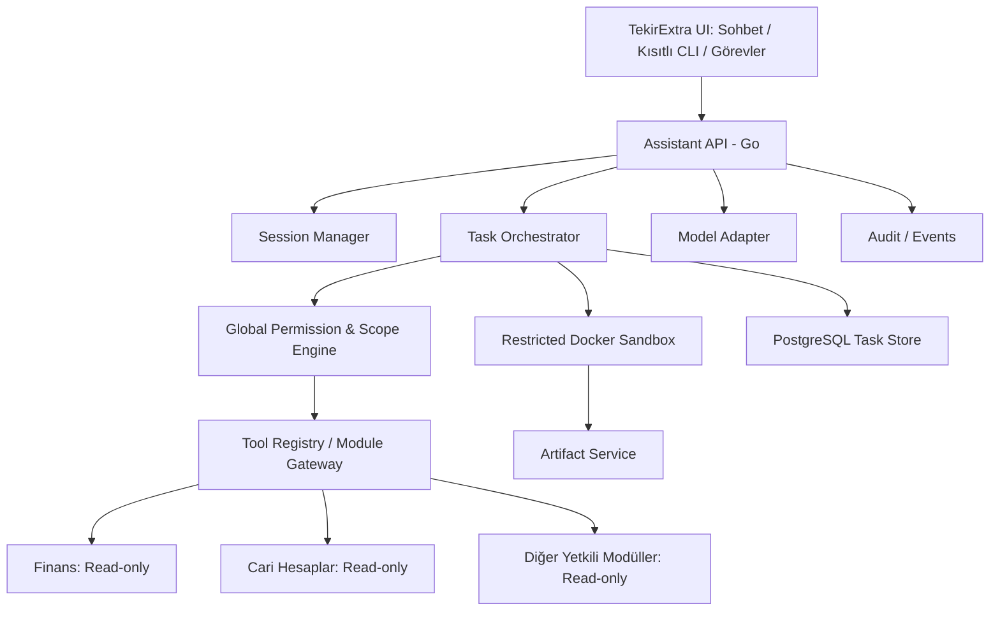

# TekirExtra CLI Assistant — Yapay Zekâ Ajanları İçin Üretim Planı

**Sürüm:** 1.0  
**Hedef:** Go + Docker + mevcut uygulama arayüzüne uyumlu frontend  
**Durum:** Uygulama deposu incelenmeden hazırlanmış teknik üretim spesifikasyonu

## 1. Amaç ve kapsam

TekirExtra uygulamasına, kullanıcının yetkili olduğu **tüm modüllerdeki** bilgileri okuyabilen, doğal dil ve kısıtlı CLI komutlarıyla çalışan, görev alabilen, Docker sandbox içinde güvenli analizler yapabilen ve yeni raporlar üretebilen bir asistan eklenecek.

Üretimde çalışan asistan **uygulama kaynak kodunu okuyamaz veya değiştiremez; mevcut uygulama kayıtlarını ve dosyalarını değiştiremez veya silemez.** Asistan yalnızca kendi görev/oturum kayıtlarını, denetim olaylarını, geçici hesaplama verilerini ve yeni rapor/artifact çıktılarını yetkili servisler üzerinden oluşturabilir. Bu kısıtlar, özelliği geliştiren yazılım ajanlarının kontrollü kod değişiklikleri yapmasını engellemez.

## 2. Değişmez kurallar

1. Mevcut uygulamanın iş mantığı ve kullanıcı akışları korunur.
2. Uygulamanın gerçek mimarisi, modülleri, API'leri ve yetki sistemi öncelikle incelenir; var olmayan bileşenler varsayılmaz.
3. Üretim asistanının yetkisi kullanıcının güncel kullanıcı/şirket/modül/kayıt/alan izinlerini aşamaz.
4. Aktif ekran yalnızca başlangıç bağlamıdır; diğer modüllere erişim kullanıcı yetkisine bağlıdır.
5. Her araç çağrısı sunucu tarafında ayrıca yetkilendirilir.
6. Docker sandbox, host shell, Docker socket, uygulama kaynak kodu ve doğrudan veritabanı kimlik bilgilerine erişemez.
7. Komut kara listeleri tek başına güvenlik mekanizması olarak kullanılmaz; allowlist, izolasyon ve API yetkilendirmesi kullanılır.
8. Görevler oturum yetkilerini genişletemez; yetki iptali yeni sorguları durdurur ve tamamlanmamış sonuçların yayımlanmasını yeniden değerlendirir.
9. Yapay zekâ modeli değiştirilebilir; güvenlik kararları modele bırakılmaz.
10. Her faz, test kanıtları ve kabul kriterleriyle tamamlanır.

## 3. Hedef mimari



### Çalışma ilkeleri

- **Control Plane:** Oturum, kimlik, yetki, görev, model, araç ve audit yönetimi.
- **Module Gateway:** Mevcut modül API'lerine yetki filtreli, salt okunur erişim; sandbox'a doğrudan DB erişimi yok.
- **Execution Plane:** İşlem/görev başına izole, ayrıcalıksız Docker sandbox; sadece gerekli veri kopyaları aktarılır.
- **Artifact Service:** Yeni raporları yetkili API üzerinden oluşturur; mevcut çıktıları değiştirme/silme aracı sunmaz.
- **Frontend:** Uygulamanın her ekranından açılabilen sohbet, kısıtlı CLI, görev izleme ve rapor indirme.

## 4. Geliştirme ajanları ve sorumluluklar

| Ajan | Sorumluluk |
|---|---|
| Coordinator Agent | Bağımlılık planı, görev dağıtımı, entegrasyon ve kabul |
| Architect Agent | Repo keşfi, mimari ve teknik sözleşmeler |
| Backend Agent | Go API, oturum, araç ve görev servisleri |
| Security Agent | Yetki, tehdit modeli, izolasyon ve güvenlik testleri |
| Integration Agent | Modül adaptörleri, yetkili veri erişimi |
| Sandbox Agent | Docker runtime ve izolasyon |
| Frontend Agent | Sohbet, CLI, görev ve rapor arayüzü |
| QA Agent | Birim, entegrasyon, E2E ve dayanıklılık testleri |

Ajanlar bağımsız branch/worktree üzerinde çalışır. Ortak API ve veri sözleşmeleri sabitlenmeden paralel uygulamaya başlanmaz. Birleştirme, test kapıları geçildikten sonra yapılır.

## 5. Fazlar, görevler ve teslimatlar

### P0 — Mevcut uygulama keşfi (Architect)

**Görevler**
- Repo, framework, servis ve modül envanterini çıkar.
- Kullanıcı, tenant/şirket, rol, kayıt ve alan bazlı yetkilendirmeyi incele.
- Mevcut okuma API'lerini, frontend entegrasyon noktalarını ve deployment düzenini belirle.
- Riskleri, eksikleri ve karar gerektiren konuları belgele.

**Teslimatlar:** `docs/architecture-inventory.md`, `docs/integration-decisions.md`.  
**Kabul:** Mevcut sisteme ilişkin her iddia kod veya belge referansıyla desteklenmiş olmalı.

### P1 — Sözleşmeler ve güvenlik tasarımı (Architect + Security)

**Görevler**
- `SessionScope`, `PermissionContext`, `ToolManifest`, `ToolResult`, `Task`, `Artifact` sözleşmelerini tanımla.
- OpenAPI ve JSON Schema dosyalarını hazırla.
- Kullanıcı/tenant/modül/kayıt/alan yetki matrisini çıkar.
- Prompt injection, yetki yükseltme, veri sızıntısı, sandbox kaçışı ve yetki iptali tehditlerini modelle.

**Teslimatlar:** `api/openapi.yaml`, `schemas/`, `docs/threat-model.md`.  
**Kabul:** Security Agent güvenlik sözleşmelerini onaylamalı.

### P2 — Go backend çekirdeği (Backend)

**Görevler**
- Assistant Session API ve mevcut kimlik doğrulamayla entegrasyon.
- Merkezi Policy Engine ve Tool Registry.
- Model sağlayıcı adaptörü ve güvenli araç çağrısı döngüsü.
- Audit olayları, yapılandırılmış hata yanıtları ve izleme.

**Teslimat:** Çalışan backend, API ve birim testleri.  
**Kabul:** Her araç çağrısında sunucu taraflı yetki kontrolü doğrulanmalı.

### P3 — Modüller arası okuma (Integration)

**Görevler**
- Modül araç manifestlerini keşfeden Module Registry geliştir.
- En az iki gerçek modüle salt okunur adaptör bağla.
- Kullanıcı/tenant/kayıt/alan filtreleri, sayfalama ve veri kotaları uygula.
- Modüller arası eşleştirme ve sonuç normalizasyonunu sağla.

**Teslimat:** İki modülle uçtan uca okuma ve karşılaştırma.  
**Kabul:** Yetkisiz kayıt ve alanlar API, model bağlamı ve rapor çıktısında görünmemeli.

### P4 — Docker sandbox (Sandbox + Security)

**Görevler**
- Sürümü sabitlenmiş, önceden hazırlanmış runtime imajı oluştur.
- Root olmayan kullanıcı, read-only rootfs, capability düşürme, seccomp/AppArmor ve kaynak kotaları uygula.
- Host dosyaları, Docker socket, doğrudan DB ve varsayılan dış ağ erişimini engelle.
- `/input` salt okunur, `/scratch` geçici yazılabilir; raporları Artifact Service'e gönder.
- Timeout, iptal, cleanup ve hata yönetimi ekle.

**Teslimat:** Sandbox executor ve izolasyon testleri.  
**Kabul:** Host/uygulama erişimi ve mevcut kaynak verilerin değiştirilmesi teknik olarak engellenmiş olmalı.

### P5 — Kalıcı görev motoru (Backend)

**Görevler**
- Task state machine: `Pending`, `Planning`, `Queued`, `Running`, `Waiting`, `Completed`, `Failed`, `Cancelled`, `Expired`.
- PostgreSQL görev kaydı, idempotency, kontrollü retry, cancellation ve timeout.
- Kullanıcı bağlantısı koptuğunda izinli arka plan işlerinin devamı.
- Yetki iptali, sonuç doğrulama, artifact oluşturma ve olay akışı.

**Teslimat:** Task API, worker ve testler.  
**Kabul:** Bağlantı kopması ve servis yeniden başlatma senaryoları doğrulanmalı; devam edemeyen işler açık hata durumuna alınmalı.

### P6 — Frontend (Frontend)

**Görevler**
- Uygulama genelinde açılabilir asistan paneli.
- Doğal dil sohbeti ve allowlist tabanlı kısıtlı CLI.
- Görev listesi, ilerleme, iptal ve olay akışı.
- Rapor önizleme/indirme ve erişim hatalarının anlaşılır gösterimi.

**Teslimat:** Mevcut tasarımla uyumlu UI.  
**Kabul:** Masaüstü/mobil uyumluluk ve temel erişilebilirlik testleri.

### P7 — Uçtan uca entegrasyon (Coordinator + Integration)

**Görevler**
- İki veya daha fazla modülden veri okuyup analiz/rapor üretme.
- Yetki değişikliği, model kesintisi, konteyner çökmesi ve büyük veri sınırlarını test et.
- Audit, log, metrik ve izlenebilirlik akışlarını bağla.

**Teslimat:** E2E test kanıtları.  
**Kabul:** Yetkili veriyle doğru rapor; yetkisiz veriyle ret.

### P8 — Güvenlik ve kalite kapısı (Security + QA)

**Görevler**
- Yetki aşımı, tenant izolasyonu, prompt injection ve zararlı veri testleri.
- Silme/değiştirme yasağı ve sandbox sınırlarını doğrula.
- Eşzamanlılık, performans, kaynak ve dayanıklılık testleri.
- Regresyon testleri ve güvenlik bulgularının giderilmesi.

**Teslimat:** QA ve güvenlik kabul raporu.  
**Kabul:** Zorunlu testlerin tamamı geçmeli; kritik/yüksek güvenlik açığı kalmamalı.

### P9 — Pilot dağıtım (Coordinator + DevOps)

**Görevler**
- Feature flag ile sınırlı kullanıcı grubuna aç.
- Metrikleri, hata oranlarını ve kaynak tüketimini izle.
- Migration, rollback, runbook ve operasyon dokümantasyonunu teslim et.
- Üretim dağıtımı için açık kullanıcı/işletme onayı al.

**Teslimat:** Pilot kabul raporu ve dağıtım kararı.

## 6. Önerilen proje yapısı

```text
tekirextra-assistant/
├── cmd/
│   ├── api/
│   └── worker/
├── internal/
│   ├── auth/
│   ├── session/
│   ├── scope/
│   ├── policy/
│   ├── assistant/
│   ├── tools/
│   ├── modules/
│   │   └── registry/
│   ├── tasks/
│   ├── sandbox/
│   ├── artifacts/
│   └── audit/
├── api/
├── schemas/
├── migrations/
├── configs/
├── deploy/docker/
├── tests/
└── docs/
```

Gerçek repo incelendikten sonra klasörler mevcut mimariye uyarlanacaktır; ayrı servis zorunlu değildir.

## 7. Örnek API sözleşmesi

```http
POST /api/v1/assistant/sessions
GET  /api/v1/assistant/sessions/{id}
POST /api/v1/assistant/sessions/{id}/messages
GET  /api/v1/assistant/sessions/{id}/tools
POST /api/v1/assistant/tasks
GET  /api/v1/assistant/tasks/{id}
POST /api/v1/assistant/tasks/{id}/cancel
GET  /api/v1/assistant/tasks/{id}/events
GET  /api/v1/assistant/artifacts/{id}
```

İstemcinin bildirdiği `module_id`, `tenant_id` veya `session_id` tek başına yetki kanıtı değildir.

### Modül aracı örneği

```json
{
  "tool": "finance.cheques.list",
  "version": "1.0",
  "required_permissions": ["finance.cheques.read"],
  "parameters": {"status": "pending", "limit": 100},
  "side_effects": "none"
}
```

### Örnek Go sözleşmesi

```go
type ModuleTool interface {
    Name() string
    RequiredPermissions() []string
    Execute(ctx context.Context, scope SessionScope, input json.RawMessage) (ToolResult, error)
}
```

Merkezi gateway bu sözleşmenin çevresinde yetki, giriş şeması, sonuç filtreleme, kota ve audit uygular.

## 8. Veri modeli

Temel tablolar: `assistant_sessions`, `assistant_tasks`, `task_executions`, `tool_invocations`, `assistant_events`, `assistant_artifacts`, `assistant_audit_logs`.

Görevler `session_id`, `user_id`, `tenant_id`, izin kapsamı sürümü, durum, zaman damgaları, idempotency anahtarı ve deneme sayısıyla ilişkilendirilmelidir. Oturum kapsamı sunucu tarafından doğrulanır; görev boyunca genişletilemez.

## 9. Güvenlik ve çalışma politikası

| Alan / Yetki | Politika |
|---|---|
| `/input` | Göreve özel salt okunur veri kopyası |
| `/scratch` | Geçici yazılabilir alan; kaynak verilerden bağımsız |
| Artifact Service | Yeni çıktı oluşturma; mevcut çıktıyı silme/değiştirme yok |
| Host dosyaları | Mount edilmez |
| Docker socket | Mount edilmez |
| Uygulama kaynak kodu | Sandbox'a verilmez |
| Uygulama veritabanı | Doğrudan bağlantı yok |
| Ağ | Varsayılan kapalı; gerekirse açıkça izinli uçlar |
| İşlem kullanıcısı | Root olmayan |
| Kaynak | CPU/RAM/PID/disk/zaman kotası |

Başlangıç için örnek görev limiti: 1–2 vCPU, 512 MB–2 GB RAM, 1 GB geçici disk, 5–30 dakika. Bunlar pilot yük testleriyle ayarlanır. Güvenilmeyen çok kullanıcılı kod yürütme senaryolarında ayrı worker VM veya microVM değerlendirilmelidir.

## 10. Zorunlu kabul testleri

| ID | Test | Beklenen sonuç |
|---|---|---|
| SEC-001 | Yetkisiz modül sorgusu | Reddedilir |
| SEC-002 | Başka şirketin kaydına erişim | Veri döndürülmez |
| SEC-003 | Mevcut kayıt/dosya silme | Engellenir |
| SEC-004 | Kaynak kodu okuma/değiştirme | Engellenir |
| SEC-005 | Docker socket/host erişimi | Engellenir |
| SEC-006 | Prompt injection içeren kayıt | Talimat olarak yürütülmez |
| SEC-007 | Görev sırasında yetki iptali | Yeni erişim durur; çıktı yeniden kontrol edilir |
| SEC-008 | Kayıt/alan bazlı yetki aşımı | Filtrelenir veya reddedilir |
| FUNC-001 | İki modülden veri karşılaştırma | Doğru ve yetkili sonuç |
| FUNC-002 | Excel/PDF raporu üretme | Yeni artifact oluşur |
| FUNC-003 | Terminal bağlantısı kopması | İzinli görev sürer |
| FUNC-004 | Görev iptali | Çalışan işlem durdurulur |
| FUNC-005 | Yeni modül adaptörü ekleme | Registry keşfeder |
| FUNC-006 | Mükerrer görev isteği | Idempotency uygulanır |
| REL-001 | Worker çökmesi | Görev doğru duruma alınır veya güvenle tekrar denenir |

## 11. Definition of Done

- [ ] Kullanıcı asistanı herhangi bir yetkili ekrandan açabilir.
- [ ] Asistan farklı yetkili modüllerden veri okuyabilir.
- [ ] Modüller arası analiz sonuçları doğrulanmıştır.
- [ ] Mevcut uygulama verilerini değiştirme/silme teknik olarak engellenmiştir.
- [ ] Sandbox izolasyon testleri geçmiştir.
- [ ] Arka plan görevleri izinli koşullarda bağlantı kopmasından etkilenmez.
- [ ] Yeni raporlar güvenli artifact API üzerinden sunulur.
- [ ] Kritik/yüksek güvenlik bulguları kapatılmıştır.
- [ ] Mevcut uygulama regresyon testleri geçmiştir.
- [ ] Dağıtım, geri alma ve operasyon belgeleri hazırlanmıştır.

## 12. MASTER IMPLEMENTATION DIRECTIVE (Ajanlara verilecek talimat)

> **ROLE:** You are the Lead Software Engineering Agent implementing the secure cross-module AI CLI Assistant in the existing TekirExtra application. Coordinate Architect, Backend, Security, Integration, Sandbox, Frontend and QA agents.
>
> **OBJECTIVE:** Deliver a model-independent, application-wide, read-only AI assistant with restricted CLI, authorized cross-module queries, isolated Docker computations, persistent background tasks and new report artifacts.
>
> **NON-NEGOTIABLE:** The production assistant must not modify/delete existing application data, read/modify source code, access unauthorized users/tenants/records, access host/Docker daemon, receive database credentials, run unrestricted host commands or bypass policy enforcement. Development agents may make authorized code changes to implement this feature.
>
> **PROCEDURE:** Begin with P0 repository discovery. Identify real modules, API endpoints, auth and deployment architecture; do not invent them. Produce an evidence-backed inventory. Then finalize contracts and threat model (P1), implement backend (P2), module adapters (P3), Docker sandbox (P4), task engine (P5), frontend (P6), E2E integration (P7), QA/security (P8), and pilot deployment (P9).
>
> **EXECUTION RULES:** Use typed/versioned contracts; prefer additive backward-compatible changes; do not refactor unrelated code; isolate work in branches/worktrees; test every change; enforce authorization at every tool call; treat module data as untrusted; preserve tenant isolation; document assumptions and blockers; do not mark failed tests complete.
>
> **REPORTING:** After each phase, provide changed files, completed tasks, test commands and results, security evidence, blockers, remaining risks and next-phase prerequisites.
>
> **STOP CONDITIONS:** Stop on missing critical authorization contracts, security boundary failures, unexplained cross-tenant access, failing critical tests or unclear deployment permissions. Do not deploy to production without explicit authorization.

## 13. Başlangıç komutu

**Coordinator Agent için ilk görev:**

```text
Start P0 — Repository Discovery.
Inspect the existing TekirExtra codebase, identify its module boundaries,
authentication and authorization model, read APIs, database access paths,
frontend framework and deployment architecture.
Produce docs/architecture-inventory.md and docs/integration-decisions.md.
List missing information and risks. Do not begin implementation until
contracts and integration decisions are reviewed.
```

---

**Not:** Bu belge uygulanabilir bir üretim planıdır; mevcut kaynak kodu incelenmediğinden teknoloji uyumu, süre ve modül adları keşif aşamasında kesinleştirilmelidir.
