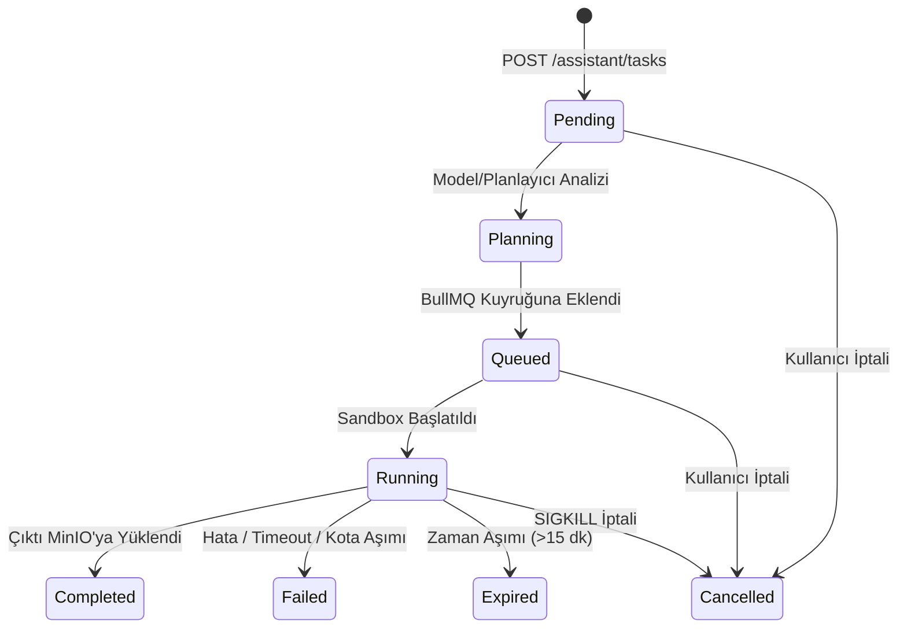

# TekirExtra CLI Assistant — Entegrasyon Kararları (P0 Integration Decisions)

**Tarih:** 15 Ekim 2026  
**Durum:** Karara Bağlandı (P0 Fazı Teslimatı)  
**Referans Plan:** [TekirExtra_CLI_Assistant_Uretim_Plani_V1.md](TekirExtra_CLI_Assistant_Uretim_Plani_V1.md)  
**Referans Envanter:** [architecture-inventory.md](architecture-inventory.md)

---

## Karar 1: Dil ve Runtime Mimarisi (Go vs. TypeScript / NestJS)

### Bağlam
Plan belgesi §4 ve §5'te Go tabanlı bir `Assistant API` önermiş; ancak §6'da şu istisnayı açıkça belirtmiştir:
> *"Gerçek repo incelendikten sonra klasörler mevcut mimariye uyarlanacaktır; ayrı servis zorunlu değildir."*

### İncelenen Seçenekler
1. **Seçenek A (Ayrı Go Mikroservisi):**
   - *Artıları:* Bağımsız ikili dosya, yüksek eşzamanlılık.
   - *Eksileri:* TekirExtra monoreposunda TypeScript ile yazılmış 50'den fazla veri şeması, DTO ve hesaplama motorunun (`packages/shared`) Go dilinde sıfırdan yeniden yazılması ve senkron tutulması gerekir. Ayrıca her araç çağrısında NestJS API'sine ek HTTP ağı trafiği, JWT yetki doğrulaması ve RLS oturum açma gecikmesi eklenir.
2. **Seçenek B (Mevcut NestJS Çatısı Altında Entegre Control Plane — TAVSİYE EDİLEN):**
   - *Artıları:*
     - Mevcut [`UcCagirici`](../../../apps/api/src/ai/ajan/uc-cagirici.ts) altyapısı doğrudan kullanılır; araç çağrıları hafızada (in-memory) 0 ms ağ gecikmesiyle, ekran controller'larının `@Roller` ve RLS kontrollerinden geçer.
     - `@tekirextra/shared` ve Prisma veri modelleri tek kaynak (Single Source of Truth) olarak korunur.
     - Dağıtım ve operasyon karmaşıklığı sıfıra iner (yeni bir servis/port açılmaz, mevcut `api` ve `worker` süreçleri içinde çalışır).

### Karar
**Control Plane, Policy Engine, Tool Gateway ve Task Orchestrator mevcut NestJS (`apps/api`) yapısı içerisinde `apps/api/src/assistant/` modülü olarak inşa edilecektir.**

---

## Karar 2: Docker Sandbox İzolasyon ve Çalıştırma Modeli

### Bağlam
P4 fazı gereğince, asistan büyük veri analizleri ve dosya üretimi için güvenli, ayrıcalıksız ve host'tan tamamen yalıtılmış bir Docker sandbox çalıştırmalıdır (SEC-004, SEC-005).

### Karar ve Uygulama Kuralları
1. **Docker Socket İzolasyonu:** Sandbox konteynerinin içine Docker socket (`/var/run/docker.sock`) ASLA bağlanmaz. Konteynerleri host'taki NestJS BullMQ Worker süreci Docker Engine API / CLI üzerinden yönetir.
2. **Konteyner Çalışma Parametreleri:**
   ```bash
   docker run --rm \
     --network none \
     --read-only \
     --tmpfs /scratch:rw,noexec,nosuid,size=512m \
     -v /tmp/tekir-jobs/{jobId}/input:/input:ro \
     --user 1001:1001 \
     --cap-drop=ALL \
     --security-opt=no-new-privileges:true \
     --cpus="1.5" \
     --memory="1024m" \
     --pids-limit=100 \
     tekirextra-sandbox:1.0
   ```
3. **Veri Akışı:**
   - Worker, kullanıcının yetkili olduğu verileri `/tmp/tekir-jobs/{jobId}/input/data.json` olarak salt-okunur hazırlar.
   - Sandbox betiği (Python / Node.js) veriyi işler ve çıktıyı `/scratch/output.pdf` veya `output.xlsx` olarak yazar.
   - Konteyner sonlandığında worker çıktıyı okur, MinIO/S3'e yükler ve diskteki geçici dizini temizler.
   - Sandbox'ın veritabanına, kaynak koduna veya internete erişimi donanımsal/ağsal olarak imkansızdır.

---

## Karar 3: Kısıtlı CLI (Whitelisted CLI) Sözleşmesi ve Sözlüğü

### Bağlam
Asistan hem doğal dil hem de kısıtlı CLI komutlarını destekleyecektir. CLI girdileri kabuk (shell) seviyesinde değil, uygulama içinde katı bir **Allowlist Komut Ayrıştırıcısı** ile çalıştırılacaktır.

### Desteklenecek Komut Sözlüğü

| Komut Şablonu | Açıklama | Yetki / Güvenlik |
| :--- | :--- | :--- |
| `tekir cari list [--tip=musteri\|tedarikci] [--limit=N]` | Cari hesapları listeler | `CariController.listele` yetkisi |
| `tekir cari get <id>` | Cari detay ve bakiye kartını getirir | `CariController.getir` yetkisi |
| `tekir fatura list [--tip=satis\|alis] [--durum=kesin\|taslak]` | Faturaları listeler | `FaturaController.listele` yetkisi |
| `tekir stok list [--arama=kelime]` | Stok ve varyant bakiyelerini listeler | `StokController.listele` yetkisi |
| `tekir rapor list` | Kullanıcının erişebildiği raporları listeler | `raporKatalogu` yetkisi |
| `tekir rapor run <kod> [--filtre=deger...]` | Hazır raporu çalıştırır | `raporCalistir` yetkisi |
| `tekir analiz <konu> [--format=excel\|pdf]` | Sandbox üzerinde derin analiz görevi başlatır | Task Engine yetkisi |
| `tekir gorev list \| status <id> \| cancel <id>` | Arka plan analiz görevlerini yönetir | Oturum sahibi yetkisi |

**Kural:** Tanımlı allowlist haricindeki hiçbir komut, joker karakter (`*`), boru hattı (`|`) veya kabuk operatörü (`&&`, `;`, `>`) kabul edilmez; syntax hatasıyla doğrudan reddedilir.

---

## Karar 4: Kalıcı Görev Motoru ve Durum Makinesi (Task Engine)

### Durum Makinesi (State Machine)



### Veri Depolama
- PostgreSQL üzerinde `assistant_tasks` ve `assistant_artifacts` tabloları kullanılacaktır.
- Arka plan işlerinin güvenle devam etmesi ve yeniden denemeleri (retry) için mevcut **Redis + BullMQ** altyapısından faydalanılacaktır.
- İstemci tarayıcıyı kapatsa dahi görev BullMQ worker tarafından sürdürülür (`FUNC-003`).

---

## Karar 5: Raporlama ve Artifact Servisi

### Çıktıların Yaşam Döngüsü
1. Sandbox tarafından üretilen rapor dosyaları (PDF, Excel, CSV, JSON) doğrudan veritabanına değil, projedeki **MinIO (S3 Uyumlu Depolama)** üzerine yazılır.
2. `assistant_artifacts` tablosuna dosya meta verisi (ad, boyut, SHA-256 hash, mime-type, tenant_id, user_id, gorev_id) kaydedilir.
3. İndirme işlemi `GET /api/v1/assistant/artifacts/:id` ucu üzerinden kiracı ve kullanıcı yetkisi doğrulanarak geçici imzalı URL (presigned URL) veya streaming ile sunulur.
4. Asistanın mevcut sistem dosyalarını değiştirme veya silme yetkisi kesinlikle bulunmaz (`SEC-003`).

---

## Karar 6: P1 Fazına Geçiş Onayı ve Önkoşulları

P0 fazı tamamlanmış olup P1 fazına geçiş için gerekli kararlar şu şekilde özetlenmiştir:
- [x] Mimari envanteri ve kod tabanı sınırları netleştirildi.
- [x] Go yerine mevcut NestJS çatısı ile monorepo entegrasyonu kararlaştırıldı.
- [x] Docker Sandbox izolasyon modeli tanımlandı.
- [x] Kısıtlı CLI komut sözlüğü belirlendi.
- [x] Görev motoru ve Artifact yaşam döngüsü tasarlandı.

**Sonraki Adım (P1):** `SessionScope`, `ToolManifest`, `Task` ve `Artifact` veri sözleşmelerinin (OpenAPI & JSON Schema / Zod) ve Tehdit Modelinin (`docs/threat-model.md`) hazırlanması.
