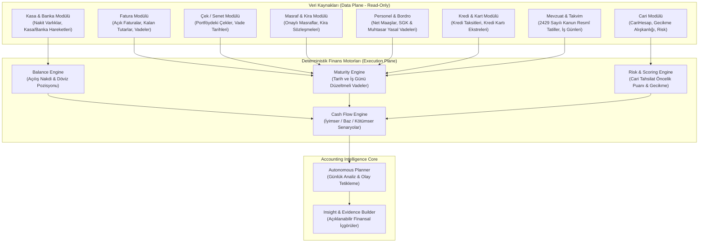

# TekirExtra Accounting Intelligence V2 — Modül Haritası (P0 Module Map)

**Tarih:** 15 Ekim 2026  
**Durum:** Doğrulandı ve Tamamlandı (P0 Fazı Teslimatı)  
**Referans Plan:** [TekirExtra_Accounting_Intelligence_V2_Detayli_Uretim_Plani.md](../../TekirExtra_Accounting_Intelligence_V2_Detayli_Uretim_Plani.md)

---

## 1. İlk Dikey Ürün (Otonom Nakit Akışı ve Tahsilat Riski) Modül Haritası

V2 planı §6 uyarınca ilk dikey ürün olan **"Otonom Nakit Akışı ve Tahsilat Riski"** için TekirExtra bünyesinde bulunan gerçek modüller ve veri kaynakları aşağıda eşleştirilmiştir. Hayali hiçbir bileşen varsayılmamıştır.

---

## 2. Modül Ayrıntıları ve Veri Erişim Yolları

### 2.1. Nakit Akışı Motoru ([`apps/api/src/nakit-akisi/`](../../../apps/api/src/nakit-akisi/))
- **Hizmet Dosyaları:** [`nakit-akisi.service.ts`](../../../apps/api/src/nakit-akisi/nakit-akisi.service.ts), [`nakit-akisi.hesap.ts`](../../../apps/api/src/nakit-akisi/nakit-akisi.hesap.ts).
- **Yetenekler:** 7, 30 ve 90 günlük ufuklarda (`Ufuk`) nakit akışını; kasa/banka açılış bakiyesi, faturalar, çek/senetler, masraflar, kiralar, kredi kartı ekstreleri, kredi taksitleri ve bordro yükümlülüklerini toplayarak kuruş hassasiyetinde (`kurus: number`) hesaplar.
- **Senaryolar:** `iyimser`, `baz`, `kotumser`.
- **Kritik Çıktılar:** İlk nakit açığı günü (`ilkEksi`), en düşük bakiye günü (`enDusuk`), ötelenen tahsilatlar (`kaydirilanTahsilat`).

### 2.2. Cari ve Tahsilat Riski Modülü ([`apps/api/src/cari/`](../../../apps/api/src/cari/))
- **Hizmet Dosyaları:** [`vade-hatirlatma.service.ts`](../../../apps/api/src/cari/vade-hatirlatma.service.ts), [`cari-analiz.ts`](../../../apps/api/src/cari/cari-analiz.ts).
- **Yetenekler:** 
  - Müşterinin tutar ağırlıklı geçmiş ortalama gecikme gününü (`gecikmeGun`) ve kara liste durumunu hesaplar (`cariDavranisAnalizi`).
  - Vadesi geçmiş veya yaklaşan alacakları cari bazında öncelik puanıyla (`kalanTutar × riskKatsayisi × (1 + gecikme/30)`) sıralar (`tahsilatOncelikleri`).

### 2.3. Çek ve Senet Modülü ([`apps/api/src/kasa-banka/`](../../../apps/api/src/kasa-banka/))
- **Veritabanı Modelleri:** `CekSenet`, `CekSenetBordro`, `CekSenetOlay`.
- **Yetenekler:** Portföydeki veya tahsile verilmiş müşteri çekleri (`yon: "alinan"`) nakit girişi; keşide edilmiş veya verilmiş çekler (`yon: "verilen"`) nakit çıkışı olarak vade gününde projeksiyona dahil edilir. Karşılıksız, iade edilmiş veya teminattaki çekler nakit girişinden güvenle hariç tutulur.

### 2.4. Kasa ve Banka Modülü ([`apps/api/src/kasa-banka/`](../../../apps/api/src/kasa-banka/))
- **Veritabanı Modelleri:** `Kasa`, `BankaHesap`, `KasaBankaHareket`, `BankaOdemeTalimati`, `BankaKredisi`.
- **Yetenekler:** Anlık açılış nakdi hesaplanır. Banka ödeme talimatında bekleyen tutarlar mükerrerlik olmaması için ilgili faturalardan otomatik düşülür (`bankaOdemeTalimatiFatura`).

### 2.5. Resmî Tatil ve İş Günü Takvimi ([`packages/shared/src/resmi-tatiller.ts`](../../../packages/shared/src/resmi-tatiller.ts))
- **Yetenekler:** 2429 sayılı Kanun uyarınca Türkiye'deki tüm sabit resmî tatilleri ve 2026-2027 dinî bayram tarihlerini gün gün barındırır. Hafta sonu veya tatile denk gelen vadelerin bir sonraki iş gününe ötelenmesini deterministik olarak sağlar.

---

## 3. Otonomi Seviyelerine Göre Modül Etkileşim Matrisi

| Otonomi Seviyesi | İlgili Modüller | Gerçekleşen Eylem | Güvenlik Sınırı |
| :---: | :--- | :--- | :--- |
| **L0 (Soru-Cevap)** | Tüm Okuma Araçları | Kullanıcının "Bu hafta hangi çeklerin vadesi var?" sorusuna yanıt verme | Salt okunur |
| **L1 (Rutin Analiz)** | Nakit Akışı + Cari | Gece/sabah periyodunda günlük nakit projeksiyonunu hesaplama | Salt okunur, arka plan |
| **L2 (Olaydan Görev)** | Kasa-Banka + Nakit Akışı | Kasa bakiyesi eşiğin altına indiğinde (`KASA_KRITIK`) veya büyük çek yaklaştığında analiz görevi başlatma | İdempotent görev kaydı |
| **L3 (Alt Görev)** | Cari + Fatura | Nakit açığına neden olan müşterilerin ödeme geçmişi ve açık fatura alt analizini planlama | Görev derinlik kotası (Max 3) |
| **L4 (İçgörü Üretme)**| Insight Engine + Bildirim | Yöneticinin paneline kanıtlı `Insight` kartı düşürme ve bildirim iletme | Create-only, RLS kontrolü |
| **L5 (YASAK)** | Tüm Modüller | Fatura kesme, çek tahsilatı kaydetme, banka transferi yapma, veri silme | **KESİNLİKLE ENGELLİ** |
